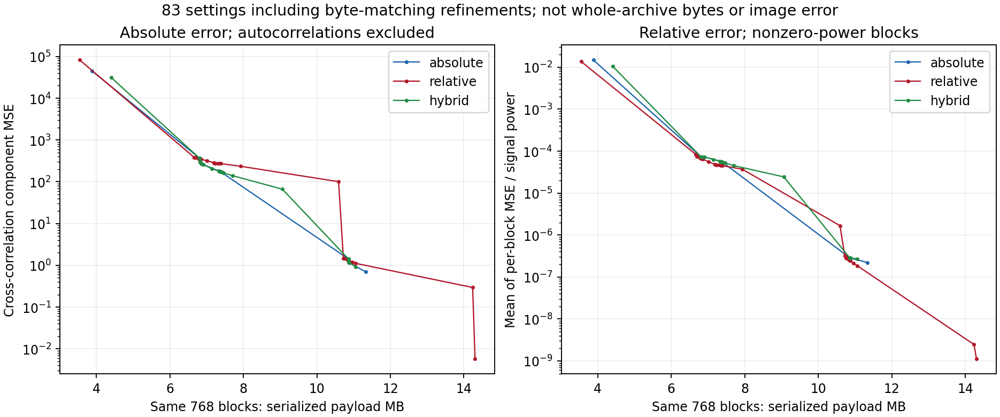
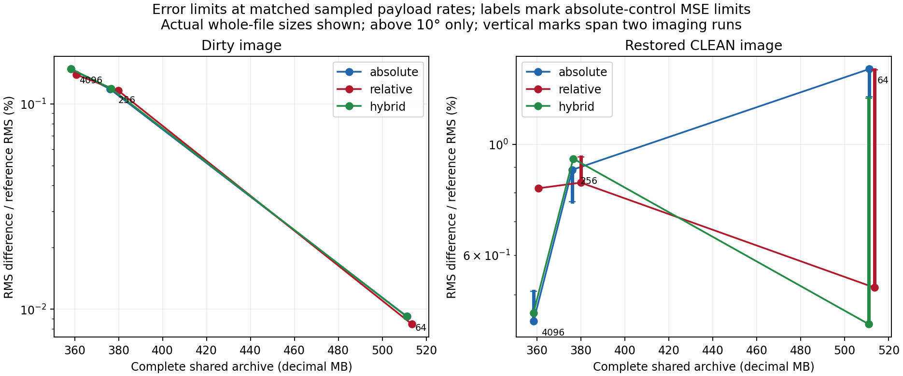
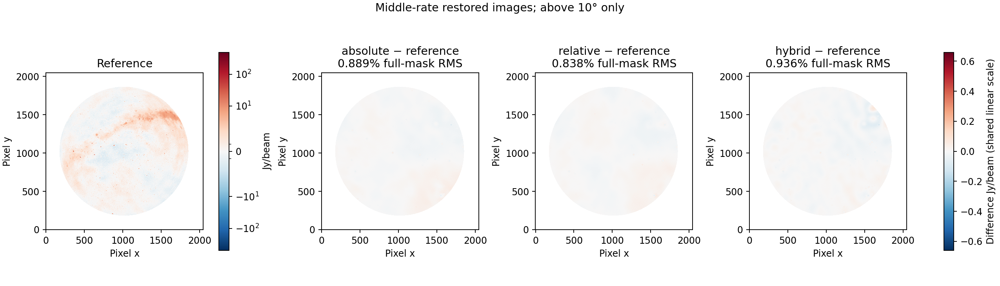
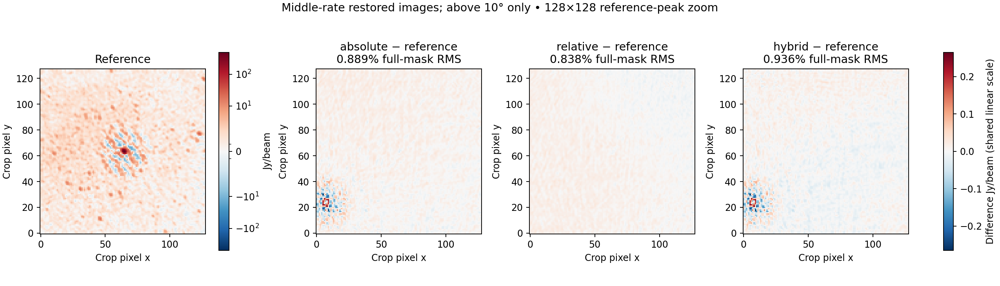
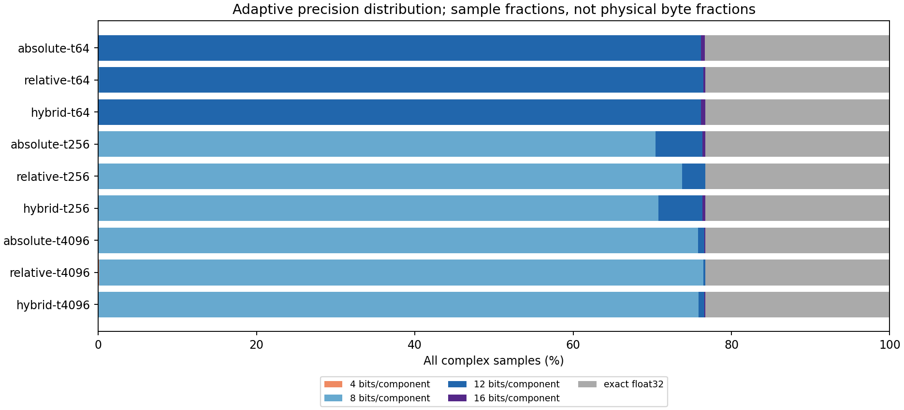
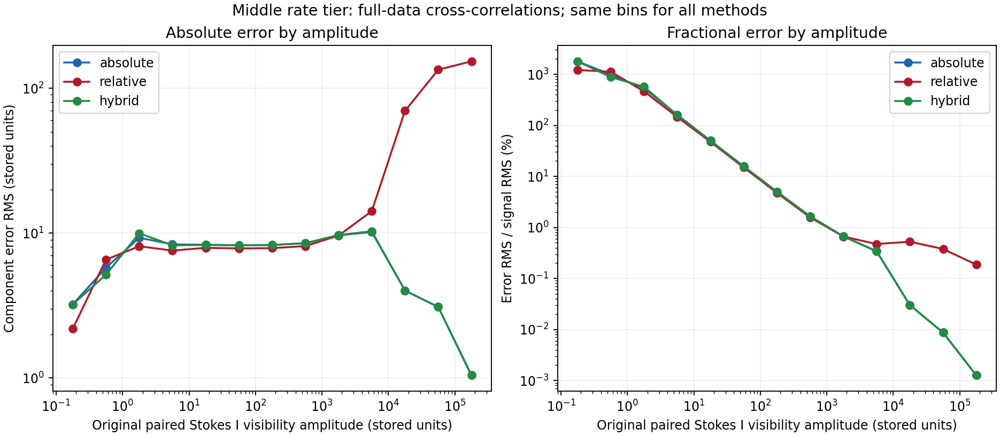

# Absolute versus relative visibility error limits

Experiment run on 24 October 2026. This note records the image comparison;
the paper and README stay unchanged. Related:
[calibrated tests](test_calibrated_dataset.md), [gamma rule](gamma_max_std.md),
[issue #1](https://github.com/peijin94/vamp/issues/1).

## Question and definitions

Does a bound in visibility units, a fractional bound, or their intersection give
the better final image at comparable archive size? Here **relative** means
block-normalized RMS, not per-sample division by a visibility close to zero.

For unflagged finite complex samples in a quantization block, define

$$P_g=\frac{1}{2N_g}\sum_{j\in g}|V_j|^2,\quad
E_g=\frac{1}{2N_g}\sum_{j\in g}|\widehat V_j-V_j|^2.$$

The primary limits are

$$\begin{aligned}
\text{absolute:}&\quad E_g\le B,\\
\text{relative:}&\quad E_g\le r^2P_g,\\
\text{hybrid:}&\quad E_g\le\min(B,r^2P_g).
\end{aligned}$$

Each family also uses the same guard shape: maximum complex error ≤10√budget,
complex bias ≤√budget and maximum baseline component MSE ≤2×budget, evaluated
inside each block. The hybrid intersects every bound. All candidates are
reconstructed using their stored parameters, and failing blocks can use exact
float32 storage. Flags and nonfinite samples are excluded from the reference
power. No thermal-noise interpretation is attached to P. A zero-power block has
zero relative tolerance; there is no implicit floor.

An absolute error enters imaging through the weighted Fourier operator. In a
simplified dirty-image normalization,

$$\delta I(\boldsymbol\ell)=\frac{\sum_j w_j\operatorname{Re}
 [e_j\exp(i\phi_j(\boldsymbol\ell))]}{\sum_jw_j}.$$

For independent zero-mean component errors only,

$$\operatorname{Var}(\delta I)\simeq
\frac{\sum_jw_j^2\sigma_{e,j}^2}{(\sum_jw_j)^2}.$$

Bias and correlated errors add coherent terms. Therefore raw fractional accuracy
alone does not specify image accuracy, and unweighted absolute MSE is also not
a complete image predictor. Briggs weights depend on uv sampling as well as MS
weights; see the [WSClean weighting documentation](https://wsclean.readthedocs.io/en/latest/image_weighting.html).
Quantization normalization and image-domain testing have prior art in
[Offringa (2016)](https://arxiv.org/abs/1609.02019); this experiment tests error
allocation on this particular calibrated observation.

## Fixed design, selected before imaging

All methods use the direct max/std gamma rule with R0=4, the same power codec,
stored component medians, range candidates 1/.995, nearest reconstruction,
4/8/12/16 rails, amplitude groups 128×48×1 and independent product ordering.
Autocorrelations remain separate. Selected values are CORRECTED_DATA under the
same calibrated-only policy; four-bit weights are checked against source values.

The screen evaluates 83 unique settings on exactly the same 768 blocks from
integrations 0, 7 and 14. Nine full tests use all 15 integrations. Absolute
targets B=64, 256 and 4096 define three payload rates. Relative and hybrid
parameters are selected by 12-step logarithmic bisection on serialized block
bytes alone. Their sampled payloads match the corresponding absolute target
within 0.19%; whole-data and complete-file byte differences must still be reported.
The hybrid transition power is the fixed median nonzero cross-correlation block
power over the screen, P*=3,221,707.0439231344, with r²=B/P*.

All images use the requested 2048², four-arcmin, eight-thread Stokes I multiscale
CLEAN template, reference restoring beam and fixed above-10° comparison mask.
Dirty, restored, residual, bright, faint and reference-peak metrics are retained.
Autocorrelation errors are reported separately because they do not determine
these cross-correlation images. No image is used to tune the test thresholds.

All nine full archives and exports passed verification. All nine images were
repeated with the same settings. The table and plots below contain the measurements.

## Measured results

**Absolute and relative limits control where precision is spent; neither alone determines CLEAN agreement.** For the two lower-distortion tiers, block-relative allocation gives a slightly smaller dirty-image difference at similar sampled byte counts, despite a larger unweighted cross-I MSE. Actual weighting and error correlations matter. The separate [25% payload study](fixed25.md) tests the user’s specific budget and recommends parameters from repeated images.

Restored-image differences are not monotonic in visibility error: the tightest tier has some larger CLEAN differences than looser tiers. Repeated eight-thread CLEAN on identical decoded inputs can change the restored result substantially, while dirty-image differences remain stable. The complete repeat table is therefore part of the result; a favorable single image is insufficient.

| Target tier | Rule | Archive MB | Visibility blocks MB | Cross-I component MSE | Dirty difference % | Restored difference % | Faint difference % |
| ---: | --- | ---: | ---: | ---: | ---: | ---: | ---: |
| 64 | absolute | 511.192 | 411.878 | 0.7679 | 0.0092 | 1.4160 | 2.1631 |
| 64 | relative | 513.458 | 414.011 | 1.0980 | 0.0084 | 0.5164 | 0.7911 |
| 64 | hybrid | 510.986 | 411.665 | 0.7953 | 0.0092 | 0.4359 | 0.6677 |
| 256 | absolute | 376.048 | 275.913 | 90.1018 | 0.1181 | 0.8889 | 1.3557 |
| 256 | relative | 379.915 | 279.476 | 186.1783 | 0.1159 | 0.8380 | 1.2816 |
| 256 | hybrid | 376.495 | 276.312 | 91.0483 | 0.1189 | 0.9360 | 1.4061 |
| 4096 | absolute | 358.434 | 258.286 | 169.3171 | 0.1478 | 0.4419 | 0.6775 |
| 4096 | relative | 360.752 | 260.545 | 291.3661 | 0.1387 | 0.8165 | 1.2375 |
| 4096 | hybrid | 358.413 | 258.263 | 170.2340 | 0.1478 | 0.4595 | 0.7036 |

These are full-data measurements. Tier labels refer to the absolute screen targets; relative and hybrid thresholds differ to match sampled byte counts. Cross-I uses only unflagged XX/YY pairs; all original sample ordering and exact metadata checks passed. These MSE values exclude autocorrelations.

| Tier | Relative RMS fraction r | Hybrid absolute cap B | Hybrid RMS fraction r |
| ---: | ---: | ---: | ---: |
| 64 | 0.000550456058724 | 86.596432336 | 0.00518450116832 |
| 256 | 0.0072055314092 | 260.91791911 | 0.00899930414723 |
| 4096 | 0.00897182635345 | 4216.96503429 | 0.0361790348249 |

### Repeat controls

| Case | First restored difference % | Repeat restored difference % | Repeat versus first % |
| --- | ---: | ---: | ---: |
| absolute-t64 | 1.4160 | 1.2455 | 0.3186 |
| relative-t64 | 0.5164 | 1.4119 | 1.1789 |
| hybrid-t64 | 0.4359 | 1.2384 | 1.1132 |
| absolute-t256 | 0.8889 | 0.7675 | 0.2884 |
| relative-t256 | 0.8380 | 0.9425 | 0.2973 |
| hybrid-t256 | 0.9360 | 0.9365 | 0.0414 |
| absolute-t4096 | 0.4419 | 0.5080 | 0.2224 |
| relative-t4096 | 0.8165 | 0.8149 | 0.0446 |
| hybrid-t4096 | 0.4595 | 0.4596 | 0.0165 |

| Source/lossless control | Dirty difference % | Restored difference % |
| --- | ---: | ---: |
| reference-repeat | 0.00005 | 0.2287 |
| lossless | 0.00006 | 0.1683 |
| reference-repeat-3 | 0.00004 | 0.2356 |













### Timing observations

| Case | Encoding only s | Complete verified bundle s | Compaction s | Export s | CLEAN s |
| --- | ---: | ---: | ---: | ---: | ---: |
| absolute-t64 | 158.30 | 368.52 | 54.71 | 58.67 | 203.46 |
| relative-t64 | 165.79 | 393.68 | 62.20 | 50.94 | 202.21 |
| hybrid-t64 | 164.33 | 509.49 | 69.90 | 105.02 | 162.78 |
| absolute-t256 | 146.84 | 495.42 | 71.16 | 76.93 | 170.27 |
| relative-t256 | 146.58 | 499.04 | 62.90 | 54.28 | 174.46 |
| hybrid-t256 | 141.86 | 501.29 | 52.51 | 62.04 | 204.70 |
| absolute-t4096 | 151.60 | 930.32 | 54.43 | 54.57 | 185.12 |
| relative-t4096 | 147.95 | 804.78 | 54.59 | 53.86 | 183.89 |
| hybrid-t4096 | 170.85 | 776.00 | 18.38 | 47.25 | 164.64 |

Two pipelines overlap on a shared host, without cache eviction. These observations do not establish speed rankings or a 15-second conversion guarantee. All complete-file sizes use the same lossless compaction policy, including removal of unused streaming-chunk allocation. Array digests and scientific manifests match the imaged exports.

### Reproduction and scope

```bash
export PYTHONPATH=src OPENBLAS_NUM_THREADS=1 OMP_NUM_THREADS=1
python scripts/screen_error_limits.py INPUT.ms NEW_SCREEN_DIR
python scripts/run_error_limits.py --source INPUT.ms --plan NEW_SCREEN_DIR/plan.json --root NEW_RESULT_DIR
```

Repeat all cases with `scripts/run_error_limits.py --repeat-only` using the same plan/root arguments. All retained FITS, archives and MS copies are under ignored `results/calibrated-error-limits/`. The JSON records commands, checksums, preservation policies, exact selected thresholds, byte categories, all 83 screen aggregates and per-block results for the nine selected cases.

[Machine-readable report](../reports/calibrated-error-limits.json). The source retains all 108 original import checksums. All weights are checked separately; no original weight is silently adjusted for quantization error. No polarization-image, calibration-solution, held-out-observation, spectral-cube or temporal acceptance is implied.
