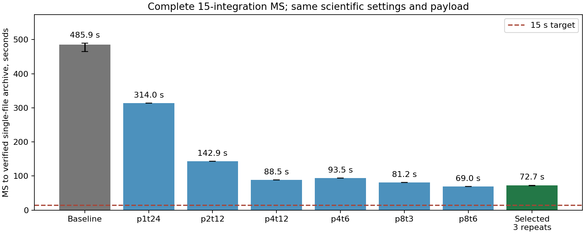
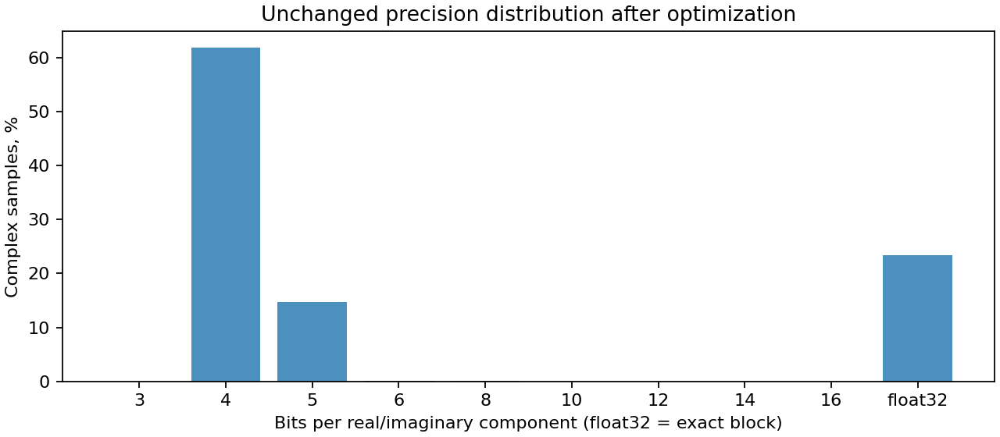
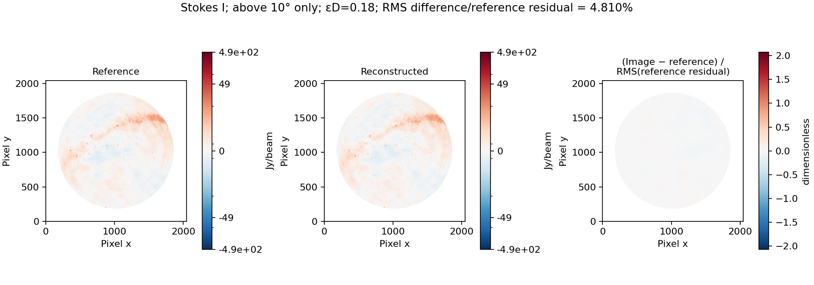
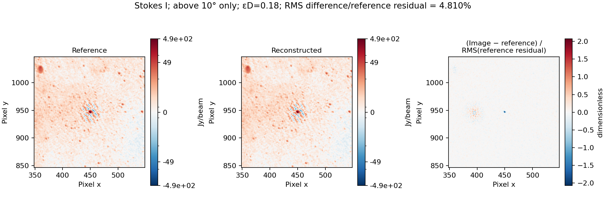
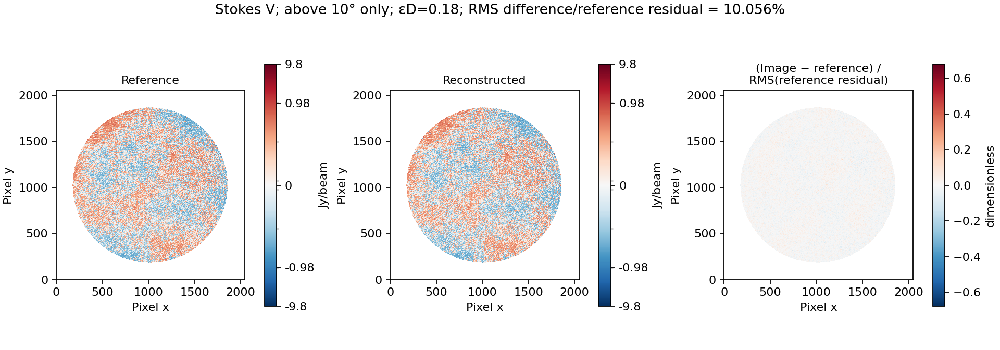
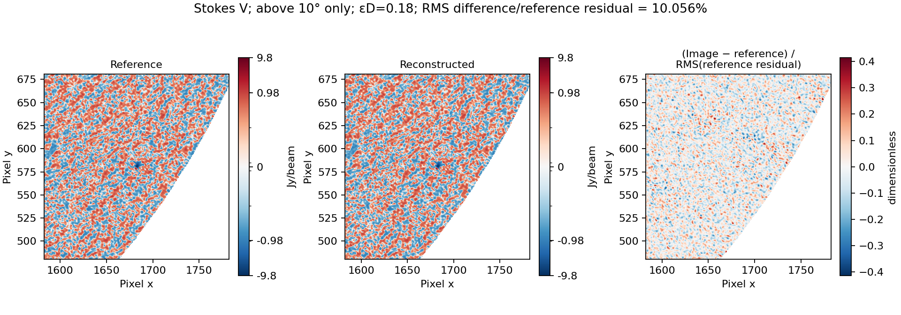

# Calibrated archive performance and I/V validation

Measured 2026-10-25. Issue [#2](https://github.com/peijin94/vamp/issues/2)
tracks performance; results are also reported in
[#1](https://github.com/peijin94/vamp/issues/1). The paper is intentionally unchanged.

## Timing scope and controls

The input is the complete 15-integration calibrated OVRO-LWA MS: 931,920 rows,
48 channels and four products (XX, XY, YX, YY). CORRECTED_DATA contains
178,928,640 complex64 samples, or 1,431,429,120 bytes. Physical source bytes
also include the raw and model columns omitted by the calibrated-only policy.

The fixed scientific configuration is `configs/calibrated-epsd-018.json`:
epsilon D **0.18**, independent amplitude ordering, 128 baselines × 48 channels
× one product, auto/cross separation, median centres, max/std-selected power
spacing, range quantiles 1 and .995, and the 3/4/5/6/8/10/12/14/16/exact
ladder. Flags are retained and flagged visibilities are zeroed. Four-bit
weights happen to reproduce this dataset exactly. All error guards and global
reference sampling remain enabled as configured.

The principal latency starts with source partition discovery and reference
sampling, includes inspection, encoding, inventory checksums, independent
source-error verification and single-file compaction, and ends with a complete
shared HDF5 archive. It excludes subsequent MS export and WSClean. These
boundaries differ from encoding-only and single-integration timings.

The baseline is frozen at commit `67a3d7964ca1df67a997d4311738469cd6788926`,
including its compiled extension. A separate cProfile run precedes three
fresh-process unprofiled repeats. Runs are sequential; no task-owned CLEAN,
test or alternative benchmark runs overlap the timed repeats. The host is
shared, OS caches are not flushed, and these are warm-cache observations,
not a cold-storage benchmark. Implicit BLAS/OMP threads are limited to one.

## Baseline profile

The separate profile took 523.58 s process wall time (523.09 s inside the
workflow). Cumulative times overlap and must not be added:

| Stage | Profiled cumulative seconds |
| --- | ---: |
| Partition encoding | 201.54 |
| Source verification | 188.85 |
| Exact column comparisons | 108.44 |
| Visibility verification | 73.22 |
| Temporary MS copies | 52.36 |
| Inspection | 37.81 |

HDF5 reads account for 97.08 s of profiler self time. Small row slices reopen
dataset handles and can repeatedly decompress chunks larger than the default
read cache. Visibility verification also decodes each block twice. The
111.72 s recorded in lock acquisition represents main-thread waiting for
worker results; it is not evidence that locks consumed that much CPU.

Worker timing sums overlap: candidate quantization totals 660.57 worker-seconds
and compression 465.45 worker-seconds. They cannot be equated to elapsed wall
time or compared directly with individual serial stages.

## Candidate changes and validation plan

- Read contiguous integration rows through read-only casacore selections,
  preserving original subtable references and all declared column values.
- Retain HDF5 dataset handles, size the read cache for its chunks and compare
  exact arrays in chunk-sized slabs.
- Reuse the independently decoded array for source-error checks after block
  CRC and inventory verification, and batch bounded payload reads.
- Cache normalized power levels using the decoder's exact binary64 operation
  order; retain float32 scale/centre storage and final rounding.
- Compare partition-process and encoder-thread allocations under the host CPU
  budget. Scientific settings, candidate competition and acceptance stay fixed.

Tests cover row-window isolation/reset, exact tail comparisons, all supported
power-level bit patterns, native/reference agreement, parallel reconstruction,
and Stokes identity/normalization. Full-data checks must compare payload and
quality inventories, independently decode with the frozen implementation,
compare supported source metadata/UVW/flags/weights, and confirm the source and
paper hashes remain unchanged. Results and the complete verification scope follow below.

## Standard imaging validation

The standard calibrated runner now requests **I and V separately** by default.
Each has its own source reference, restoring beam, output paths and repeat.
The WSClean settings remain 2048², 4 arcmin/pixel, eight threads, multiscale,
scale bias .8, 150000 iterations, mgain .95, auto-threshold .5, auto-mask 3,
local RMS, horizon mask 10°, Briggs 0, mem 40, reorder and no model update.

All image comparisons use the existing fixed above-10° mask. In each Stokes
product report RMS(candidate restored image − reference restored image)
and its ratio to the **matching reference residual RMS** over the same domain.
This uses a scalar RMS denominator, not pixelwise division, a noise estimate,
or a denominator floor. A zero residual denominator yields an undefined ratio.
Polarization metadata and FITS coordinates must match. CLEAN repeat differences
are reported separately from numerical archive identity. The measured V results below do not establish calibrated polarization accuracy or
general scientific acceptance.

## Full-MS timing results

All values here include the **complete 15-integration MS** and the complete,
verified shared archive. They are not a sum of encoding-only measurements.
The host is inti, two Xeon Silver 4214 processors, 48 logical CPUs and about
376.5 GiB RAM. The selected allocation is eight partition processes with six
encoder threads each. No error tolerance or archive preservation policy changed.

| Implementation | Fresh unprofiled runs, seconds | Median, seconds |
| --- | --- | ---: |
| Frozen baseline: one process, 24 threads | 489.143 / 464.957 / 485.870 | 485.870 |
| Optimized: eight processes, six threads each | 71.636 / 72.685 / 72.965 | 72.685 |

The median speedup is **6.685×**. The complete-MS **15-second target is not met**.
The selected verified-bundle stage took 53.1–56.1 s; shared-file compaction and
its validation added 16.6–19.3 s. Compaction alone remains around or above the
whole-workflow target. Further work must address candidate search, verification
and shared-file construction together; reporting encoding-only time would hide
material remaining costs.

Pilot runs used the same scientific settings and one fresh process per trial:

| Partition processes | Threads per partition | Encoder threads requested | Complete workflow, seconds |
| ---: | ---: | ---: | ---: |
| 1 | 24 | 24 | 313.962 |
| 2 | 12 | 24 | 142.893 |
| 4 | 6 | 24 | 93.450 |
| 8 | 3 | 24 | 81.171 |
| 4 | 12 | 48 | 88.457 |
| 8 | 6 | 48 | 69.014 |

The lowest pilot time selected the allocation; the three subsequent repeats
provide the reported result. Single pilot differences are not confidence
intervals or proof of a universal optimum. Encoder stage sums overlap across
processes and must not be stacked into elapsed wall time.



The speed figure separates the three-run median/range comparison from the
single-run worker-allocation pilots. Labels give partition processes × encoder
threads per process; the 15-second target refers to the complete workflow.

Baseline parent peak RSS was 0.99–1.02 GB. Optimized parent peaks were about
0.136 GB, and the largest terminated worker peaks were 0.714–0.738 GB.
These are process peaks from `getrusage`, **not a measured simultaneous sum of
all worker/helper processes**. Parallel encoding trades more aggregate memory
for lower latency. No cache eviction or unrelated-host workload isolation was
performed.

## Controlled context ablation and follow-up profile

The ablation uses the first 62,128-row integration and the same already computed
full-MS distribution references, with one partition process and 24 threads.
These one-off timings exclude global sampling and shared compaction and are
not end-to-end conversion claims:

| Cumulative change | Context wall seconds | Copy seconds | Inspection seconds | Encode seconds |
| --- | ---: | ---: | ---: | ---: |
| Baseline | 42.518 | 15.122 | 2.238 | 14.226 |
| Read-only row views | 25.451 | 0.000 | 1.361 | 13.053 |
| Plus chunk caching and reused verification decode | 20.026 | 0.000 | 1.442 | 13.952 |
| Plus bounded payload reads and cached power levels | 19.307 | 0.000 | 1.373 | 13.002 |

Copy time varies with the filesystem; the 15.12 s copy in this one-off ablation
is higher than the roughly 3 s average in the complete baseline. The final two
ablations are close enough that they do not establish a precise individual
speedup for cached levels. The main supported conclusions are removal of copy
work, cheaper verification reads and effective partition concurrency.

Separate profiles of this same first context confirm the read/verification
change. These are profiled measurements, not substitutes for the unprofiled
workflow runs:

| Profiled operation | Baseline seconds | Optimized seconds |
| --- | ---: | ---: |
| HDF5 reads, self time | 5.942 | 0.290 |
| Exact column comparison, cumulative | 6.707 | 0.618 |
| Visibility verification, cumulative | 4.650 | 3.638 |
| Complete source verification, cumulative | 11.853 | 4.705 |
| Encoding, cumulative | 13.984 | 13.567 |
| Complete context, wall | 33.471 | 20.370 |

## Archive identity, bytes and reconstruction

The baseline and selected archive match across **5,040 inventoried dataset
references in all 15 partitions**. Dataset dtypes, shapes and SHA-256 values,
logical table descriptors, exact subtables and stored quality summaries agree.
Every inventory was reverified. Physical HDF5 files differ because execution
records, timestamps and source-view provenance differ.

The frozen pre-optimization decoder independently exported the new archive.
Source comparison passed for all declared exact metadata, UVW, flags and weights;
all selected visibility blocks passed the configured reconstructed-error checks.
The export matches the earlier epsilon-D=0.18 export bitwise across **147 column
checks**, including both calibrated DATA and CORRECTED_DATA, plus supported
metadata. Original raw DATA/MODEL_DATA remain intentionally omitted and flagged
visibility values remain zeroed under the existing calibrated-only policy.
Four-bit weights reproduce this dataset exactly.

The independent old-decoder export took 58.35 s; export plus source verification
and reference resampling took 118.08 s, outside the archive timing window.
This is a compatibility check using the frozen decoder, not an optimized-decoder
speed claim.

- Visibility payload: **142,163,290 bytes**, **9.93156%** of the original
  1,431,429,120 CORRECTED_DATA bytes, unchanged by optimization.
- Complete selected archive: **242,769,176 bytes** in the first repeated run;
  the other repeats differ by under 200 bytes of recorded execution metadata.
- The 4.428 GB physical input also includes discarded raw/model columns.
  Its whole-file ratio must not be attributed entirely to visibility quantization.
- Remaining stored bytes are dominated by quality arrays (42.15 MB), amplitude
  statistics/counts (21.03 MB) and coordinates (19.51 MB).



All **108 source files** still match the original import hashes. All **74 paper
files** match the inventory taken before this work. The measured library source
and compiled extension also match the validated local implementation.

## Measured I/V imaging results

All results use the same 2,245,726-pixel region above 10° throughout the
observation and the matching reference restoring beam. The candidate first and
repeat CLEANs use identical reconstructed MS values. Reference repeats use
identical original MS values. Each CLEAN reached its final threshold.

| Stokes | Reference residual RMS, Jy/beam | Quantized − reference RMS, mJy/beam, first / repeat | Difference / reference residual RMS, %, first / repeat | Original-reference repeat / reference residual RMS, % |
| --- | ---: | ---: | ---: | ---: |
| I | 1.031244811 | 49.601920 / 50.278913 | 4.809907 / 4.875556 | 0.420964 |
| V | 0.384439444 | 38.660121 / 38.660120 | 10.056232 / 10.056231 | 0.011120 |

V has the larger residual-normalized discrepancy at epsilon D=0.18 in this
observation. Its repeat control is far smaller, so the V difference cannot be
explained away as CLEAN repeat variation. The optimized encoder introduces no
additional visibility error: its decoded MS is identical to the previous
implementation. These measurements characterize the existing compression
profile; they do not approve epsilon D=0.18 for arbitrary weak-polarization
science. Absolute polarization accuracy, leakage calibration, spectral features
and temporal behaviour require separate validation.

The maps show the reference and reconstructed images on a shared symmetric-log
flux scale: **viridis for Stokes I** and **bwr for Stokes V**. Signed difference
panels use **bwr**, centred on zero, on a separate linear scale. The difference divisor is
the scalar reference residual RMS, not the residual value at each pixel. Zooms
are 200×200 pixels around each Stokes reference's largest absolute pixel inside
the comparison mask; the location is not identified as a specific source.






The pinned WSClean 3.7 container is
`sha256:03ffbf70c829e220707b9843e96765f5886005b4b05a26344a0b5bb4d9ece8c6`.
Imaging/validation tasks overlapped after archive timing finished; their recorded
runtimes are not isolated imaging performance benchmarks.

CASA 5.4.1 reopened the reconstructed MS and completed a separate 64×64,
600-arcsec-cell natural-weight Stokes I dirty-image smoke workflow on a private
copy. Its installed tables warn about missing OVRO-LWA observatory metadata,
unavailable frequency conversion, IERS coverage and outdated leap-second data.
This is limited compatibility evidence, not CASA 6, precision astrometry or
calibration-solution validation. No archive coordinates were regenerated.

## Reproduction and evidence

Build the optional native extension, run the 124-test suite, and use the
execution preset with the explicit partition-process count:

```bash
python setup.py build_ext --inplace
PYTHONPATH=src python -m unittest discover -s tests -v
PYTHONPATH=src OPENBLAS_NUM_THREADS=1 OMP_NUM_THREADS=1 MKL_NUM_THREADS=1 \
  python scripts/timeslot_archive.py encode INPUT.ms OUTPUT.bundle \
  --config configs/calibrated-epsd-018-parallel.json --partition-workers 8
PYTHONPATH=src python scripts/timeslot_archive.py compact OUTPUT.bundle OUTPUT.h5
```

The preset retains epsilon D=0.18 and uses six encoder threads; it is the measured
configuration for this observation, not a general archival tolerance default.
Eight processes × six threads requires at least 48 logical CPUs under the
runtime check. Choose an allocation within the available CPU budget elsewhere.

`scripts/benchmark_calibrated_performance.py` measures fresh-process repeats and
an optional separate profile against a specified frozen `--code-root`.
`scripts/benchmark_partition_stage.py` reproduces the explicitly scoped context
ablation. `scripts/compare_archive_inventories.py` checks numerical identity.
The standard `run_error_limits.py` and `run_normalized_study.py` now default to
`--stokes I V`; `--stokes I` is an explicit narrower test. Reference source hashes,
settings and polarization are checked before reuse; incomplete references fail.

The machine-readable [performance and I/V report](../reports/calibrated-performance.json)
contains per-run timing/bytes, process memory, profile excerpts, source/library
hashes, identity audits, CASA scope and imaging metrics. Figures and this note
are generated/maintained outside the paper. The local `agent.md` and `mem.md`
working notes are ignored by Git.

Figure styling updated 26 October 2026. Numerical measurements, FITS inputs,
image colour limits and the above-10° mask are unchanged. Redraw the figures from
the saved measurements with:

```bash
PYTHONPATH=src:scripts python scripts/report_calibrated_performance.py --figures-only
```
