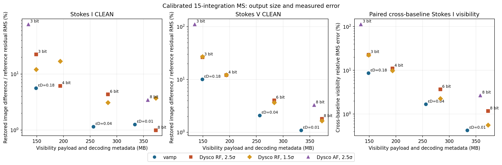
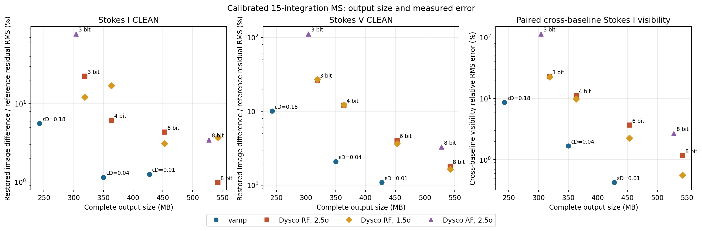
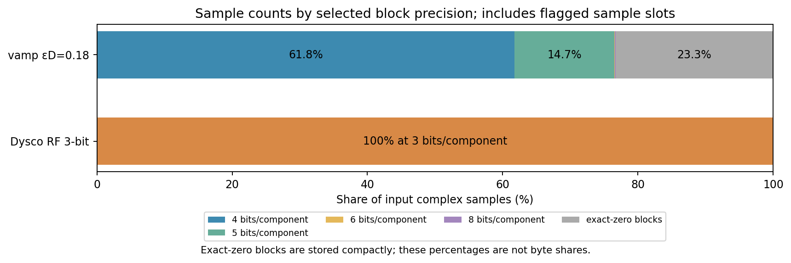

# Matched calibrated-MS comparison with Dysco

Tracked in [issue #3](https://github.com/peijin94/vamp/issues/3).
The matched comparison is now summarized in paper section 3.7; additional
epsilon measurements are documented in [the follow-up note](dysco-paper-comparison.md).
Results are for this dataset and these settings, not a general ranking of the algorithms. The complete measurements
and binned visibility diagnostics are in [the JSON report](../reports/dysco-comparison.json).

## Data and matching policy

The input is the calibrated 15-integration OVRO-LWA MS used in the preceding
I/V study: 931,920 rows, 48 channels and XX, XY, YX, YY. The selected
`CORRECTED_DATA` contains 178,928,640 complex64 values, or 1,431,429,120 bytes.
The matched calibrated-only input retains original flags, row weights, sigma,
metadata and UVW, omits raw `DATA` and `MODEL_DATA`, and purges flagged
visibility values. The flag mask remains available. Four-bit weight
storage in the vamp experiments happens to reproduce the source row
weights exactly. The Dysco comparison keeps those row weights exactly too;
this MS has no `WEIGHT_SPECTRUM`.

To match the earlier experiment and the export contract, a verified lossless
intermediate also has `DATA` recreated bitwise from the calibrated values.
`CORRECTED_DATA` from that input is written once to Dysco's `DATA`; it is not
quantized twice. The unflagged input values are identical. Dysco's primary
cases substitute complex NaN at flagged positions, following the procedure in
[Offringa (2016), section 5](https://arxiv.org/html/1609.02019v1); its NaN
marker excludes flagged data from normalization. Earlier zero-filled Dysco
controls are identified separately, since the same flag policy does not imply
the same normalization statistics. The vamp export uses purged zeros.
Its WSClean input is the compressed `DATA` column; the
uncompressed reference images the original `CORRECTED_DATA`. The comparison
only permits this column-name difference after checking the source and output
identities and the intermediate verification. Original input files are never
overwritten.
After imaging, an independent repeat of the calibrated-only comparison checked
147 exact column/alias entries and confirmed both the original and prepared MS
file hashes were unchanged. The final report records the recheck and the
lossless intermediate archive checksum.

LINC image `astronrd/linc:5.2.1`, digest
`sha256:03ffbf70c829e220707b9843e96765f5886005b4b05a26344a0b5bb4d9ece8c6`,
provides casacore `DyscoStMan` and WSClean 3.7. Dysco uses
`TruncatedGaussian`, with the reported truncation, per-component bit count and
normalization. RF and AF are separate experiments. The [Dysco manual](https://github.com/aroffringa/dysco/wiki)
recommends trying truncation 1.5 for RF, so that is included alongside 2.5.
For the direct
casacore path, metadata and subtables are copied, and only calibrated `DATA`
is assigned to DyscoStMan. Casacore source and destination are independently
verified after every write. DP3's high-level MS writer was unsuitable for this
particular input: its FIELD subtable has 91 entries even though the main
rows use field 0, and DP3 rejected it. Removing or flattening FIELD merely to
make DP3 run would change the comparison, so it was retained.
The Dysco manual states that its storage manager currently requires at least
two time steps (or fields/spectral windows); this 15-integration test satisfies
that condition and does not demonstrate direct support for a one-integration
MS.

The Dysco outputs pass checks over all 18 tables, 145 retained exact columns,
table keywords and row order, including UVW, identities, flags, row weights,
SIGMA and subtables. Three private vamp physical-layout keywords are
replaced by a `DYSCO_COMPARISON` provenance marker, and the visibility column
descriptor/storage manager necessarily differs. This is not a claim of
byte-identical casacore files. Flagged input values were deliberately purged;
in the zero-filled RF controls all 41,752,612 flagged values decode numerically
to zero, with between two and five negative-zero components per run. Thus even
the signs of those purged zero bits are not claimed as exact. NaN-marker cases
are verified against their own declared marker. Unflagged reconstructed
values in these runs are finite.

## Rate and image definitions

The visibility-specific rate includes the vamp serialized visibility
blocks, permutations and indexes, versus the entire Dysco DATA-manager file
including its scales and header. This is a practical accounting boundary, not
a claim that both managers have identical internal overhead. Complete-output
bytes also include the rest of each HDF5 archive or Measurement Set, including
their different container and metadata layouts. Exact per-case category counts
and diagnostics are in the generated report. Counts are byte lengths; MB
means 1,000,000 bytes. The original MS's full size is not used as a codec
ratio because it also contains raw/model columns dropped by both policies.
The Dysco output is itself an MS readable by Dysco-enabled casacore; the
vamp number is a standalone HDF5 archive and WSClean images a reconstructed
MS. Exported MS size and export time are not included in the archive size.

Both methods use the existing fixed WSClean template: 2048² pixels, 4 arcmin,
eight threads, Stokes I or V, multiscale scale bias 0.8, 150,000 iterations,
mgain 0.95, auto-threshold 0.5, auto-mask 3, local RMS, 10° horizon mask,
Briggs 0, `-mem 40`, `-reorder` and `-no-update-model-required`. Each run
uses the matching reference restoring beam. Comparisons use the same 2,245,726
pixels above 10° for every integration, and report

`100 × RMS(reconstructed restored image − reference restored image) / RMS(reference residual)`.

The denominator is a single scalar per Stokes product, not a pixelwise
division or an independently established thermal-noise level. It is
1.0312448 Jy/beam for I and 0.3844394 Jy/beam for V. The original I and V
reference images, fixed mask, container and imaging parameters are shared;
repeated CLEANs are shown separately where available. The results do not
establish calibration, transient, spectral, imaging-dynamic-range or broader
science fidelity.
An earlier repeat of each uncompressed reference on the same mask differed by
0.421% (I) and 0.0111% (V) of its reference residual RMS; this is an imaging
repeat control, not an estimate of compression error.

## Nearly matched visibility-storage case

The 3-bit RF cases and the `εD=0.18` vamp case have essentially the same
visibility-specific byte count: **149.119 MB** for Dysco's manager versus
**148.702 MB** for vamp including its permutations and indexes, a 0.28%
difference. The first I/V differences, expressed as percentages of the
matching reference residual RMS, were 5.58% / 10.06% for vamp, 22.36% /
26.43% for NaN-flagged Dysco RF at truncation 2.5, and 12.05% / 27.15% for
NaN-flagged RF at truncation 1.5. The second vamp I run was 4.80%, and the
second Dysco RF 2.5 I run was 22.22%. These are separate lossy encodes; the
observed difference between Dysco settings cannot be assigned solely to the
flag-marker convention, truncation or stochastic encoding without further
controls. The earlier 15.01% / 26.47% RF result used zero-filled flags and is
retained only as a labeled control.

This dataset also illustrates that restored CLEAN error need not decrease
monotonically with better visibility reconstruction. At RF truncation 1.5,
the first 3-bit and 4-bit I dirty-image differences were 11.16% and 4.66% of
the reference residual RMS, respectively, while restored-image differences
were 12.05% / 12.25% (first / repeat) and 16.91% / 16.91%. All of these
CLEANs reached the configured final threshold. That observation does not by
itself identify the cause: the
nonlinear deconvolution, independently randomized encodes and run variation
can all matter. The dirty and restored measurements are both retained in the
machine-readable report.
For RF 8-bit, 1.5σ, the first/repeated I differences were 3.72% / 3.03%; the
2.5σ first run was 0.99%. These settings are independent stochastic encodes.

At this rate, complete outputs were **242.766 MB** for the HDF5 archive and
**318.774 MB** for the Dysco MS. The discrepancy includes the different
container/metadata representation, not just visibility encoding.

At a similar **complete-output** size, the εD 0.04 HDF5 archive is 350.112 MB
and the Dysco RF 4-bit, NaN-flagged MS is 363.506 MB, about 3.8% larger. The
first I/V differences are 1.15% / 2.09% for vamp and 6.15% / 12.11%
for Dysco RF with truncation 2.5. Here the visibility storage itself differs:
256.080 MB versus 193.851 MB, respectively. The comparison therefore measures
the complete archive designs rather than isolating quantizer efficiency.

## Full rate and distortion measurements

The following numbers are first CLEAN runs. The paired-I column is the
unflagged cross-baseline relative visibility RMS error for `(XX + YY) / 2`.
The image columns instead divide restored-image difference RMS by the matching
reference **residual** RMS; the two kinds of percentage have different
denominators. All listed CLEANs reached the configured final threshold.

| Method | Visibility + decode metadata, MB | Complete output, MB | Paired-I visibility error, % | I image / residual, % | V image / residual, % |
| --- | ---: | ---: | ---: | ---: | ---: |
| vamp, εD 0.18 | 148.702 | 242.766 | 8.650 | 5.584 | 10.056 |
| vamp, εD 0.04 | 256.080 | 350.112 | 1.678 | 1.151 | 2.088 |
| vamp, εD 0.01 | 333.745 | 427.429 | 0.425 | 1.259 | 1.087 |
| Dysco RF, 3 bits, 2.5σ | 149.119 | 318.774 | 22.767 | 22.359 | 26.433 |
| Dysco RF, 4 bits, 2.5σ | 193.851 | 363.506 | 11.060 | 6.145 | 12.111 |
| Dysco RF, 6 bits, 2.5σ | 283.315 | 452.970 | 3.669 | 4.323 | 4.033 |
| Dysco RF, 8 bits, 2.5σ | 372.780 | 542.435 | 1.171 | 0.985 | 1.806 |
| Dysco RF, 3 bits, 1.5σ | 149.119 | 318.774 | 22.448 | 12.049 | 27.154 |
| Dysco RF, 4 bits, 1.5σ | 193.851 | 363.506 | 9.841 | 16.908 | 12.259 |
| Dysco RF, 6 bits, 1.5σ | 283.315 | 452.970 | 2.268 | 3.089 | 3.666 |
| Dysco RF, 8 bits, 1.5σ | 372.780 | 542.435 | 0.559 | 3.717 | 1.642 |
| Dysco AF, 3 bits, 2.5σ | 134.293 | 303.948 | 112.984 | 77.316 | 111.051 |
| Dysco AF, 8 bits, 2.5σ | 357.953 | 527.608 | 2.687 | 3.439 | 3.277 |

All Dysco cases in the table use NaN flagged-value markers. The original 2.5σ
zero-flagged RF runs remain in the machine-readable results as separate
controls and are omitted from the rate plots for legibility. The 3-bit RF 1.5σ setting improves this observation's I image relative
to 2.5σ, but not its V image. Other points likewise show that a lower visibility
error does not by itself force a lower restored CLEAN-image error. No threshold
is asserted as scientifically acceptable for all use cases.








The matched-rate figure compares the first εD 0.18 and Dysco RF 3-bit 1.5σ
images. The V zoom uses the previously audited Taurus A crop, all above 45°;
its displayed differences use the full above-10° V residual RMS as denominator.
The precision plot counts input samples, including flagged slots, and does not
represent bytes: vamp's blocks of exact positive zeros are stored compactly.
The corresponding AF 3-bit [full-field image](figs/dysco-matched-images-af.png)
and [V zoom](figs/dysco-matched-v-zoom-af.png) are also retained; its visibility
storage is 134.293 MB rather than the 149.119 MB used by RF 3-bit.

For perspective, packing three bits for each real and imaginary component of
all 178,928,640 samples would require 134.196 MB before scales, padding or
headers. Dysco's 3-bit RF DATA-manager file is 149.119 MB, 14.922 MB above
that ideal count; the 3-bit AF manager is 134.293 MB, 0.096 MB above it. These
differences include manager metadata and padding and are not a direct measure
of scales alone. For εD 0.18, vamp stores 142.163 MB of visibility block
payload plus 6.538 MB of permutations and indexes. Its remaining whole-archive
bytes and Dysco's remaining MS bytes include different metadata and containers;
the per-category vamp sizes are in the machine-readable report.

The same matched-rate complete outputs break down as follows. Dysco numbers
are physical file lengths assigned to casacore storage managers; vamp
numbers are archived dataset/inventory categories. These categories do not
have identical logical boundaries.

| vamp εD 0.18 category | MB | Dysco RF 3-bit, 1.5σ category | MB |
| --- | ---: | --- | ---: |
| Visibility block payload | 142.163 | DATA manager | 149.119 |
| Permutations + visibility indexes | 6.538 | UVW manager | 22.545 |
| Visibility quality | 42.154 | FLAG + FLAG_CATEGORY managers | 22.368 |
| Quantization statistics | 21.032 | WEIGHT + SIGMA managers | 29.885 |
| Coordinates | 19.511 | Main scalar-column manager | 71.896 |
| Subtables | 5.531 | Subtables | 22.951 |
| Flags and weights | 0.032 | Other root files | 0.010 |
| Reconstruction + auxiliary + container/manifests | 5.805 | — | — |
| **Complete output** | **242.766** | **Complete output** | **318.774** |

## Autocorrelation warning from the exploratory AF probe

A separate, zero-flagged AF 8-bit probe covers only the first two integrations.
Its matching prefix identity, UVW, flags and row weights were checked. Of the
30,240 unflagged autocorrelations per product in that prefix, relative complex
RMS errors were 97.29% for XX, 63.27% for XY, 66.00% for YX and 96.79% for YY.
The same exact prefix and sample masks give the following comparisons; these
are relative **visibility** RMS errors, not image-residual percentages:

| Codec / setting | XX | XY | YX | YY |
| --- | ---: | ---: | ---: | ---: |
| vamp, εD 0.18 | 0.45% | 0.74% | 0.74% | 0.55% |
| Dysco RF, 3 bits, 2.5σ, NaN flags | 15.14% | 21.24% | 21.06% | 17.72% |
| Dysco RF, 3 bits, 1.5σ, NaN flags | 14.14% | 20.71% | 20.46% | 16.63% |
| Dysco RF, 8 bits, 2.5σ, NaN flags | 2.41% | 2.15% | 2.15% | 2.21% |
| Dysco RF, 8 bits, 1.5σ, NaN flags | 0.66% | 0.69% | 0.69% | 0.65% |
| Dysco AF, 3 bits, 2.5σ, NaN flags | 97.23% | 66.08% | 67.33% | 96.61% |
| Dysco AF, 8 bits, 2.5σ, NaN flags | 97.23% | 65.95% | 67.21% | 96.61% |
| Dysco AF, 8 bits, 2.5σ, zero flags; exploratory probe | 97.29% | 63.27% | 66.00% | 96.79% |

The higher-rate 8-bit cases do not have the same storage cost as εD 0.18.
The [probe report](../reports/dysco-af-probe.json),
[same-prefix comparison](../reports/dysco-autocorr-prefix.json) and
`scripts/analyze_dysco_autocorr_probe.py` / `scripts/compare_autocorr_prefix.py`
record the checks. The AF probe is exploratory,
not a full-MS archive acceptance; it also used zero-filled flagged positions,
whereas the primary AF experiments use NaNs. The original Dysco paper reports
that its AF normalizer was not designed to model autocorrelation statistics.
WSClean's cross-correlation imaging can therefore look good while an archive's
autocorrelations have large errors. Full AF measurements must be evaluated on
their own before drawing conclusions about them.

The subsequent **full 15-integration NaN-flagged AF** diagnostics confirm that
the warning was not limited to the zero-filled two-integration probe. At
8 bits, unflagged autocorrelation relative RMS errors were 97.15% XX, 66.51%
XY, 67.01% YX and 96.65% YY. At 3 bits they were 97.15%, 66.64%, 67.13%
and 96.65%. Cross-baseline paired-I relative RMS errors were 2.69% at 8 bits
and 112.98% at 3 bits. These are visibility-level measurements; I/V imaging
results and total byte counts are reported separately. The full AF writes
passed the same 18-table, 145-exact-column, flags and weights checks, and did
not produce unflagged nonfinite values.

## Reproduction and limitations

The full experiment products under `results/dysco-comparison/` and the
calibrated MS are local, intentionally excluded from Git. The individual
encode, verification, visibility-diagnostic and I/V image comparison reports
are retained there. `scripts/dysco_encode.py`,
`scripts/run_dysco_benchmark.py`, `scripts/verify_dysco.py`,
`scripts/analyze_visibility_errors.py`, `scripts/run_dysco_imaging.py`,
`scripts/compare_dysco_images.py` and `scripts/report_dysco_comparison.py`
record the workflow. Input/output paths are never overwritten; incomplete
encodes are left as `.partial` rather than presented as complete.

For example, given the existing lossless calibrated archive, source MS,
reference I/V FITS images and elevation mask, the primary 3-bit RF case can be
reproduced in a new results directory as follows. The identity step repeats
the exact calibrated-only column comparison and checks both MS snapshots.

```bash
export PYTHONPATH=src:scripts
mkdir -p results/dysco-new
python scripts/validate_partition_export.py \
  results/calibrated-sharing/lossless-shared.h5 data/working/lwa-15slot-flat.ms \
  results/dysco-new/input-calibrated.ms --ms-v2-data \
  --report results/dysco-new/input-calibrated-verification.json
python scripts/prepare_dysco_input_identity.py \
  data/working/lwa-15slot-flat.ms results/dysco-new/input-calibrated.ms \
  --archive results/calibrated-sharing/lossless-shared.h5 \
  --verification results/dysco-new/input-calibrated-verification.json \
  --report results/dysco-new/input-identity.json
python scripts/run_dysco_benchmark.py --input results/dysco-new/input-calibrated.ms \
  --output results/dysco-new --normalization RF --truncation 1.5 \
  --flagged-input nan --bits 3
python scripts/verify_dysco.py results/dysco-new/input-calibrated.ms \
  results/dysco-new/dysco-rf-03-t15-nan.ms \
  --report results/dysco-new/dysco-rf-03-t15-nan-verification-v2.json
python scripts/analyze_visibility_errors.py results/dysco-new/input-calibrated.ms \
  results/dysco-new/dysco-rf-03-t15-nan.ms --source-column CORRECTED_DATA \
  --decoded-column DATA --report results/dysco-new/dysco-rf-03-t15-nan-visibility.json
python scripts/run_dysco_imaging.py --root results/dysco-new --normalization RF \
  --truncation 1.5 --flagged-input nan --bits 3 --jobs 2
```

The complete plotted comparison also requires the other measured cases. The
reference datasets and large generated MS files are not part of the public
repository, and image/encode timings depend on the local hardware and load.

Wall-clock figures are descriptive only. RF process timing starts at Docker
launch and ends at process exit, excluding matched-input preparation,
independent verification and imaging. The prior vamp complete-archive
timing includes inspection, verification and compaction. AF experiments
overlap other jobs and their containers were CPU-limited to avoid saturating
the shared host. OS caches were not controlled; none of these is a fair
head-to-head speed benchmark. No re-encoding seed or dithering pattern was
selected for favorable results. This is a single dataset, one calibration
state, selected quantization settings and one imaging setup. Dysco's stochastic
threaded encoding was not given a user-controlled seed in this workflow;
individual output files and their checksums are retained. Repeating WSClean on
the same encoded MS measures imaging variation, not compression-seed variation.

The full NaN-flagged AF 3-bit and 8-bit processes took 970.59 s and 983.50 s
respectively under the five-CPU Docker limits while other imaging and analysis
jobs ran. Earlier zero-flagged AF jobs were deliberately stopped when the
recommended NaN convention was identified; their partial outputs are excluded
from the full-MS comparison. These timings do not establish an intrinsic AF
speed or a fair speed ratio against the earlier vamp runs.
