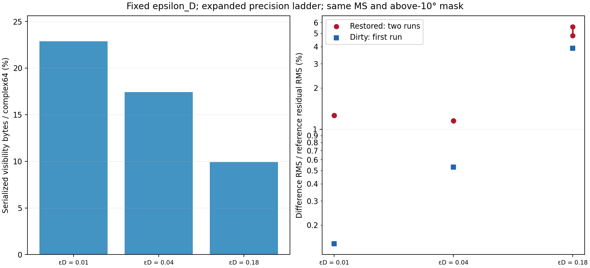
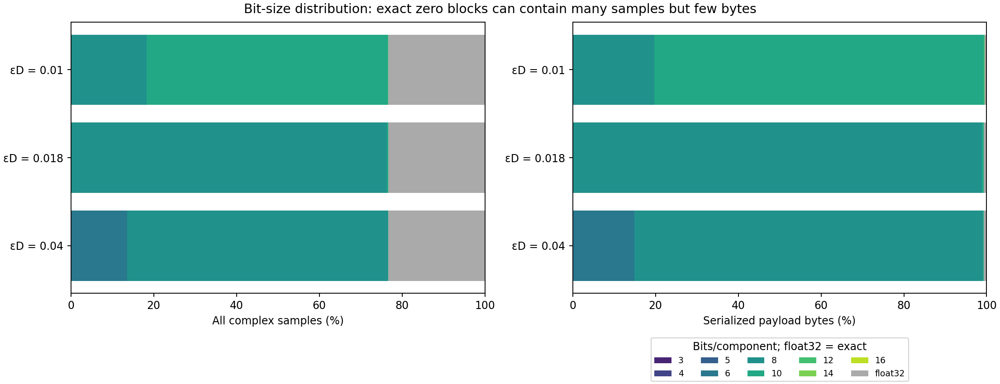
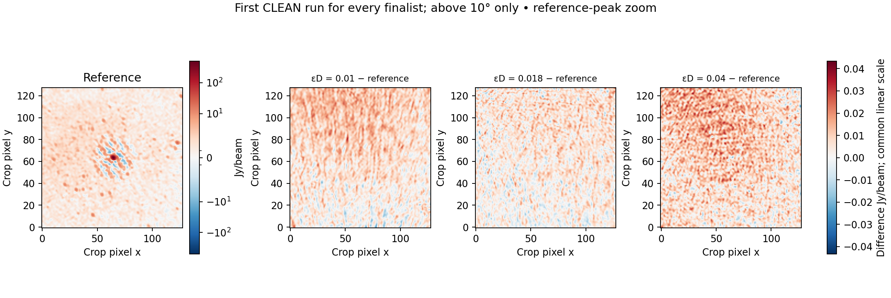
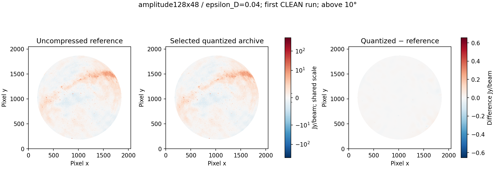

# Fixed epsilon D with the expanded precision ladder

25 October 2026. Three requested tolerances were encoded independently from the original calibrated source, with no rate cap or retuning: 0.01, 0.04, 0.18. All use 128×48×1 amplitude groups, median centres, max/std gamma (R0=4), range quantiles 1 and 0.995, and the 3/4/5/6/8/10/12/14/16 ladder plus exact fallback. G/S/R are disabled.

Correction: the requested third tolerance is **0.18**, replacing 0.018. The 0.18 archive and both CLEAN runs are new measurements; verified 0.01 and 0.04 results are reused unchanged. The [earlier 0.018 results](https://github.com/peijin94/vamp/blob/b9596c800e176dfe312945212453b99161343bac/devnotes/epsd-dense.md) remain historical and are not relabelled.

The four-bit precision selector is stored in the low nibble of a versioned header byte. Exact is tag 0; tags 1–9 select the nine widths; tag A is legacy two-bit; B–E are reserved and F is invalid/error. Invalid tags fail rather than pretending to contain data. Header sizes remain 16/28 bytes.

| εD | Payload MB (% of complex64) | Complete archive MB | Difference mJy/beam, first / repeat | Difference / reference residual RMS %, first / repeat |
| ---: | ---: | ---: | ---: | ---: |
| 0.01 | 327.207 (22.859%) | 427.429 | 12.9866 / 12.9944 | 1.2593 / 1.2601 |
| 0.04 | 249.542 (17.433%) | 350.112 | 11.8731 / 11.8666 | 1.1513 / 1.1507 |
| 0.18 | 142.163 (9.932%) | 242.766 | 57.5807 / 49.4859 | 5.5836 / 4.7987 |

| εD | Dirty difference mJy/beam | Worst reference-peak change % | Worst faint-region RMS difference % | Candidate residual RMS Jy/beam, first / repeat |
| ---: | ---: | ---: | ---: | ---: |
| 0.01 | 1.5080 | 0.00020 | 1.0430 | 1.030953 / 1.030953 |
| 0.04 | 5.4572 | 0.00244 | 0.9556 | 1.031218 / 1.031221 |
| 0.18 | 40.0807 | 0.43340 | 4.5891 | 1.026183 / 1.028690 |

| εD | Cross XX RMSE / signal RMS % | Cross XY % | Cross YX % | Cross YY % |
| ---: | ---: | ---: | ---: | ---: |
| 0.01 | 0.59372 | 0.38169 | 0.48786 | 0.45558 |
| 0.04 | 2.35604 | 1.43210 | 1.87325 | 1.78090 |
| 0.18 | 11.49117 | 10.65014 | 11.56520 | 9.94197 |

The reference residual RMS is 1.031244811 Jy/beam, measured without clipping or mean removal on the fixed above-10° mask. Two CLEAN runs record variation, not statistical confidence. Minimum image error is a different objective from minimum archive bytes; no universal default is selected.

Epsilon-D 0.18 has the smallest archive. Epsilon-D 0.04 has the smallest worst-of-two restored-image difference, and epsilon-D 0.04 has the smallest first-run difference. Tighter visibility bounds do not monotonically rank the restored CLEAN images: the unchanged 0.01 versus 0.04 comparison shows that reversal.

All six CLEAN runs reached the final threshold, with 3 major iterations each.

All source/export checks passed, all 108 import-file hashes match, and the dataset’s four-bit weights remain exact. Original metre UVW, supported metadata, coordinates and flags remain exact. Calibrated-only deliberately omits original DATA/MODEL_DATA and zeroes flagged values. The local suite has 116 passing tests.











## Timing

| εD | Sum partition encode s | Global sampling s | Verified bundle wall s | Compaction s | MS export s | CLEAN s, first / repeat |
| ---: | ---: | ---: | ---: | ---: | ---: | ---: |
| 0.01 | 196.45 | 7.45 | 456.48 | 33.25 | 58.61 | 174.66 / 185.93 |
| 0.04 | 178.68 | 6.97 | 456.93 | 31.88 | 55.97 | 288.42 / 213.19 |
| 0.18 | 188.12 | 6.29 | 447.38 | 17.17 | 48.29 | 164.56 / 183.58 |

These shared-host timings do not evict caches. The 0.01/0.04 pipelines overlapped other archive/image work; 0.18 was run separately after the correction, with its two CLEAN repetitions concurrent. Active workload differs, so this is not an isolated speed ranking. Verified bundle time includes source copying, inspection, encoding and verification. Compaction and MS export are additional. The full 15-second conversion target is not established. G is disabled, but the shared policy still measures and records global references; that cost is included.

## Byte accounting

### epsilon_D = 0.01

| Category | Physical MB |
| --- | ---: |
| visibility block payload | 327.207 |
| visibility quality | 41.774 |
| quantization statistics | 21.032 |
| coordinates | 19.511 |
| permutations | 6.185 |
| subtables | 5.531 |
| container manifests verification and links | 5.341 |
| reconstruction | 0.463 |
| visibility indexes | 0.353 |
| flags weights | 0.032 |
| auxiliary columns | 0.000 |

| Bits/component | Complex samples % | Serialized payload bytes % |
| --- | ---: | ---: |
| 3 | 0.0000 | 0.0000 |
| 4 | 0.0000 | 0.0000 |
| 5 | 0.0000 | 0.0000 |
| 6 | 0.0000 | 0.0000 |
| 8 | 18.2695 | 19.6842 |
| 10 | 58.3053 | 79.6238 |
| 12 | 0.1030 | 0.1640 |
| 14 | 0.0000 | 0.0000 |
| 16 | 0.0000 | 0.0000 |
| float32 | 23.3222 | 0.5279 |

Entirely positive-zero exact blocks contain 23.322% of samples and occupy 1.727 MB.

### epsilon_D = 0.04

| Category | Physical MB |
| --- | ---: |
| visibility block payload | 249.542 |
| visibility quality | 42.121 |
| quantization statistics | 21.032 |
| coordinates | 19.511 |
| permutations | 6.185 |
| subtables | 5.531 |
| container manifests verification and links | 5.341 |
| reconstruction | 0.463 |
| visibility indexes | 0.353 |
| flags weights | 0.032 |
| auxiliary columns | 0.000 |

| Bits/component | Complex samples % | Serialized payload bytes % |
| --- | ---: | ---: |
| 3 | 0.0000 | 0.0000 |
| 4 | 0.0000 | 0.0000 |
| 5 | 0.0000 | 0.0000 |
| 6 | 13.5343 | 14.9409 |
| 8 | 63.0405 | 84.1861 |
| 10 | 0.1030 | 0.1808 |
| 12 | 0.0000 | 0.0000 |
| 14 | 0.0000 | 0.0000 |
| 16 | 0.0000 | 0.0000 |
| float32 | 23.3222 | 0.6922 |

Entirely positive-zero exact blocks contain 23.322% of samples and occupy 1.727 MB.

### epsilon_D = 0.18

| Category | Physical MB |
| --- | ---: |
| visibility block payload | 142.163 |
| visibility quality | 42.154 |
| quantization statistics | 21.032 |
| coordinates | 19.511 |
| permutations | 6.185 |
| subtables | 5.531 |
| container manifests verification and links | 5.341 |
| reconstruction | 0.463 |
| visibility indexes | 0.353 |
| flags weights | 0.032 |
| auxiliary columns | 0.000 |

| Bits/component | Complex samples % | Serialized payload bytes % |
| --- | ---: | ---: |
| 3 | 0.0000 | 0.0000 |
| 4 | 61.7719 | 75.8607 |
| 5 | 14.7174 | 22.5786 |
| 6 | 0.0923 | 0.1450 |
| 8 | 0.0961 | 0.2007 |
| 10 | 0.0000 | 0.0000 |
| 12 | 0.0000 | 0.0000 |
| 14 | 0.0000 | 0.0000 |
| 16 | 0.0000 | 0.0000 |
| float32 | 23.3222 | 1.2150 |

Entirely positive-zero exact blocks contain 23.322% of samples and occupy 1.727 MB.

## Reproduction

```bash
export PYTHONPATH=src OPENBLAS_NUM_THREADS=1 OMP_NUM_THREADS=1
python scripts/run_normalized_study.py --source INPUT.ms --root NEW_RESULTS --plan configs/calibrated-epsd-study.json
```

[Machine-readable results](../reports/calibrated-epsd-dense.json). [Rewritten paper](../docs/paper/vamp.md). The previous manuscript was moved without content changes to [the initial work note](../docs/paper/work_note_20261025_init_work.md).

Only joint Stokes I on this supplied observation was tested; no held-out, polarization, spectral-cube or calibration-solution claim is made.
