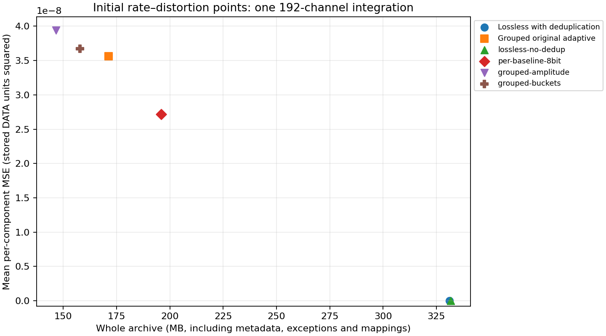
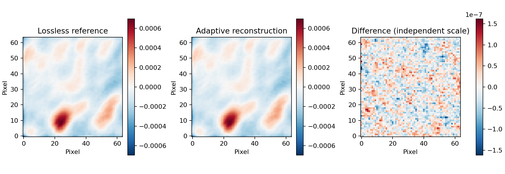

# Initial prototype experiment results

These are measurements of one 62,128-row, 192-channel, four-product integration.
They establish working reconstruction and bounded numerical errors for the tested
configuration. They do not establish an archival default for unknown science.

## Source and acceptance checks

The source is `20260904_190008_59MHz.ms`, copied from the requested NAS directory.
It has 352 antennas, 352 autocorrelation rows, products XX/XY/YX/YY, one spectral
window and no flagged/nonfinite DATA samples. It occupies 409,594,838 physical
file bytes, with 381,714,432 logical DATA bytes. Channel frequencies span
59,335,937.5–63,905,761.71875 Hz. TIME and TIME_CENTROID differ and are separately
preserved. UVW remains the original float64 metre array with ITRF reference.

Lossless archive and pristine exported MS passed comparison of supported values
and logical metadata, including all subtables, keywords, descriptors, units,
references, flags, weights and original ordering. Storage-manager assignment and
physical casacore files are intentionally outside equality. The adaptive archive
passed every configured per-block error check, preserved exact protected sample
bits and matched encode-time error accounting after decoding and MS export.
Both verification reports contain 266 column/relationship checks.

- Exact mode: `reports/lossless-verification-pristine.json`.
- Adaptive mode: `reports/adaptive-verification.json`.
- Source tar plus all 65 extracted file hashes after codec work:
  `reports/sample-copy-after-codec-tests.json`.
- Test suite: 36 passing tests, including an independently implemented block
  decoder, all packing widths, corruption/truncation, both MS organizations,
  irregular cells, duplicates, partial chunks, Stokes, optional columns and
  special-value bit patterns.

Pristine exports are `results/lossless/verified.ms` and
`results/adaptive/verified.ms`. CASA's early imaging runs appended HISTORY in
their separate original exports; subsequent checks use independent working
copies. The original NAS tar and copied source MS were never altered.

## Absolute numerical budgets

`configs/engineering-adaptive.json` uses group size 32, 64-channel segments,
one product per block, original row order with auto/cross boundaries,
uniform nearest-even quantization, 2/4/6/8-bit candidates and exact float32 escape.
Scale candidates use maximum and 99.5th-percentile component magnitudes. Steps
are stored as float32; scales are not quantized further. The explicit limits are:

| Check | Limit in stored DATA units |
| --- | --- |
| Per-real-component MSE | 1×10⁻⁷ |
| Maximum per-baseline component MSE | 2×10⁻⁷ |
| Maximum absolute complex error | 0.003 |
| Absolute complex bias | 0.0003 |

No thermal-noise model was accepted, and original WEIGHT/SIGMA were not modified
or interpreted as validated thermal variances. DATA does not declare a unit in
its column keywords. These ceilings are an engineering example, not a science
requirement or a claim of a particular RMS-noise increase.

## Initial archive measurements

| Experiment | Whole archive bytes | Reduction vs source | Mean component MSE | Max complex error |
| --- | ---: | ---: | ---: | ---: |
| Lossless with structural deduplication | 331,220,418 | 1.237× | 0 | 0 |
| Lossless without structural deduplication | 331,693,912 | 1.235× | 0 | 0 |
| Original-order grouped adaptive | 171,177,189 | 2.393× | 3.561×10⁻⁸ | 7.898×10⁻⁴ |
| Per-baseline, 192-channel, fixed 8-bit with exact fallback | 195,858,700 | 2.091× | 2.717×10⁻⁸ | 8.132×10⁻⁴ |
| Per-product amplitude sorting, grouped adaptive | 146,698,448 | 2.792× | 3.940×10⁻⁸ | 2.724×10⁻³ |
| Per-product logarithmic buckets, grouped adaptive | 157,820,272 | 2.595× | 3.675×10⁻⁸ | 2.452×10⁻³ |

All four matrix experiments passed source/archive/pristine-export verification.
Raw results are in `reports/benchmark-comparison.json`; the combined measured
points and histogram counts are in `reports/rate-distortion.json`.

Amplitude sorting used fewer bytes than bucketing at these ceilings, but its
measured MSE and worst error were larger. This is not an equal-error verdict.
Neither case was subjected to the image comparison below; that check used the
original-order adaptive archive only.

The controlled lossless comparison changes only structural deduplication in the
encoding policy. The measured difference is 473,494 bytes (about 0.14% of the
lossless archive). Conventional compression already removes much repeated
metadata. A plain UVW dictionary plus uint32 row map costs more logical bytes
than this source's UVW, so that dictionary is not selected. No 192-fold UVW
channel-record repetition exists in this input.

The per-baseline control differs from the grouped adaptive profile in both
frequency segmentation and allowed precision. It cannot isolate grouping's
benefit. A matched per-baseline adaptive/64-channel comparison and a broader
rate–distortion sweep remain necessary before recommending grouped scales.

The grouped adaptive archive includes 164,627,060 physical payload-dataset bytes,
360,832 index bytes, 1,676,751 statistics bytes, 2,951,159 quality bytes, exact
coordinates/flags/weights/subtables, and 563,063 container/manifest bytes. These
categories sum to the whole-file size. Payload allocation includes encoded
headers, exceptions, exact blocks, independent secondary compression and chunk
padding. Inner code/exception counts before joint secondary compression are
reported separately; compressed bytes cannot be attributed uniquely to them.

| Product | Component MSE | Maximum complex error | 99th-percentile error | Absolute complex bias |
| --- | ---: | ---: | ---: | ---: |
| XX | 3.148×10⁻⁸ | 7.839×10⁻⁴ | 6.180×10⁻⁴ | 4.130×10⁻⁸ |
| XY | 4.128×10⁻⁸ | 7.898×10⁻⁴ | 5.858×10⁻⁴ | 9.494×10⁻⁹ |
| YX | 4.059×10⁻⁸ | 7.898×10⁻⁴ | 5.849×10⁻⁴ | 1.113×10⁻⁷ |
| YY | 2.911×10⁻⁸ | 7.807×10⁻⁴ | 5.996×10⁻⁴ | 1.197×10⁻⁷ |

All 11,928,576 complex samples per product were in the finite/unflagged error
domain. Numerical exceptions and fallback were still enabled and counted.
Original-order adaptive block selections are:

| Product | 2-bit | 4-bit | 6-bit | 8-bit | Exact float32 |
| --- | ---: | ---: | ---: | ---: | ---: |
| XX | 0 | 55 | 152 | 2,952 | 4,200 |
| XY | 0 | 75 | 201 | 5,439 | 1,644 |
| YX | 0 | 50 | 246 | 5,532 | 1,531 |
| YY | 0 | 25 | 209 | 2,930 | 4,195 |

Exact blocks dominate the remaining bytes, particularly parallel products. This
result does not support a claim that four-bit quantization is generally adequate.
Quality data retain per-baseline/channel statistics and paired cross-product/
adjacent-channel covariance for further analysis.

Across all products, sorted/bucketed block selections were:

| Ordering | 2-bit | 4-bit | 6-bit | 8-bit | Exact float32 |
| --- | ---: | ---: | ---: | ---: | ---: |
| Stable amplitude | 8 | 448 | 1,475 | 16,464 | 4,909 |
| Logarithmic buckets | 31 | 472 | 1,509 | 15,477 | 6,007 |

Actual permutation, boundary, exception, statistics and quality-array bytes are
included in each corresponding archive size. These counts are blocks, not sample
fractions: partial blocks differ in size and samples-by-width are also recorded.

## CASA workflow and image check

CASA 5.4.1 table tools reopened both exported MSs. A 64×64 natural-weight,
600-arcsec-cell, multi-frequency-synthesis Stokes I dirty image was made from
each. Image comparisons in `reports/image-comparison.json` found:

- Difference RMS: 3.82697×10⁻⁸ in the image's numeric units.
- Difference RMS / reference-image RMS: 0.02677%.
- Maximum pixel difference: 1.61541×10⁻⁷.
- Relative peak change: +0.005892%.

The installed CASA warned about outdated IERS/leap-second data and missing
OVRO-LWA observatory metadata, including unavailable frequency conversion.
These warnings affect interpretation and were not repaired by changing archive
coordinates. Image RMS includes sky structure and is not a thermal-noise
estimate. This smoke workflow does not validate precision astrometry, narrow
spectral features, deconvolution, calibration solutions, weak polarization, solar
photometry or transient light curves. No multi-frame behavior has been tested.

## Remaining experiments and limitations

The matrix runner records raw configurations, full byte categories, process
timings, environment/thread settings, peak process RSS, verification and MS
export. Initial runs used a warm/unspecified OS cache with no eviction. Prototype
I/O caching was improved during development, so early standalone/benchmark
wall-clock timings must not be treated as a controlled throughput comparison.
Current timers distinguish input reading, amplitude statistics, sorting/grouping,
gathering, quantization/scale estimation, packing/secondary compression, candidate
reconstruction/error checks and writing. Decode/export process totals are also
recorded; some stages include integrity checks.

The host exposes 48 logical CPUs on Intel Xeon Silver 4214 processors at 2.20 GHz
and approximately 376.5 GiB RAM. Runs set OMP_NUM_THREADS=1 and
OPENBLAS_NUM_THREADS=1. Python 3.11.5, NumPy 1.26.4, python-casacore 3.5.2 and
h5py 3.10.0 were used; `reports/hardware.json` and archive environment records
include details and implementation-file hashes. This is a shared host, so these
wall-clock timings do not establish isolated throughput.

Sorting and bucketing comparisons are supplementary measurements, not a final
equal-error selection. The original-order profile splits groups at interleaved
auto/cross row boundaries; sorted profiles place classes contiguously. This can
change partial-group counts in addition to amplitude sharing. Future controls
must match class partitioning, group/segment shapes, actual error and mapping
costs before attributing savings specifically to amplitude sorting.

No complete block-size/precision/budget grid has been run, and no preferred group
size is established. Stochastic rounding is implemented/tested but not scientifically
compared on this observation. Nonuniform codebooks, subtractive dithering and
offsets remain unimplemented. Neither `aocompress` nor `dysco-compress` was found
in PATH, and no Dysco library was found in the inspected library directories;
there is no Dysco result or equivalent-settings claim.

The practical result is an independently decodable prototype, exact acceptance
for the tested lossless profile, and measurable absolute errors for tested
quantized profiles. A final archive recommendation requires the broader matched
rate–distortion experiments and scientific validation in the original proposal.
