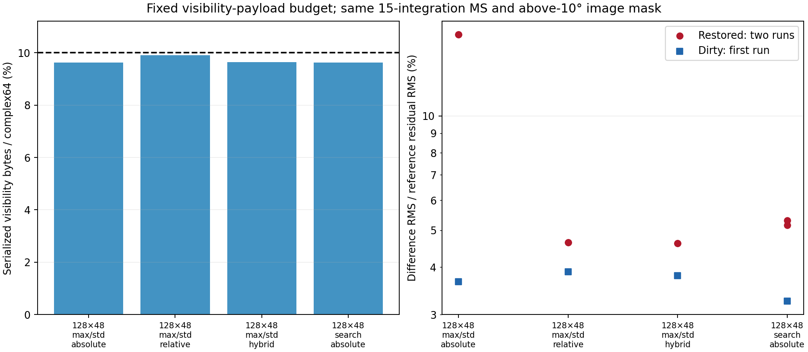
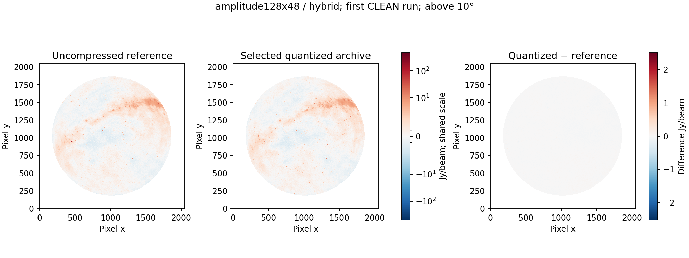
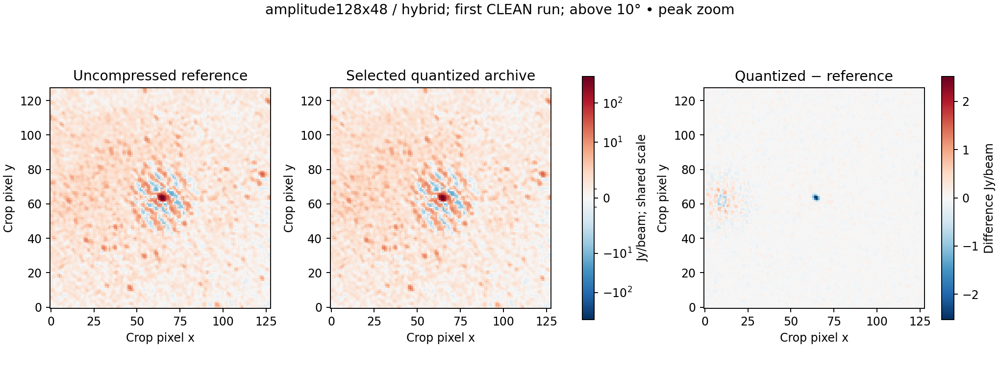
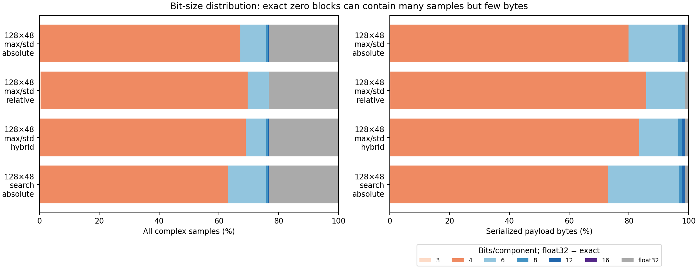
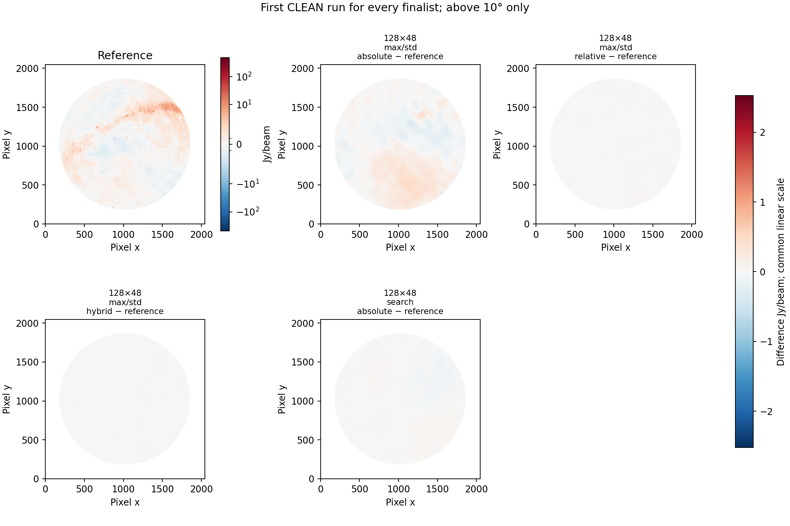
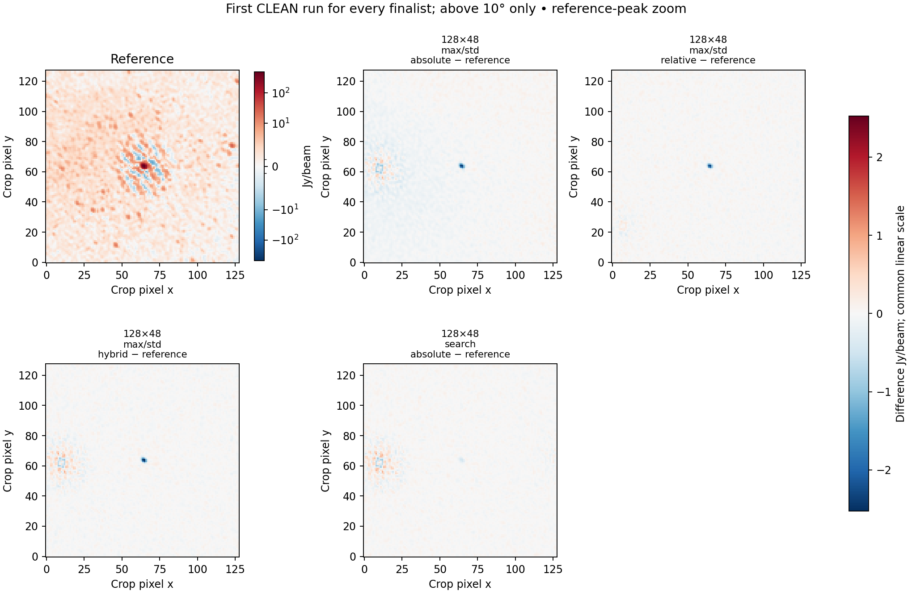

# Ten-percent visibility payload with 3/4/6/8/12/16-bit selection

The best worst-of-two restored-image comparison among the tested finalists is **tenth-amplitude128x48-hybrid**. Its physical visibility payload is **138.095 MB (9.647%)** and its complete archive is **238.378 MB**. [Exact opt-in configuration](../configs/calibrated-fixed10-best.json).

The smaller file has a measurable fidelity cost: its larger restored-image difference is **4.620% of reference residual RMS**, versus 0.508% for the earlier 25%-budget selection. That is 9.10 times the difference RMS. The 10% target is achievable, but these measurements do not support calling its image agreement equivalent to the 25% result.

The ceiling is **143,142,912 bytes**, 10% of the original 1,431,429,120 complex64 visibility bytes. It includes serialized factors, block headers, exceptions and exact fallback after secondary compression. Permutations, indexes, coordinates, flags, weights, metadata and quality arrays are counted separately.

All candidates use the [new 3/4/6/8/12/16 ladder](precision-ladder-3bit.md), calibrated-only CORRECTED_DATA, component medians, independent amplitude order per product, and unchanged time/channel resolution. Original DATA/MODEL_DATA are omitted and flagged values zeroed while flags remain. Four-bit weights are exact on this dataset.

The pilot screened three layouts/codec choices × three error rules with 14 byte-count refinements per rule, targeting 9.9%. Absolute, block-relative and hybrid 128×48 max/std profiles were retained, plus the alternative with the lowest sampled cross-parallel-hand MSE. Grouping pilots sample different rank blocks, so their visibility errors are nomination criteria, not imaging results. All full files must fit 10% before imaging. Actual rates differ slightly; this compares candidates under a common ceiling, not at identical bytes.

| Profile | Group | Gamma | Absolute component MSE cap | Relative component RMS fraction |
| --- | --- | --- | ---: | ---: |
| Max/std + absolute | 128×48×1 | max-std-v1 | 65377.707459130295 | — |
| Max/std + relative | 128×48×1 | max-std-v1 | — | 0.12106199111308591 |
| Max/std + hybrid | 128×48×1 | max-std-v1 | 69236.00988354703 | 0.14659629432469284 |
| Gamma search + absolute | 128×48×1 | search | 57610.022769505296 | — |

The [error-rule definitions](absolute_relative_error.md) are unchanged: component MSE ≤B, or ≤r²P, or their intersection; maximum complex error ≤10√budget, complex bias ≤√budget, and baseline component MSE ≤2×budget. P is block signal power, not thermal noise. Max/std uses R0=4; search tries gamma 1, 1/2 and 1/4.

## Images relative to the reference residual

Reference residual RMS is **1.031244811 Jy/beam**, over the same 2,245,726 above-10° pixels. The numerator is RMS(quantized restored image − reference restored image), without mean removal or clipping. This denominator includes residual sky structure and is not a thermal-noise estimate.

| Profile | Payload MB (%) | Whole MB | Difference RMS mJy/beam: run 1 / 2 | Difference / residual RMS %: run 1 / 2 | Dirty difference / residual RMS % |
| --- | ---: | ---: | ---: | ---: | ---: |
| Max/std + absolute | 137.750 (9.623%) | 237.912 | 168.7787 / 168.7849 | 16.3665 / 16.3671 | 3.6645 |
| Max/std + relative | 141.762 (9.904%) | 242.273 | 47.9481 / 47.9226 | 4.6495 / 4.6471 | 3.8888 |
| Max/std + hybrid | 138.095 (9.647%) | 238.378 | 47.6438 / 47.6408 | 4.6200 / 4.6197 | 3.7982 |
| Gamma search + absolute | 137.845 (9.630%) | 238.025 | 54.6851 / 53.2473 | 5.3028 / 5.1634 | 3.2517 |

| Profile | Candidate residual RMS Jy/beam: run 1 / 2 | Worst restored difference / restored-reference RMS % | Worst faint-region difference % | Largest absolute pixel difference Jy/beam | Largest reference-peak change % |
| --- | ---: | ---: | ---: | ---: | ---: |
| Max/std + absolute | 1.031116 / 1.031113 | 8.8909 | 13.6411 | 2.362457 | 0.48349 |
| Max/std + relative | 1.028435 / 1.028401 | 2.5257 | 3.8337 | 2.249695 | 0.44879 |
| Max/std + hybrid | 1.029677 / 1.029677 | 2.5097 | 3.7846 | 2.527893 | 0.51734 |
| Gamma search + absolute | 1.029208 / 1.029237 | 2.8806 | 4.3790 | 0.941079 | 0.09246 |

Faint pixels are defined from the fixed restored reference below 1% of its masked absolute peak; they are not a blank-sky noise estimate. The peak comparison is at the brightest absolute reference pixel, not a solar identification or integrated-flux measurement. Similar candidate residual RMS does not establish image agreement: a different CLEAN model can redistribute sky structure while leaving this scalar nearly unchanged.

The hybrid and relative profiles are close in global restored RMS (2.510% versus 2.526% of the restored-reference RMS). Their small separation is not evidence of a universal ranking. Full gamma search gives the lowest dirty-image difference and the smallest peak change (0.092%, versus 0.517% for hybrid), despite a larger global restored difference. The saved hybrid preset follows the stated global-RMS objective; a peak-focused objective would favor a different tested profile.

At this 10% ceiling, relative and hybrid limits improve global restored agreement over the direct max/std absolute rule. The earlier 25% selection favored absolute limits. Neither absolute nor relative visibility thresholds alone determine final CLEAN quality; rate, gamma choice, weighting and deconvolution also affect the measured result.


For context, the previous 25%-budget candidate used 349.000 MB and gave 5.238 / 4.967 mJy/beam differences (0.508 / 0.482% of this residual RMS). It used the earlier 4/8/12/16 ladder; the comparison changes both rate and available widths. Source-only CLEAN repeats previously differed by about 0.229–0.236% of restored-image RMS. These are limited repeat observations, not confidence intervals or corrections to subtract.

All images use the requested 2048², 4 arcmin, eight-thread multiscale Stokes I template and reference restoring beam. Best means lowest larger error in these two runs on this observation, not a universal optimum or approval of a scientific tolerance.













## Accounting and timing

| Profile | Payload + permutation/index MB | Encode only s | Verified bundle s | Compaction s | Export s | First CLEAN s |
| --- | ---: | ---: | ---: | ---: | ---: | ---: |
| Max/std + absolute | 144.288 | 135.59 | 383.97 | 20.81 | 52.83 | 273.27 |
| Max/std + relative | 148.300 | 145.80 | 390.58 | 18.25 | 52.51 | 450.88 |
| Max/std + hybrid | 144.634 | 168.33 | 649.12 | 17.78 | 51.32 | 192.09 |
| Gamma search + absolute | 144.384 | 125.28 | 841.78 | 23.53 | 49.61 | 174.49 |

Every selected three-bit sample is an autocorrelation; none is a cross-correlation. The cross-correlation streams use the other widths. This study therefore does not establish three-bit cross-correlation image fidelity. The JSON records the sample distribution separately for ordered auto and cross baseline classes.


For the selected file, error-accounting arrays occupy 62.910 MB, coordinates 19.511 MB, and permutations/indexes 6.538 MB. These costs are outside the visibility-payload ceiling and inside the complete-file size.

Exact positive-zero blocks contain 23.322% of all samples but use only 1.727 MB. The large float32 sample fraction in the plot therefore does not imply a large float32 byte fraction. This includes the calibrated-only zeroing policy; the ratio is not a lossless preservation claim for flagged values.

These durations cover all 15 integrations, with overlapping work on a shared host and no cache eviction. They are not isolated speed rankings. Full conversion is still above the 15-second goal. The JSON includes every byte category, sample/byte precision distributions, flags/weights checks, timings, input hashes and the full pilot.

## Reproduction

```bash
export PYTHONPATH=src OPENBLAS_NUM_THREADS=1 OMP_NUM_THREADS=1
python scripts/screen_fixed_rate.py INPUT.ms NEW_SCREEN_DIR \
  --target-fraction .10 --pilot-fraction .099 --bits 3 4 6 8 12 16 \
  --layouts amplitude128x48 amplitude32x24 search128x48 --max-finalists 4 --prefix tenth
python scripts/run_error_limits.py --source INPUT.ms --plan NEW_SCREEN_DIR/plan.json --root NEW_RESULTS
python scripts/run_error_limits.py --source INPUT.ms --plan NEW_SCREEN_DIR/plan.json --root NEW_RESULTS --repeat-only
```

[Machine-readable results](../reports/calibrated-fixed10.json). All 108 original source-file hashes still match. Export verification preserves original UVW and declared metadata exactly. The codec suite has 103 passing tests. No Q/U/V, calibration-solution, held-out-observation or spectral-cube fidelity is claimed. The paper is unchanged.
