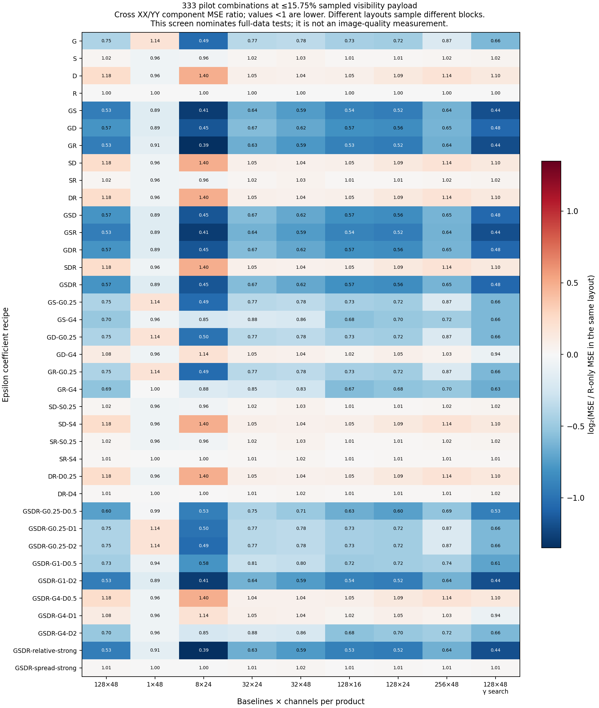
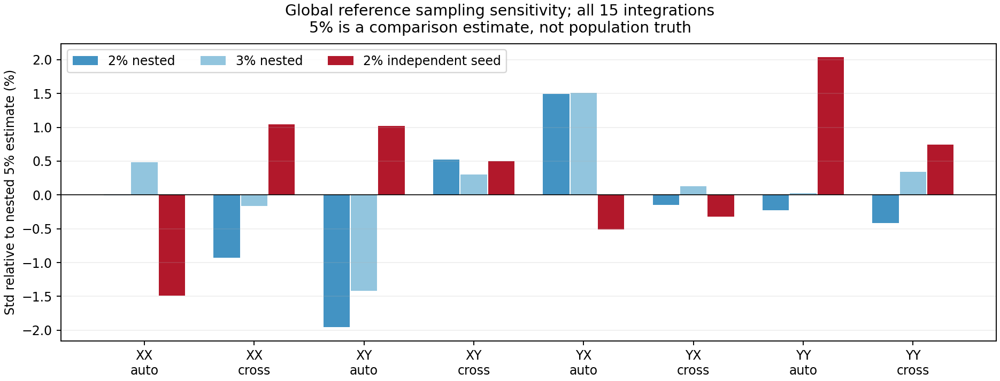
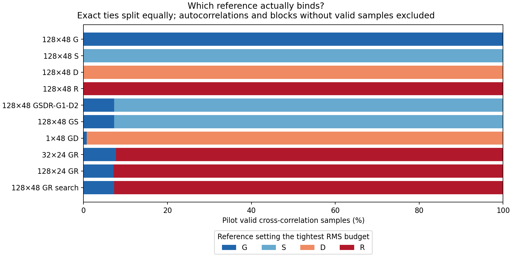
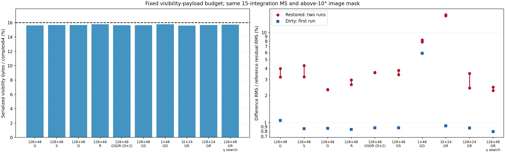
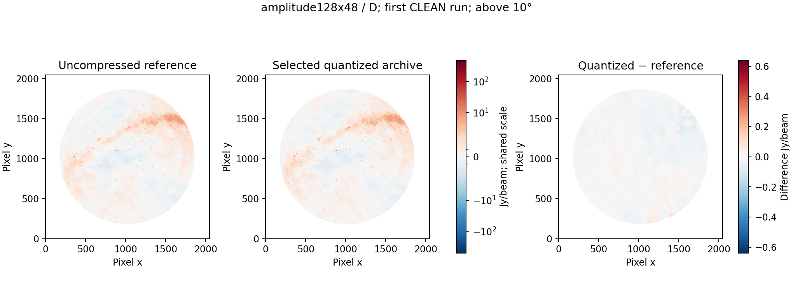
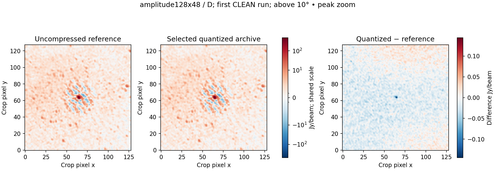
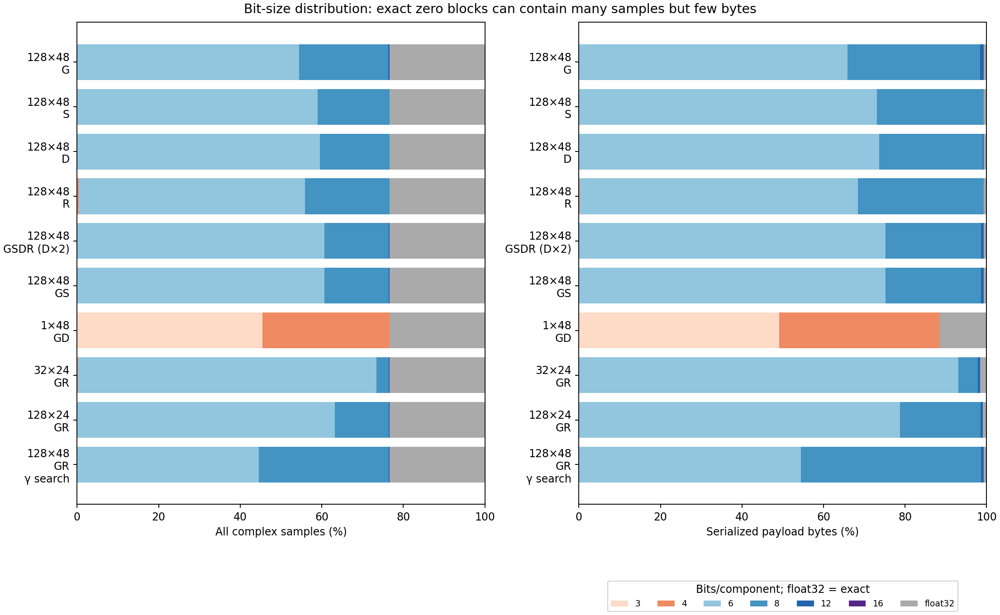
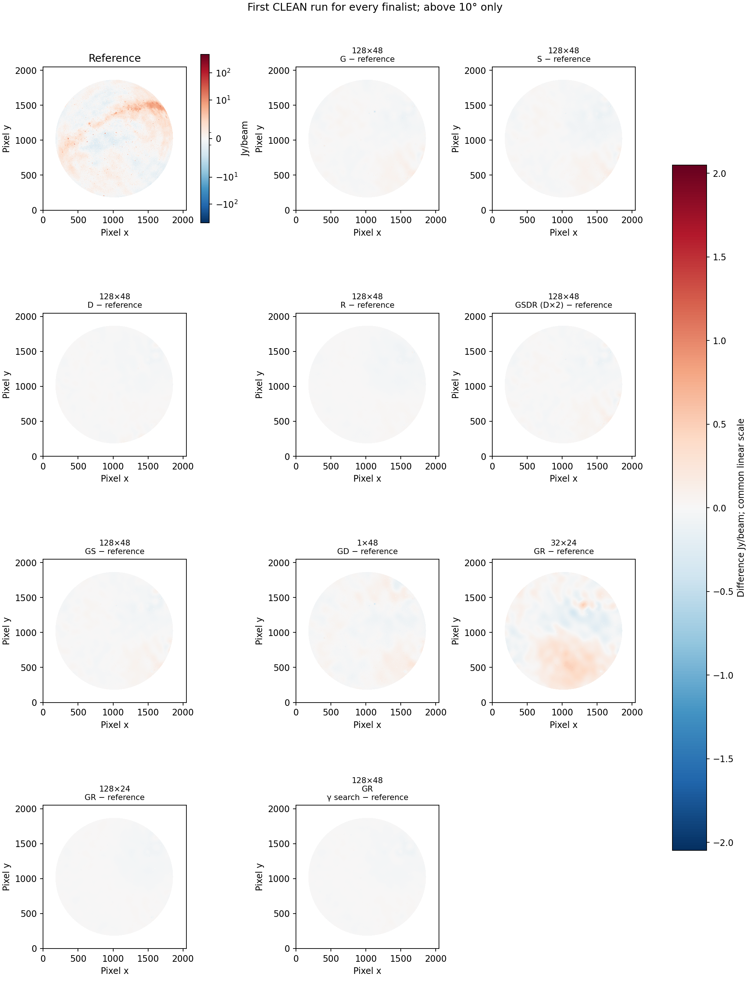
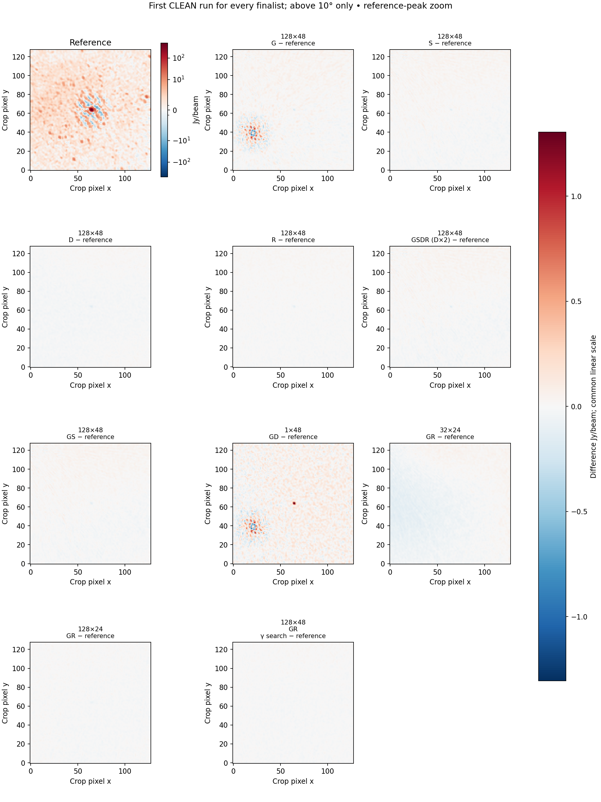

# Sixteen-percent payload: G/S/D/R budgets, combinations and block sizes

Among the ten tested configurations, **128×48 D** has the lowest worst-case restored-image difference across two CLEAN runs. Its visibility payload is **224.131 MB (15.658%)**, and the complete archive is **324.762 MB**. [Exact opt-in configuration](../configs/calibrated-fixed16-best.json).

Fixed absolute B has been removed from these configurations. The [distribution-v1 policy](normalized-budgets.md) uses only dimensionless epsilons and data-derived references. Legacy experiments remain unchanged. This is a measured configuration for this observation, not a scientific default.

## Design and reference sampling

The byte ceiling is **229,028,659 bytes**, the integer limit corresponding to 16% of 1,431,429,120 original CORRECTED_DATA complex64 bytes. It counts packed codes, factors, headers, exceptions, exact fallback and secondary compression. Permutations, indexes and other content are outside this ceiling and inside the complete archive.

The pilot tests **37 coefficient recipes × 9 layout/codec settings = 333 combinations**. Recipes include all 15 nonempty G/S/D/R subsets, pairwise coefficient ratios and four-reference combinations. Block shapes are 1×48, 8×24, 32×24, 32×48, 128×16, 128×24, 128×48 and 256×48, each for one correlation; 128×48 also tests full gamma search. Baseline 1 uses original order; grouped cases use independent amplitude order per product, with auto/cross classes separate.

Every packed candidate is measured once in the pilot and its error/byte tradeoff reused to search a common multiplier for each recipe, targeting 15.75% to leave sampling margin. Thresholds are chosen by bytes before imaging. Cached decisions are checked against the production encoder. Ten finalists include each single-reference control, combined rules, an unsorted per-baseline control, smaller blocks and full gamma search. Different layout pilots sample different rank blocks; they do not establish image rankings.

Global references use a fixed seeded 2% sample from all 15 integrations, separately for each correlation and auto/cross class. The source has one physical configuration, despite different observation IDs, so there are eight global references. A minimum of 128 samples is available for small strata; it was not needed here. Nested 3% and 5% samples plus an independent 2% seed measure sampling sensitivity.

| Product/class | 2% sample count | Global component std | 2% versus 5% difference | Independent 2% versus 5% difference |
| --- | ---: | ---: | ---: | ---: |
| XX/auto | 4,514 | 226985.677424 | -0.003% | -1.489% |
| XX/cross | 680,803 | 3136.873761 | -0.929% | +1.047% |
| XY/auto | 4,480 | 12435.283327 | -1.956% | +1.020% |
| XY/cross | 680,624 | 1941.869898 | +0.523% | +0.500% |
| YX/auto | 4,534 | 12846.052387 | +1.491% | -0.512% |
| YX/cross | 681,917 | 1926.189510 | -0.143% | -0.319% |
| YY/auto | 4,551 | 221869.396457 | -0.228% | +2.038% |
| YY/cross | 679,623 | 3250.803332 | -0.417% | +0.747% |

Holding each finalist's epsilons fixed and changing only G to the 3%, 5% or independent-seed estimate changes at most **1.442% of pilot samples' selected candidates**, and the sampled payload fraction by at most **0.0079 percentage points**. This is a pilot allocation check, not a further imaging test or a guarantee for other MS distributions.





Std/MAD are computed within real and imaginary components and pooled. RMS retains the coherent centre. They describe signal distributions, not thermal noise. No fixed absolute floor is inserted. Zero MAD can require exact storage even for nonconstant sparse blocks.

$$T_b=\min(\epsilon_G G_{p,a},\epsilon_S S_b,\epsilon_D D_b,\epsilon_R R_b),\qquad \mathrm{component\ MSE}_b\le T_b^2.$$

Disabled terms are omitted. Every finalist uses maximum complex error ≤10T, complex bias ≤T and baseline component MSE ≤2T². All four epsilon values are recorded below; no legacy B or fixed absolute guard is active.

| Finalist | εG | εS | εD | εR |
| --- | ---: | ---: | ---: | ---: |
| 128×48 G | 0.023203396 | — | — | — |
| 128×48 S | — | 0.028711985 | — | — |
| 128×48 D | — | — | 0.042935981 | — |
| 128×48 R | — | — | — | 0.028637596 |
| 128×48 GSDR-G1-D2 | 0.028819778 | 0.028819778 | 0.057639555 | 0.028819778 |
| 128×48 GS | 0.028819778 | 0.028819778 | — | — |
| 1×48 GD | 0.34279086 | — | 0.34279086 | — |
| 32×24 GR | 0.030928648 | — | — | 0.030928648 |
| 128×24 GR | 0.028936314 | — | — | 0.028936314 |
| 128×48 GR search | 0.02819529 | — | — | 0.02819529 |

Some constraints can be redundant: S≤R, so equal εS and εR make the RMS constraint inactive. Pilot binding fractions are recorded rather than assuming every enabled coefficient affects bit selection.



## Repeated image comparisons

The fixed above-10° mask contains **2,245,726 pixels**. Reference residual RMS is **1.031244811 Jy/beam**, without mean removal or clipping. Its sky/deconvolution structure prevents interpreting it as a thermal-noise estimate.

| Finalist | Payload MB (%) | Whole MB | Restored difference mJy/beam: first / repeat | Difference / reference residual RMS %: first / repeat | Dirty difference / residual RMS % |
| --- | ---: | ---: | ---: | ---: | ---: |
| 128×48 G | 223.510 (15.614%) | 324.130 | 40.8185 / 32.9725 | 3.9582 / 3.1973 | 1.0550 |
| 128×48 S | 224.317 (15.671%) | 324.974 | 44.2599 / 33.1180 | 4.2919 / 3.2115 | 0.8517 |
| 128×48 D | 224.131 (15.658%) | 324.762 | 23.9469 / 23.6988 | 2.3221 / 2.2981 | 0.8594 |
| 128×48 R | 225.722 (15.769%) | 326.419 | 27.1611 / 30.6217 | 2.6338 / 2.9694 | 0.8365 |
| 128×48 GSDR-G1-D2 | 223.998 (15.649%) | 324.594 | 37.0537 / 36.7400 | 3.5931 / 3.5627 | 0.8723 |
| 128×48 GS | 223.998 (15.649%) | 324.594 | 39.0135 / 35.0079 | 3.7831 / 3.3947 | 0.8723 |
| 1×48 GD | 225.713 (15.768%) | 364.941 | 84.8542 / 80.7557 | 8.2283 / 7.8309 | 5.8554 |
| 32×24 GR | 223.342 (15.603%) | 326.070 | 157.5275 / 162.2285 | 15.2755 / 15.7313 | 0.9169 |
| 128×24 GR | 224.173 (15.661%) | 325.052 | 24.8406 / 36.0328 | 2.4088 / 3.4941 | 0.8696 |
| 128×48 GR search | 224.851 (15.708%) | 325.459 | 23.3682 / 25.5045 | 2.2660 / 2.4732 | 0.7917 |

The G/S and selected four-term archives have **identical visibility payloads and decoding maps** in all 375 arrays checked byte for byte. Their CLEAN inputs are therefore identical. Any difference between their image comparisons is repeat variation, not a benefit from adding D or R.

| Finalist | Worst difference / restored-reference RMS % | Worst faint-region difference % | Largest reference-peak change % | Candidate residual RMS Jy/beam: first / repeat |
| --- | ---: | ---: | ---: | ---: |
| 128×48 G | 2.1502 | 3.2046 | 0.03840 | 1.029446 / 1.029407 |
| 128×48 S | 2.3314 | 3.4832 | 0.02829 | 1.027961 / 1.029180 |
| 128×48 D | 1.2614 | 1.9065 | 0.02958 | 1.029077 / 1.029038 |
| 128×48 R | 1.6130 | 2.4141 | 0.02576 | 1.030135 / 1.029811 |
| 128×48 GSDR-G1-D2 | 1.9518 | 2.8934 | 0.02957 | 1.028860 / 1.028748 |
| 128×48 GS | 2.0551 | 3.0573 | 0.02878 | 1.028723 / 1.029178 |
| 1×48 GD | 4.4698 | 6.7937 | 0.26617 | 1.033611 / 1.034586 |
| 32×24 GR | 8.5455 | 13.1196 | 0.00724 | 1.033290 / 1.032961 |
| 128×24 GR | 1.8981 | 2.8851 | 0.01350 | 1.029681 / 1.029575 |
| 128×48 GR search | 1.3435 | 2.0190 | 0.00346 | 1.030252 / 1.030161 |

Faint pixels are below 1% of the masked reference peak, using the fixed reference to define the region. Peak change refers to the brightest absolute reference pixel, not an identification of the Sun or an integrated-flux measurement. Similar residual RMS alone does not demonstrate restored-image agreement.

All runs use the requested 2048², four-arcmin, eight-thread multiscale Stokes I template and reference restoring beam. Two runs characterize observed repeat variation only; they are not confidence intervals. Actual payloads differ slightly under the common ceiling.

## What the measurements support

With 128×48 blocks and the same max/std gamma rule, **D** is the best of the four single-reference controls by the stated larger-of-two image-RMS criterion. G is a data-normalized global ceiling; S, D and R follow local block statistics. None is a thermal-noise bound.

The tested per-baseline control has 364.941 MB total storage, including 44.735 MB of block indexes. Its larger image difference is 8.228% of reference residual RMS, versus 2.322% for the best single-reference grouped control. These are separately rate-tuned configurations, with different reference recipes; this is not an isolated test of sorting alone.

The lowest first-run dirty-image difference belongs to **128×48 GR search**. The smallest larger-of-two reference-peak change belongs to **128×48 GR search**. The saved preset follows global restored-image RMS; another science objective can favor another configuration.

Only four distinct block shapes were carried through full-data imaging; all eight shapes were screened. Pilot unweighted visibility MSE nominates candidates and does not establish their final image ranking. Neither an eight-statistic global reference nor any single relative error number is a universal scientific tolerance.

The 32×24 first-run dirty-image difference is 9.456 mJy/beam, while its restored-image difference is 157.527 mJy/beam. CLEAN reached its final threshold after 85,906 components. This observed sensitivity of the restored result is not an iteration-limit failure, and small peak changes do not establish agreement across the image. Logs and termination counts are retained.

| Historical target | Payload MB | Whole MB | Larger image difference / reference residual RMS % |
| --- | ---: | ---: | ---: |
| 10% | 138.095 | 238.378 | 4.6200 |
| 25% | 349.000 | 449.433 | 0.5079 |
| 16%, selected here | 224.131 | 324.762 | 2.3221 |

Historical runs use the same reference image and calibrated-only preservation policy, but rates, block choices and threshold policies differ; the older 25% experiment also used a different bit ladder. This is context, not an isolated measurement of the epsilon policy change.













## Byte accounting and timing

| Selected archive category | Physical MB |
| --- | ---: |
| visibility block payload | 224.131 |
| visibility quality | 42.183 |
| quantization statistics | 21.032 |
| coordinates | 19.511 |
| permutations | 6.185 |
| subtables | 5.531 |
| container manifests verification and links | 5.340 |
| reconstruction | 0.463 |
| visibility indexes | 0.353 |
| flags weights | 0.032 |
| auxiliary columns | 0.000 |

| Selected precision | Complex samples % | Serialized payload bytes % |
| --- | ---: | ---: |
| 3 | 0.0000 | 0.0000 |
| 4 | 0.0000 | 0.0000 |
| 6 | 59.5186 | 73.6591 |
| 8 | 17.0631 | 25.3467 |
| 12 | 0.0961 | 0.2235 |
| 16 | 0.0000 | 0.0000 |
| float32 | 23.3222 | 0.7707 |

Exact positive-zero blocks account for 23.322% of all samples and 1.727 MB. This counts samples in entirely zero blocks, not every individual zero inside mixed blocks.

| Finalist | Payload + permutation/index MB | Sum of partition encode s | Global sampling s | Verified bundle wall s | Compaction s | Export s | First CLEAN s |
| --- | ---: | ---: | ---: | ---: | ---: | ---: | ---: |
| 128×48 G | 230.049 | 191.13 | 6.59 | 472.15 | 19.02 | 49.60 | 181.35 |
| 128×48 S | 230.855 | 206.50 | 7.78 | 665.02 | 25.98 | 81.41 | 197.05 |
| 128×48 D | 230.670 | 166.29 | 7.10 | 807.70 | 26.73 | 57.25 | 183.32 |
| 128×48 R | 232.260 | 156.28 | 7.07 | 516.00 | 19.28 | 66.45 | 176.47 |
| 128×48 GSDR-G1-D2 | 230.536 | 155.72 | 7.92 | 516.65 | 32.50 | 72.62 | 192.57 |
| 128×48 GS | 230.536 | 192.15 | 8.04 | 1291.95 | 19.51 | 66.07 | 186.48 |
| 1×48 GD | 270.448 | 4948.67 | 6.64 | 1788.46 | 20.15 | 459.23 | 168.69 |
| 32×24 GR | 232.329 | 1007.59 | 6.80 | 2384.99 | 18.36 | 85.69 | 167.82 |
| 128×24 GR | 231.062 | 333.72 | 7.82 | 1254.89 | 23.13 | 58.44 | 170.61 |
| 128×48 GR search | 231.389 | 192.36 | 6.75 | 857.72 | 28.97 | 49.54 | 170.58 |

Timings cover all 15 integrations on a shared host with overlapping archive/image pipelines and no cache eviction. They are observations, not isolated speed rankings. Grouped cases use 24 encoder threads and serial partitions. The per-baseline control uses six independent partition processes, each with one encoder worker; its summed partition times exceed wall time. A preliminary serial attempt was stopped and retained as incomplete, then the full control was restarted; the report records that discarded attempt separately. Fixture checks and completed serial partitions are compared for exact array equivalence. The full-conversion 15-second goal remains unmet. Global sampling is included in verified-bundle time; compaction and export are additional stages.

Every byte category, sample/byte precision histogram and auto/cross precision split is retained in the JSON. Calibrated-only storage omits original DATA/MODEL_DATA and zeros flagged visibility values, while preserving flags and original time/frequency resolution. Four-bit weights were verified exact on this dataset. All 108 source-file hashes still match; supported metadata and original metre UVW passed exact comparisons.

## Reproduction

```bash
export PYTHONPATH=src OPENBLAS_NUM_THREADS=1 OMP_NUM_THREADS=1
python scripts/sample_distribution.py INPUT.ms SAMPLING_DIR
python scripts/screen_normalized.py INPUT.ms SCREEN_DIR \
  --references SAMPLING_DIR/fraction2-seed20261024.json --target .16 --pilot-target .1575
python scripts/run_normalized_study.py --source INPUT.ms --root NEW_RESULTS --plan SCREEN_DIR/plan.json
```

[Machine-readable results](../reports/calibrated-fixed16.json). The codec/archive suite has 110 passing tests. No held-out observation, Q/U/V, spectral-cube or calibration-solution fidelity is claimed. The paper is unchanged.
