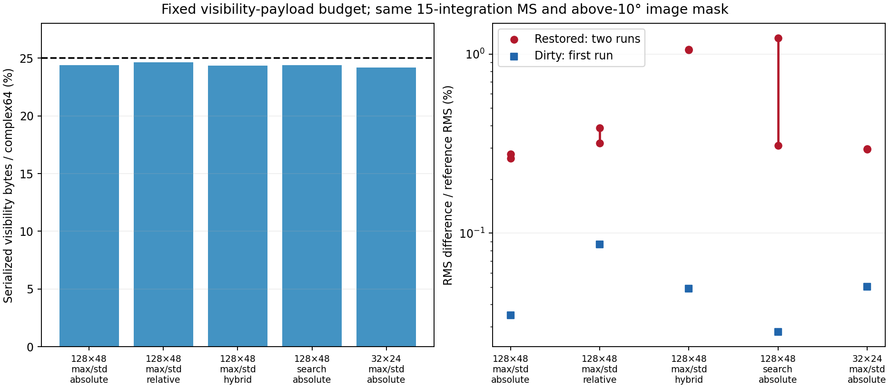
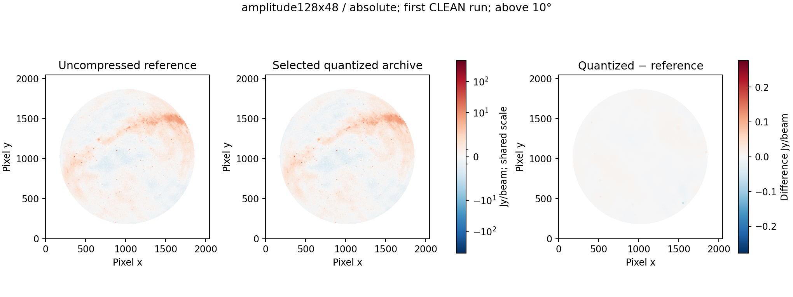
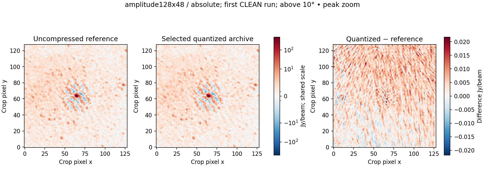
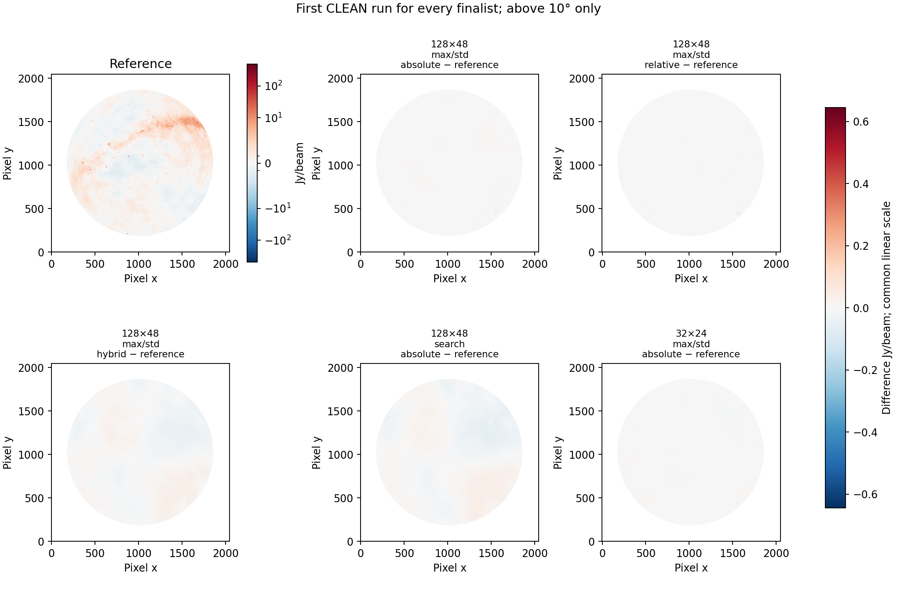
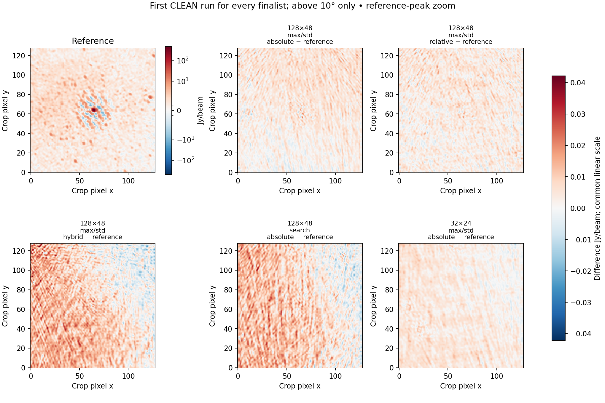
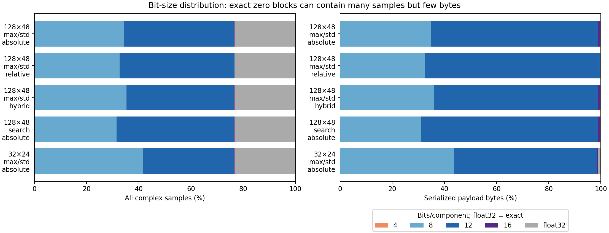

# Fixed 25% visibility-payload budget

Among the fully imaged finalists, **amplitude128x48 with absolute limits** gives the smallest worse-of-two restored-image difference. Its physical visibility payload is **349.000 MB (24.381%)**; the complete file is **449.433 MB**. The two restored-image differences are **0.2759% and 0.2616%**. This measures agreement with the uncompressed Stokes I reference, not accuracy against sky truth.

[Exact opt-in configuration](../configs/calibrated-fixed25-best.json). Defaults remain unchanged. This calibrated-only profile omits original DATA/MODEL_DATA and zeros flagged visibilities while preserving their flags; original CORRECTED_DATA values are used independently for every experiment. Four-bit weights are exact for this dataset.

Follow-up to [absolute versus relative error limits](absolute_relative_error.md). The target is **25% of original complex64 visibility bytes**, equivalent to 25% of the two original float32 component streams. It means 4× smaller, not a 25% saving.

This MS contains 178,928,640 complex samples: 1,431,429,120 original bytes. The payload ceiling is **357,857,280 bytes (357.857 MB)**. Payload includes codes, medians, scales, gamma, block headers, exact exceptions and float32 fallback after conventional lossless compression. Whole-archive coordinates, flags, weights, maps, metadata and quality arrays are counted separately.

## Tested configurations

The pilot compares five layout/codec choices and three error rules, tuning thresholds with 14 logarithmic byte-count refinements. It targets 24.8% to allow for sampling differences. Three 128×48 candidates test absolute, relative and hybrid rules directly; the lowest-MSE alternative and a smaller-group control are also imaged. Every full finalist’s serialized block stream had to fit 25% before imaging. The final compacted physical streams are independently checked against the same ceiling. This is a finite experimental comparison, not a proof of the global optimum.

| Finalist | Baselines × channels | Ordering | Gamma rule | Absolute MSE cap | Relative component RMS fraction |
| --- | --- | --- | --- | ---: | ---: |
| amplitude128x48 / absolute | 128 × 48 | amplitude | max-std-v1 | 147.6350424034557 | — |
| amplitude128x48 / relative | 128 × 48 | amplitude | max-std-v1 | — | 0.0069841926599429754 |
| amplitude128x48 / hybrid | 128 × 48 | amplitude | max-std-v1 | 163.90779555580346 | 0.007132746369146603 |
| search128x48 / absolute | 128 × 48 | amplitude | search | 139.40781147272753 | — |
| amplitude32x24 / absolute | 32 × 24 | amplitude | max-std-v1 | 151.41739882930253 | — |

All groups contain one correlation product; all spectra retain their original channels. Power levels use stored real/imaginary medians, float32 range, gamma in {1, 1/2, 1/4}, exact exceptions and 4/8/12/16-bit choices. Ratio selection uses R0=4. The error-rule definitions and maximum/bias/baseline guards are specified in the companion note; exact configurations are retained in the JSON.

## Full-data images and bytes

| Finalist | Payload MB (%) | Whole archive MB | Dirty difference % | Restored run 1 % | Restored run 2 % | Worst faint-region difference % |
| --- | ---: | ---: | ---: | ---: | ---: | ---: |
| amplitude128x48 / absolute | 349.000 (24.381%) | 449.433 | 0.0348 | 0.2759 | 0.2616 | 0.4230 |
| amplitude128x48 / relative | 352.435 (24.621%) | 453.324 | 0.0863 | 0.3191 | 0.3871 | 0.5912 |
| amplitude128x48 / hybrid | 348.535 (24.349%) | 449.247 | 0.0489 | 1.0647 | 1.0591 | 1.6197 |
| search128x48 / absolute | 349.019 (24.383%) | 449.407 | 0.0280 | 1.2294 | 0.3079 | 1.8691 |
| amplitude32x24 / absolute | 346.259 (24.190%) | 449.327 | 0.0502 | 0.2951 | 0.2947 | 0.4519 |

Lowest worst-of-two restored-image difference: **quarter-amplitude128x48-absolute**. Lowest first-run dirty-image difference: **quarter-search128x48-absolute**. These are empirical rankings on this observation; two repeats do not establish a confidence interval or a stable universal winner.

For this budget, use the absolute-limit configuration as a starting point: the tested relative rule has a larger dirty-image difference and a larger worse-of-two restored difference. Hybrid limits do not improve this image comparison. Full gamma search reduces dirty-image error but gives a much less consistent CLEAN result. The 32×24 grouping control is also slightly worse than 128×48 in both restored runs. These results do not establish that absolute limits always win, or that larger groups always win.

The source-only CLEAN repeat differences are about 0.229% and 0.236%; the same-policy lossless control gives 0.168%. They show the limited reproducibility of this eight-thread, independently masked workflow. They are not a confidence interval or a universal noise floor, and are not subtracted from quantized-image differences.

All images use the requested 2048², 4 arcmin, eight-thread multiscale Stokes I template, identical reference beam and fixed above-10° mask. Each archive is independently decoded and verified. Weights are exact on this dataset, so visibility-error allocation is the changing factor. No approval of a scientific error tolerance is implied by a low image-difference score.













### Smaller archives and earlier controls

The target is a ceiling, so the six lower-rate profiles from the companion study also qualify. They were each imaged twice and repacked with the same lossless storage policy; their physical payloads also fit 25%.

| Lower-rate rule | Payload % | First restored % | Repeat restored % |
| --- | ---: | ---: | ---: |
| absolute-t256 | 19.275 | 0.8889 | 0.7675 |
| relative-t256 | 19.524 | 0.8380 | 0.9425 |
| hybrid-t256 | 19.303 | 0.9360 | 0.9365 |
| absolute-t4096 | 18.044 | 0.4419 | 0.5080 |
| relative-t4096 | 18.202 | 0.8165 | 0.8149 |
| hybrid-t4096 | 18.042 | 0.4595 | 0.4596 |

Best worst-of-two result across these controls and the five near-budget finalists: **quarter-amplitude128x48-absolute**.

Earlier serialized-payload controls are also retained in the JSON, including the parallel-hand priority and six-bit experiments. Each has a first-run restored difference greater than the selected candidate’s worse repeat, so adding a second run cannot improve its worst-of-two score below that candidate. Their original physical container sizes are not substituted for codec bytes.

### Physical accounting and timings

The original extensible HDF5 streams allocated unused tail padding. Lossless compaction writes their known lengths without that padding. All scientific manifests and array checksums match the already imaged archives; the original files remain available. The physical payload meets 25%, including block headers, factors and exceptions. Permutations, indexes and other categories remain explicit rather than disappearing into a claimed payload ratio.

| Finalist | Payload + permutation/index MB | Encoding only s | Verified bundle s | Compaction s | Export s | First CLEAN s |
| --- | ---: | ---: | ---: | ---: | ---: | ---: |
| amplitude128x48 / absolute | 355.539 | 134.59 | 503.61 | 32.01 | 84.44 | 227.78 |
| amplitude128x48 / relative | 358.974 | 158.85 | 507.27 | 32.94 | 88.41 | 314.86 |
| amplitude128x48 / hybrid | 355.074 | 148.80 | 774.23 | 23.76 | 85.96 | 198.91 |
| search128x48 / absolute | 355.557 | 129.18 | 897.96 | 30.94 | 110.43 | 162.44 |
| amplitude32x24 / absolute | 355.246 | 729.79 | 1783.34 | 22.26 | 98.46 | 184.79 |

Times cover all 15 integrations. Runs overlap on a shared host with no cache eviction; these are observed durations, not isolated speed rankings or a 15-second full-conversion claim. The JSON retains hardware/software and commands through the companion report and per-stage records.

For the selected configuration, the measured byte breakdown is:

| Category | Decimal MB |
| --- | ---: |
| coordinates | 19.5106 |
| flags_weights | 0.0322 |
| reconstruction | 0.4629 |
| auxiliary_columns | 0.0003 |
| quantization_statistics | 21.0320 |
| permutations | 6.1855 |
| visibility_indexes | 0.3527 |
| visibility_block_payload | 349.0004 |
| visibility_quality | 42.0307 |
| subtables | 5.5310 |
| container_manifests_verification_and_links | 5.2949 |

The sample-weighted precision distribution is different from the byte distribution because exact zero blocks compress well:

| Bits per component | Sample fraction % | Payload byte fraction % |
| --- | ---: | ---: |
| 4 | 0.0000 | 0.0000 |
| 8 | 34.3858 | 34.7786 |
| 12 | 41.9581 | 64.1735 |
| 16 | 0.3339 | 0.5530 |
| float32 | 23.3222 | 0.4949 |

Exact all-positive-zero blocks contain 41,730,048 samples and occupy only 1.7273 MB. The calibrated-only flagged-value policy and ordinary lossless compression contribute to the measured rate; the 4× payload result is not a claim that every retained value uses a fixed 8-bit component code.

## Reproduction

```bash
export PYTHONPATH=src OPENBLAS_NUM_THREADS=1 OMP_NUM_THREADS=1
python scripts/screen_fixed_rate.py INPUT.ms NEW_SCREEN_DIR
python scripts/run_error_limits.py --source INPUT.ms --plan NEW_SCREEN_DIR/plan.json --root NEW_RESULT_DIR
python scripts/run_error_limits.py --source INPUT.ms --plan NEW_SCREEN_DIR/plan.json --root NEW_RESULT_DIR --repeat-only
```

[Machine-readable results](../reports/calibrated-fixed25.json) include thresholds, all pilot trials, measured byte categories, encode/export/CLEAN timings, commands, image metrics and checksums. Large files remain ignored under `results/calibrated-fixed25/`. Source files retain the original 108 import checksums. The paper and root README are unchanged.
