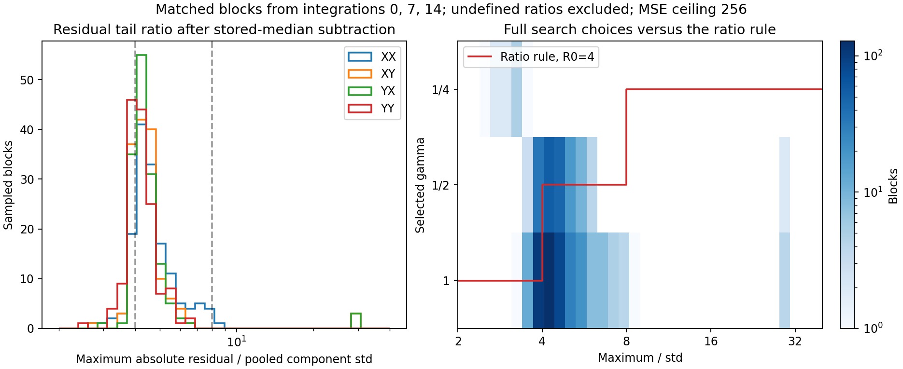
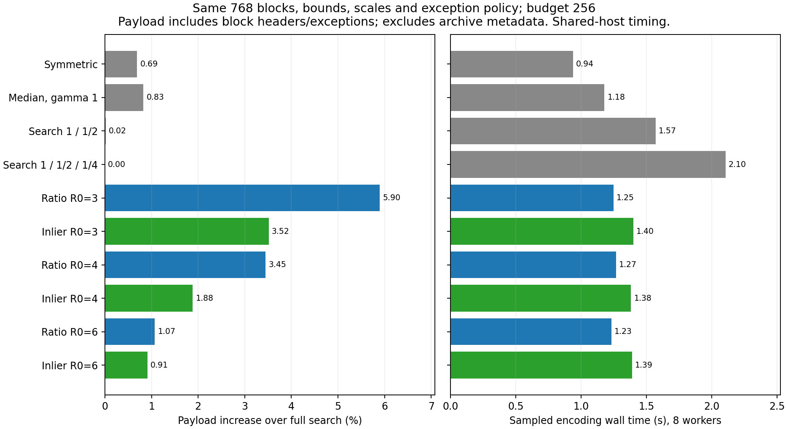
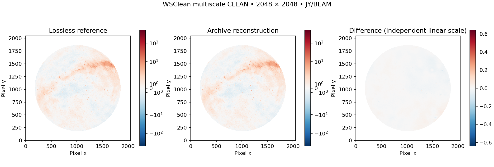
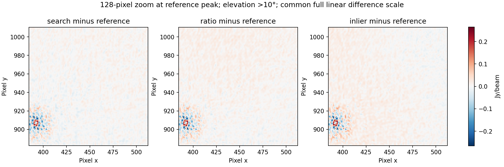
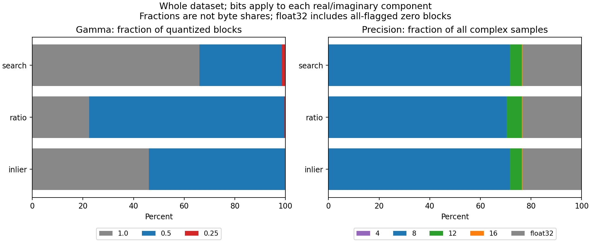

# Gamma from maximum / standard deviation

24 October 2026. Follow-up to [calibrated dataset tests](test_calibrated_dataset.md) and [issue #1](https://github.com/peijin94/varquanMS/issues/1). The paper is unchanged.

**Result:** the direct rule produces 414.827 MB and 0.766–0.768% restored-image differences in two runs. Full gamma search gives 414.629 MB / 0.734%; the inlier rule gives 414.757 MB / 1.325% in its single run. The ratio rules reduce measured native search work, but show no practical whole-archive compression or full-encoding latency advantage here. Both remain optional; archive defaults are unchanged. This tests the discrete gamma set {1, 1/2, 1/4}, not every possible smoother max/std-to-gamma mapping.

The proposed direction is sensible as a tail-concentration heuristic: a larger maximum relative to the spread can justify more code levels near the center. It is not a sufficient distribution summary or an outlier detector. Outliers also increase standard deviation, and the ratio depends on the number of eligible samples and real/imaginary component structure.

## Tested rule

Subtract the separately stored float32 real/imaginary medians. From eligible float64 residual pairs r, compute population variance within each component, then pool:

$$\sigma^2=\frac{\operatorname{Var}(r_\mathrm{Re})+\operatorname{Var}(r_\mathrm{Im})}{2},\qquad R=\frac{\max_{j,c}|r_{j,c}|}{\sigma}.$$

$$\gamma(R)=\begin{cases}1 & R\le R_0\\1/2 & R_0<R\le2R_0\\1/4 & R>2R_0.\end{cases}$$

Use R0=4 for the full tests; the screen also tries 3 and 6. Smaller gamma means denser levels near zero residual. Restricting the first test to the existing exact powers leaves the decoder unchanged. This is a stepwise approximation to a decreasing gamma-versus-tail-ratio rule, not a continuous-power codec.

`max-std-v1` excludes flagged, nonfinite and signed-zero-protected samples. `max-std-inlier-v1` additionally removes each range candidate’s exact outliers before computing its ratio. Thus an outlier already stored exactly need not determine the remaining samples’ gamma. Empty or zero-variance sets choose gamma 1; a restricted allowed-gamma set uses the nearest allowed log2 value.

One gamma is chosen per range candidate and shared by both components. The stored median, range, gamma and unsigned codes still reconstruct with the existing `power-midrise-v1` decoder. Selection across 4/8/12/16 bits, exceptions and exact float32 fallback still evaluates every configured error bound. Sigma here is signal spread, **not thermal noise**. Defaults remain the existing full gamma search and original uniform codebook.

## Matched-block screen

Use exactly the same 768 amplitude-ordered 128×48×1 blocks from the first, middle and last integrations for all 20 profiles. Four products are read from MS metadata. Budgets are 64 and 256 with baseline MSE ≤2B, max complex error ≤10√B and bias ≤√B. Both maximum/.995 ranges compete. The table below shows budget 256; all blocks and both budgets are retained in the JSON.

| Policy | Block payload MB | Component MSE | Screen time (s) |
| --- | ---: | ---: | ---: |
| symmetric | 7.1743 | 171.992 | 0.938 |
| median-uniform | 7.1839 | 170.856 | 1.178 |
| power-search2 | 7.1262 | 191.158 | 1.570 |
| power-search3 | 7.1251 | 191.745 | 2.105 |
| max-std-v1-r3 | 7.5452 | 166.922 | 1.248 |
| max-std-inlier-v1-r3 | 7.3756 | 173.617 | 1.399 |
| max-std-v1-r4 | 7.3707 | 172.975 | 1.268 |
| max-std-inlier-v1-r4 | 7.2593 | 174.349 | 1.382 |
| max-std-v1-r6 | 7.2014 | 170.933 | 1.232 |
| max-std-inlier-v1-r6 | 7.1901 | 170.693 | 1.389 |

Payload bytes include headers and exceptions, but exclude archive metadata. Screen times use eight workers on the shared host. They are not whole-MS conversion times. Equal configured bounds do not imply equal achieved MSE.





The median observed ratio is 4.29. At R0=4, the direct rule agrees with the full search’s selected gamma in 228/588 quantized blocks; the inlier variant agrees in 380/588. The full search contains every heuristic candidate, so it cannot have a larger minimum encoded block size at identical bounds. The heuristic’s possible advantage is reduced search work, not a guaranteed better rate–distortion optimum.

## Whole-data archives and CLEAN

All three new runs use all 15 integrations, amplitude groups 128×48×1, budget 256, four-bit weights and the same calibrated-only preservation policy. Each has passed source/export verification and is compacted with the same exact HDF5 sharing. Images use the requested 2048², 4 arcmin, eight-thread CLEAN template and reference beam. All metrics and plots use the same 2,245,726 pixels above 10° at every integration.

| Policy | Shared archive MB | Serialized visibility blocks MB | Component MSE | Dirty difference % | Restored difference % | Faint-region difference % |
| --- | ---: | ---: | ---: | ---: | ---: | ---: |
| search | 414.629 | 267.216 | 196.383 | 0.1208 | 0.7341 | 1.1083 |
| ratio | 414.827 | 275.913 | 178.119 | 0.1181 | 0.7677 | 1.1676 |
| inlier | 414.757 | 271.754 | 179.591 | 0.1188 | 1.3245 | 2.0158 |

The direct-rule repeat gives 0.7657% restored-image difference against the reference and 0.0386% against its first run. The previous symmetric-amplitude profile is 414.599 MB with 0.55–0.69% restored-image difference in two runs. Repeated-source/lossless controls gave 0.168–0.229%; these few repeats do not define a confidence interval. Search and inlier variants have one image run each, so small differences are not evidence of a stable scientific improvement.







| Policy | Encoding only (s) | Complete verified bundle (s) | Additional compacting (s) | MS export (s) | WSClean (s) |
| --- | ---: | ---: | ---: | ---: | ---: |
| search | 124.49 | 331.27 | 24.47 | 55.38 | 184.01 |
| ratio | 153.18 | 358.13 | 23.36 | 62.92 | 172.16 |
| inlier | 177.41 | 626.92 | 17.67 | 44.79 | 154.16 |

Native candidate-search and compression thread CPU summed to 968.8 s for search, 551.5 s for ratio and 563.0 s for inlier. These are accumulated worker CPU times, not wall latency. The selector reduces this measured work, but the full encoding wall times do not demonstrate an end-to-end speedup.

Full encodes use 24 workers and overlapped other work; caches were not evicted. Screen speed does not establish end-to-end speed. Stored block streams have chunk-allocation overhead, so serialized-byte improvements need not reduce whole-file size by the same amount. The JSON includes both byte measures, actual precision/gamma distributions, error moments and worker timings.

## Reproduction and scope

```bash
export PYTHONPATH=src OPENBLAS_NUM_THREADS=1 OMP_NUM_THREADS=1
python scripts/screen_gamma_ratio.py INPUT.ms NEW_SCREEN_DIR
python scripts/timeslot_archive.py encode INPUT.ms NEW.bundle --config configs/calibrated-gamma-ratio.json --report encode.json
python scripts/timeslot_archive.py compact NEW.bundle SHARED.h5 --report compact.json
python scripts/validate_partition_export.py SHARED.h5 INPUT.ms NEW.ms --report export.json
python scripts/run_wsclean.py NEW.ms --output IMAGES --data-column CORRECTED_DATA --clean-profile calibrated --threads 8 --beam-from REFERENCE/image-image.fits
python scripts/compare_wsclean.py REFERENCE IMAGES --mask above10deg.fits --report comparison.json
```

Use `calibrated-gamma-inlier.json` and `calibrated-gamma-search.json` for the matched variants. New configurations use `power_gamma_policy` and `power_ratio_reference`; the decoder still reads only stored block parameters.

All 97 tests pass, including analytic ratios, threshold boundaries, protected values, range-exception exclusion, constant blocks, native/portable equivalence, independent decoding and exact fallback. All 108 original source-file checksums still match. No Q/U/V, calibration-solution, temporal or held-out-data fidelity claim is made.

[Machine-readable results](../reports/calibrated-gamma-ratio.json). Large archives, exports and FITS remain ignored under `results/calibrated-gamma-ratio/`.
