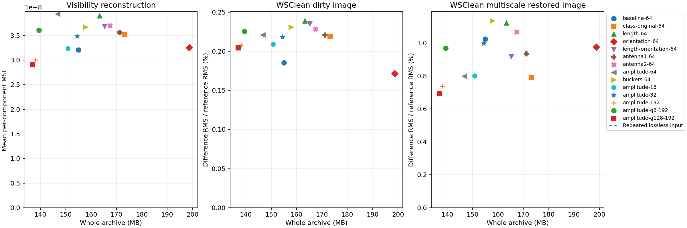
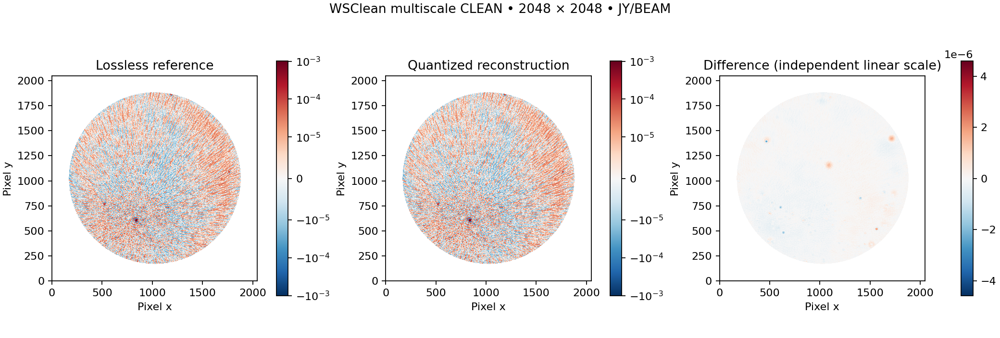

# Grouping and WSClean experiment, 2026-10-22

This experiment tests the user's proposal to group numbers by baseline length,
orientation, antenna endpoint and frequency channel before quantization. It uses
the same copied 62,128-row, 192-channel, four-product integration as the initial
prototype. All fourteen configurations passed archive/source/reconstructed-MS
verification and completed the requested WSClean comparison. This is a measured
engineering experiment; it does not establish an archival science default.

## Measured results

The source occupies 409.595 MB; the exact lossless reference archive occupies
331.220 MB. All MB values below are decimal and include metadata, original UVW,
flags, weights, permutations, exceptions, quality arrays and container overhead.
The block dimensions are maximum baselines × channels, with one product per block.
Image percentages are difference RMS / reference RMS over 2,320,513 finite pixels
with valid celestial coordinates. Peak change is measured at the reference peak.

| Experiment | Block | Archive MB | Reduction | Dirty RMS % | Restored RMS % | Peak change % |
| --- | ---: | ---: | ---: | ---: | ---: | ---: |
| Per-baseline control | 1×64 | 155.010 | 2.642× | 0.1852 | 1.0246 | +0.1042 |
| Original within class | 32×64 | 173.188 | 2.365× | 0.2189 | 0.7905 | +0.2880 |
| Baseline length | 32×64 | 163.285 | 2.508× | 0.2390 | 1.1226 | +0.1005 |
| UV orientation | 32×64 | 198.722 | 2.061× | 0.1715 | 0.9757 | +0.0790 |
| Length/orientation bins | 32×64 | 165.216 | 2.479× | 0.2353 | 0.9195 | +0.0472 |
| ANTENNA1 groups | 32×64 | 171.207 | 2.392× | 0.2208 | 0.9342 | +0.2560 |
| ANTENNA2 groups | 32×64 | 167.383 | 2.447× | 0.2285 | 1.0676 | +0.0502 |
| Amplitude sort | 32×64 | 146.699 | 2.792× | 0.2211 | 0.7992 | +0.3132 |
| Amplitude buckets | 32×64 | 157.822 | 2.595× | 0.2311 | 1.1358 | +0.1625 |
| Amplitude sort | 32×16 | 150.764 | 2.717× | 0.2091 | 0.8007 | +0.2231 |
| Amplitude sort | 32×32 | 154.371 | 2.653× | 0.2181 | 0.9986 | +0.0399 |
| Amplitude sort | 32×192 | 138.050 | 2.967× | 0.2081 | 0.7394 | +0.2273 |
| Amplitude sort | 8×192 | 139.419 | 2.938× | 0.2255 | 0.9697 | −0.0464 |
| Amplitude sort | 128×192 | 136.921 | 2.991× | 0.2045 | 0.6934 | +0.0161 |

All fourteen single-thread PSF images are numerically identical to the reference.
The single-thread repeated lossless run also has zero pixel differences in dirty,
PSF, model, residual and restored images. All these CLEAN runs reached the
10,000-component cap; they are iteration-limited comparisons.



The lowest-byte tested configuration is 128×192 amplitude sorting. Its mean
per-component visibility MSE is 2.90782×10⁻⁸ and maximum complex error is
7.73797×10⁻⁴ in stored DATA units. It uses 136,920,951 total bytes, a 2.991×
reduction relative to physical source files. Its selected-visibility ratio,
including maps/statistics/quality arrays, is 2.820× relative to the 381,714,432
logical DATA bytes; the source's shared storage manager prevents an independent
physical DATA-only disk-byte attribution.

For that configuration, restored-image difference RMS is 1.72876×10⁻⁷ and
maximum pixel difference is 4.58802×10⁻⁶ in the FITS numeric units. The brightest
reference pixel stays at the same pixel location; its value changes by +0.01607%.
The fixed 4-pixel-radius aperture's pixel sum changes by −0.004789%. These are
numerical image comparisons, not independently calibrated solar photometry.



## What grouping changed

Grouping is not automatically better than per-baseline scaling. At 64 channels,
original/geometry/antenna groups use more bytes than the per-baseline control.
Amplitude sorting uses 146.699 MB versus 155.010 MB, but its measured visibility
MSE is higher (3.94027×10⁻⁸ versus 3.21091×10⁻⁸). The 64-channel sorted case's
serialized blocks actually total 137.654 MB versus 137.313 MB for the per-baseline
control: its whole-archive advantage comes mainly from reducing block indexes
from 8.955 MB to 0.282 MB. The saved index overhead is a real benefit, but it is
not evidence that grouped scales alone improve quantization error.

Within the same 32×64 group shape, amplitude sorting is smaller than coarse
bucketing and has lower dirty/restored image RMS differences in this run.
Its visibility MSE is nevertheless higher. The experiment does not establish
equal-error superiority across every product/error measure.

Among the tested frequency segments, 192 channels gave the smallest amplitude-
sorted archives. Among 8/32/128-baseline full-spectrum groups, 128 was smallest
and had the lowest measured dirty/restored RMS differences here. This limited
grid is evidence for further testing, not a global block-size optimum. Block
criteria operate on different sample domains as group shapes change; identical
configured ceilings must not be confused with identical achieved errors.

## Remaining bytes and precision choices

For the 128×192 case, physical payload datasets use 130,023,920 bytes; quality
arrays 3,132,735; amplitude/count statistics 1,676,751; exact coordinates 988,098;
permutations 488,354; indexes 25,572; and all remaining flags/weights/auxiliary/
subtable/container categories 585,521. These sum to the total archive bytes.

| Component precision | Blocks | Fraction of complex samples in those blocks |
| --- | ---: | ---: |
| 2-bit | 0 | 0% |
| 4-bit | 37 | 1.906% |
| 6-bit | 85 | 4.378% |
| 8-bit | 1,472 | 75.818% |
| Exact float32 | 350 | 17.899% |

Sample fractions include exceptions within the corresponding quantized blocks.
There are 183,224 outlier exceptions; their original values and positions cost
2,198,688 bytes before joint secondary compression. No flagged/nonfinite/signed-
zero exceptions occur in this particular source. Before secondary compression,
exact blocks contain 68.321 MB of components and quantized blocks contain
76.394 MB of packed codes. Exact fallback remains a substantial cost, and these
measurements do not support a general four-bit archive recommendation.

The per-baseline encoder took 2,155.9 s, versus 152.7 s for the 128×192 case;
decode/export took 93.5 s versus 7.3 s, and full verification 306.8 s versus
31.3 s. These are diagnostic wall times on a shared host with concurrent work,
not isolated throughput claims. The per-baseline case evaluates 745,536 blocks;
the 128×192 case uses 1,944. Hardware, software versions, file hashes, process
timings and memory measurements accompany the machine-readable results.

Raw results and all per-product errors are in
[grouping-results.json](../reports/grouping-results.json), which also records
WSClean commands, immutable container identity, source-file hashes and archive
implementation hashes. Six `benchmark-grouping-*.json` files retain complete
benchmark records. `wsclean-single-*.json` and corresponding PNGs are the primary
image comparisons; unprefixed `wsclean-*.json` cases use eight imaging threads
and are supplementary. Original NAS tar and all 65 extracted files still match
their checksums in [the source verification](../reports/sample-copy-after-grouping.json).

## Scientific limits

All configured numerical error checks and exact preservation checks passed.
Image errors were measured; no user-approved scientific image thresholds were
provided. Stokes Q/U/V images, calibration solutions, identified solar flux,
narrow spectral features, transient behavior and longer-term statistics remain
untested. Only one integration and one dataset are covered. Dysco, nonuniform
codebooks and stochastic rounding are not benchmarked in this matrix. A budget
sweep at matched measured errors and those scientific checks are needed before
recommending a default archive profile.

The final local test suite has 45 passing tests. One advisory grouping-description
string for `original` order was clarified during the run; actual permutations,
block boundaries and quantization behavior were unchanged. Stored maps are always
authoritative for reconstruction.

## Matched compression configurations

`configs/benchmark-grouping.json` fixes adaptive 2/4/6/8-bit candidates, exact
fallback, stored float32 steps, quantile candidates and numerical ceilings.
The ceilings are engineering examples, not validated thermal-noise/science budgets.
Except for the single-baseline control, baseline groups have at most 32 rows.
The main ordering comparisons use 64-channel segments. Amplitude sorting also
tests 16, 32 and 192 channels, without changing archive channel resolution.
After the frequency sweep, two additional full-spectrum controls test 8 and 128
baselines per amplitude-sorted group against the 32-baseline case. This is an
exploratory extension, not a predeclared exhaustive grid or optimized science
profile. Every attempted completed case is included in the report.

- `class-original`: auto/cross and no-valid classes are contiguous, original
  row order is retained within each class. This controls the earlier interleaved
  autocorrelation boundary confound.
- `length`: ascending norm of original metre UVW, preserving ordered pairs.
- `orientation`: atan2(V,U) modulo 2π, sorted within auto/cross classes and split
  at 24 fixed angular-bin edges (15°). This is projected UV bearing, not geographic
  antenna bearing. There is no π folding or antenna swapping.
- `length-orientation`: factor-of-two norm bins referenced to 1 metre, crossed
  with those angular bins; original row order inside each joint bin.
- `antenna`: original row order within a fixed ANTENNA1 or ANTENNA2 endpoint;
  ordered endpoint identity is never canonicalized.
- `amplitude` and `buckets`: the previously documented per-product statistics.

No-valid samples, zero projected UV and nonfinite geometry receive deterministic
separate groups as appropriate. Partial groups are recorded in size histograms;
all actual permutations and boundaries are stored and counted. Additional bin
boundaries are part of each experiment's cost and are not hidden.

Independent lanes run concurrently on a shared host, with one BLAS/OpenMP thread
per codec process. Timing is diagnostic only; this is not isolated throughput.

## WSClean validation

The user requested 2048×2048 images, 4-arcmin pixels and multiscale CLEAN.
The available local container is `astronrd/linc:5.2.1`, resolving to
`sha256:03ffbf70c829e220707b9843e96765f5886005b4b05a26344a0b5bb4d9ece8c6`.
It contains WSClean 3.7, commit `v3.7-79-g2d5c1ed8`. Docker networking is disabled
for imaging, and only a dedicated output directory is mounted writable.

The experiment uses DATA explicitly, Stokes I, Briggs 0, `-mgain 0.8`, automatic
mask threshold 5, stopping threshold 1, at most 10,000 CLEAN components, 8 threads
and an 8-GB WSClean memory limit. The input MS is copied before imaging and its
file hashes are checked afterward. Commands, image identity, source hashes and
output FITS inventory are saved for each run. No beam correction or calibration
is added, and no archive values or UVW are regenerated.

WSClean grids 61,776 cross-correlation rows and 11,860,992 baseline/channel
samples; its normal imaging path excludes the 352 autocorrelation rows. The
archives retain those rows and their original values or measured reconstruction.
The software labels images Jy/beam, but the input DATA column declares no unit
and this experiment does not independently validate its absolute calibration.

The initial reference reached the iteration cap. The fitted restoring beam varied
slightly between repeated lossless runs, motivating a common fixed restoring beam
for the controlled comparison. Independent automatic masks and nonlinear CLEAN
paths remain part of the end-to-end experiment.

The fixed-beam, eight-thread repeat gave a relative dirty-image RMS difference of
4.39668×10⁻⁷ (0.00004397%) but a restored-image RMS difference of 0.00681772
(0.68177%). That repeatability floor must accompany the quantized comparison;
the restored-image difference cannot automatically be attributed to compression.
The single-thread reference/repeat controls produced identical pixel values in
all five image products. The main comparison therefore uses one imaging thread;
the eight-thread comparisons remain a supplementary repeatability experiment.

Comparisons require matching FITS axes, coordinates, units and restoring beam.
They measure dirty, PSF, model, residual and restored images; celestial-invalid
SIN corners are excluded. Reports include full valid-sky errors, bright-reference
pixels, a fixed aperture around the absolute reference peak, peak shifts and CLEAN
iteration counts. The peak is not assumed to be the Sun, aperture pixel sums are
not claimed as calibrated flux, and image RMS is not a thermal-noise estimate.

Reference documentation: [WSClean multiscale CLEAN](https://wsclean.readthedocs.io/en/latest/multiscale_cleaning.html),
[basic CLEAN controls](https://wsclean.readthedocs.io/en/v3.5/basic_cleaning.html).

## Reproduction

Use Python with `pip install -e '.[validation]'` and an available Docker daemon.
The WSClean runner resolves an already-installed image to its immutable ID; it
does not pull a container or enable container networking.

```bash
visarchive benchmark INPUT.ms --matrix configs/benchmark-grouping.json --output results/grouping
python scripts/run_wsclean.py LOSSLESS.ms --output results/reference-fit
python scripts/run_wsclean.py LOSSLESS.ms --output results/reference \
  --beam-from results/reference-fit/image-image.fits --threads 1
python scripts/validate_grouping.py --matrix configs/benchmark-grouping.json \
  --benchmarks results/grouping --reference results/reference \
  --beam-from results/reference-fit/image-image.fits \
  --output results/images --reports reports --threads 1 --report-prefix wsclean-single-
```

Create the imaging/report parent directories beforehand. Each output must be new.
`validate_grouping.py` may run while benchmark entries finish; it only images an
entry after source/export verification passes and the recorded configuration
matches the matrix. Use `--experiments` to select entries. The reference commands
must also use `--threads 1` when running the single-thread comparison.
