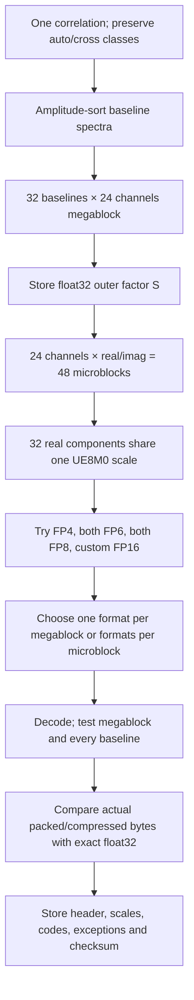

# Two-level microscaling experiment

Status: measured experimental DATA component codec; not integrated into the
archival CLI. The existing archive defaults and scientific policies are unchanged.
No ML accuracy result is used as evidence of astronomical fidelity.

## Formats and prior art

The [OCP MX 1.1 specification, 9 October 2026](https://www.opencompute.org/wp-content/uploads/2026/10/OCP_MicroXcaling_Spec_v1.1.0-1.pdf)
defines these floating-point combinations, each with a shared 8-bit UE8M0 scale
for 32 real elements:

| Component bits | Element formats |
| ---: | --- |
| 4 | E2M1 |
| 6 | E2M3, E3M2 |
| 8 | E4M3, E5M2 |

UE8M0 is a positive power of two, with exponent -127 through 127. The all-ones
byte denotes NaN. MXFP16 is absent from that specification. This experiment's
16-bit candidate uses IEEE binary16 elements with shared scales and is named
`custom-scaled-FP16`. It is lossy; exact float32 remains a separate candidate.
The earlier [MX 1.0 specification](https://www.opencompute.org/documents/ocp-microscaling-formats-mx-v1-0-spec-final-pdf)
uses the name E8M0 for the scale representation.

A higher-precision outer scale over multiple microblocks also has prior art.
[Chhugani et al., Macro Block Scaling](https://arxiv.org/html/2603.08713v1)
investigate related two-level scaling for neural-network data. That establishes
related engineering work, not visibility-fidelity guarantees or novelty here.

## Exact experiment definition

One megablock is at most **32 baseline rows × 24 channels × 1 correlation**:
768 complex values, 1,536 float32 components, 6,144 original bytes. Baselines
retain their complete spectra during ordering. Amplitude order is independent
per product, with auto/cross and no-valid classes separated, as in the existing
codec. Partial groups retain their actual row/channel dimensions.

Within one megablock, each channel has a real microblock and an imaginary
microblock. Each covers 32 baselines, giving **48 microblocks**. This deliberately
chooses the baseline direction; channel-direction microscaling is not measured
in this first experiment. Missing edge rows are zero-padded within the stored
32-component microblocks and are not restored as extra MS rows.



The decoder computes each real component as

$$
\widehat x_{gmi}=\operatorname{float32}\left[
 \operatorname{float64}(S_g)\,
 \operatorname{ldexp}\left(\operatorname{float64}(c_{gmi}),e_{gm}\right)
\right].
$$

The operation order is float64 `ldexp`, float64 outer multiplication, then one
float32 rounding. No hidden multiply-add or quantized outer factor is used.
The exact-component option in a mixed microblock bypasses both multiplications.

Controls use either `S=1` or `S=max(abs(real),abs(imag))` over unprotected values
in the megablock, stored in float32. Zero-range blocks use `S=1`. The latter is
a simple tested outer-factor rule, not an optimized scale search. An outer
power of two would mostly shift the micro exponents without changing the grid;
a general float32 factor can shift the grid relative to the samples.

For each element format with maximum magnitude `cmax`, each micro exponent is
`ceil(log2(amax / (S*cmax)))`, clipped to the supported exponent range. A check
raises the exponent if floating-point evaluation left the maximum out of range.
This is a range-covering scale rule, not a claim to implement every OCP conversion
mode. Nearest rounding uses an even least-significant code bit at exact ties.
FP6 and FP4 subnormals are supported; 6-bit values are actually bit-packed.

Flagged values, nonfinite values, and negative-zero-containing complex samples
are excluded from scale estimation and preserved by original bits. Any remaining
overflow or nonfinite reconstruction becomes an exact complex exception. There
is no silent saturation. Ordinary zero needs no exception when reconstructed
exactly. Flags and all metadata remain exact in the source-assisted MS export.

The `mega` policy evaluates all six element formats, each applied to all 48
microblocks, against exact storage. The `micro` policy adds one mixed candidate:
it selects the lowest-bit passing format for each microblock, breaking equal-bit
ties by lower scalar MSE. Local checks use the component MSE ceiling, and the
complex maximum/bias ceilings divided by sqrt(2). A local exact32 option remains
available. The assembled candidate must then pass all original megablock and
per-baseline checks. If it fails, the uniform-format candidates and exact block
remain available. This is a conservative allocation heuristic, not an exhaustive
search of all mixed-format combinations.

Candidates compete using actual bytes after packing and optional zlib level 1,
including headers, scales, tags, exceptions and padding. Exact storage competes
under the same secondary-compression policy. The principal limits are component
MSE 1e-7, within-block per-baseline MSE 2e-7, maximum complex error 0.003 and
absolute complex mean bias 0.0003, all in stored DATA units (squared for MSE).
No validated thermal-noise model is assumed. Whole-product checks are also run.

## Small custom record, established outer container

The prototype adds a binary block payload inside indexed HDF5 datasets. There
is no demonstrated reason yet to replace HDF5 with a bespoke archive container.
The component file intentionally contains only DATA, permutations, record maps,
quality arrays and configuration. **It is not a standalone MS archive**: exporting
an MS still requires the original source for exact metadata and auxiliary columns.
The reference component decoder requires only the component file to restore DATA.

The embedded grouping/control configuration is inherited from the uniform
experiment setup; its `bits` and `codebook` fields describe the uniform control.
For MX records the variant and immutable block format IDs define the actual
4/6/8/16 candidate formats. The study report labels this distinction explicitly.

`MXB1` is an experimental immutable block identifier. A 32-byte little-endian
header uses struct format `<4sBBBBHHfIIII`:

| Field | Bytes | Meaning |
| --- | ---: | --- |
| Magic | 4 | ASCII MXB1 |
| Compression | 1 | 0 raw, 1 zlib |
| Format ID | 1 | 0 exact block, 1–6 element format, 255 mixed |
| Layout | 1 | 0: channel/component/baseline micro ordering |
| Reserved | 1 | Must be zero |
| Rows; channels | 2 + 2 | Actual shape, at most 32 × 24 |
| Outer scale | 4 | Positive finite float32 |
| Exception count | 4 | Number of exact complex samples |
| Raw; stored body lengths | 4 + 4 | Bounded lengths |
| CRC32 | 4 | Header excluding CRC, followed by stored body |

Element IDs 1–6 are E2M1, E2M3, E3M2, E4M3, E5M2, custom scaled FP16.
For mixed blocks, the body begins with one format tag per microblock (ID 0 means
exact real float32 elements). All quantized megablocks then contain one UE8M0
scale byte per microblock. Exact microblocks use canonical scale byte 127.
Code banks follow in increasing format ID, retaining microblock order within
each bank. Within a microblock the original archived baseline order is retained.
Codes are little-endian, least-significant bit first, without alignment padding
between codes. Every microblock has 32 stored elements, including edge padding.

The body ends with sorted uint16 row-major complex-sample positions, followed by
their original complex64 bits: 10 bytes per exception. Positions fit because a
megablock has at most 768 complex samples. Exact whole blocks store just their
actual-shape complex64 bytes. Declared lengths, format IDs, scale values, reserved
element codes, CRC, exception positions and truncated/extra data are checked.
Decompression is bounded to 16,384 raw bytes per block.

Full-block costs before secondary compression, exceptions and external indexes:

| Bits per real component | Codes | Micro scales | Header | Total bytes |
| ---: | ---: | ---: | ---: | ---: |
| 4 | 768 | 48 | 32 | 848 |
| 6 | 1,152 | 48 | 32 | 1,232 |
| 8 | 1,536 | 48 | 32 | 1,616 |
| 16 | 3,072 | 48 | 32 | 3,152 |

Mixed formats add 48 tag bytes to a full block. The outer factor is already
inside the header. HDF5 holds a uint64 offset array, a five-uint32 record map
(product, archived-row start/stop, channel start/stop), and the actual per-product
permutations. Those maps and all container overhead are counted separately.
HDF5 payload chunks are 1 MiB, independent of quantization boundaries.

## Reproduction and timing scope

```bash
PYTHONPATH=src OPENBLAS_NUM_THREADS=1 OMP_NUM_THREADS=1 \
  python scripts/evaluate_mx.py INPUT.ms --output results/mx-new \
  --variant max-micro --export-ms
```

Other variants are `unit-mega`, `max-mega`, `unit-micro` and `uniform` (the existing
4/8/12/16-bit integer codec at the same 32×24 shape). Use `--sample-groups 16`
for deterministic evenly spaced groups, including extremes, before full runs.
The sample is not a random population estimate. `--mse` changes the MSE ceiling
and sets the per-baseline ceiling to twice that value. Unknown options fail.

Each candidate uses a fresh process with one CPU worker, batches of 128 megablocks,
and warm/unspecified cache on the same shared host. Times include inspection,
reading, ordering, candidate search, packing/compression, writing, per-block
independent decoding and error checks. A separate complete-file decode validates
record maps and exact equality with encode-time reconstruction. Export and imaging
are separate. These are diagnostic prototype timings, with possible documentation
and synthetic-test work, not the production encoder's isolated 24-worker benchmark.

The full run independently checks all supported source/export metadata and
non-DATA columns using `compare_ms`, including exact original UVW, flags and
weights. Source file SHA-256 inventories bracket the full experiment series.

## Measurements

All four full-data runs cover 47,714,304 complex samples in 62,144 megablocks.
They use the same 32×24 shape and independent amplitude ordering. The stricter
uniform control changes the component/per-baseline MSE ceilings to 1e-8/2e-8;
maximum error and bias ceilings remain unchanged. Whole-product checks pass.

| Codec | Serialized blocks MB | Component file MB | Component MSE | Maximum complex error |
| --- | ---: | ---: | ---: | ---: |
| Uniform 4/8/12/16, original ceilings | 101.569 | 107.935 | 3.1149e-8 | 0.00078872 |
| MX, unit outer factor, mixed formats | 172.260 | 179.268 | 5.0988e-9 | 0.00286072 |
| MX, float32 outer factor, mixed formats | 171.725 | 178.222 | 5.2093e-9 | 0.00282696 |
| Uniform 4/8/12/16, tighter MSE ceilings | 138.239 | 144.653 | 7.0993e-10 | 0.00025058 |

Serialized bytes include headers, scales, tags and exceptions after actual joint
secondary compression. Component files additionally include permutations, record
maps, quality arrays, configuration and HDF5 overhead. These are **not whole-MS
archive sizes**. The existing 106.731 MB archive uses a different 128×192 grouping
and preserves all MS information, so it is not inserted into this table.

The tighter uniform control uses **19.50% fewer serialized bytes** than outer-scale
MX, with **7.34× lower component MSE**, lower maximum error, lower maximum
within-block per-baseline MSE (1.5314e-8 versus 1.9988e-7), and lower maximum block
bias (1.2159e-5 versus 3.7532e-5). Thus this measured MX configuration does not
improve the visibility rate–distortion tradeoff over the uniform controls.
This is evidence about these scale rules, direction and allocation heuristic,
not an impossibility result for all microscaling designs.

The outer factor saves 534,900 serialized bytes (**0.311%**) relative to the
unit-factor MX control, while mean component MSE rises slightly. The initial
512-megablock rank sample compared both allocation granularities: serialized
bytes were 1,408,974 (unit/mega), 1,404,597 (outer/mega), 1,404,309 (unit/micro),
and 1,399,499 (outer/micro). Those sample results motivated the two full-data
mixed-format runs; whole-megablock-only allocation was not rerun on the full MS.

Outer-scale MX real-component shares are 4-bit **2.398%**, 6-bit **4.027%**,
8-bit **3.650%**, custom FP16 **89.649%**, and exact float32 **0.275%**.
The low-mantissa FP4/6/8 elements generally cannot meet the absolute error budgets
on this observation. Uniform 12-bit components offer an intermediate precision
that is absent from the tested MX ladder. The 4/6/8/16 label alone therefore
does not imply better rate–distortion than 4/8/12/16 scaled integers.

Before compression, outer-scale MX uses 179,711,176 code bytes, 2,974,944 micro-scale
bytes, 684,576 format-tag bytes, 1,988,608 header bytes and zero exception bytes.
Headers include 248,576 bytes of outer float32 fields, including exact blocks'
canonical factor. The body compresses from 183,370,696 to 169,736,890 bytes.
The dominant remaining cost is the FP16 code payload, not the outer factor or
custom header. Changing the outer container cannot remove that precision cost.

The three initial full runs were sequential, without a concurrent imaging job.
Single-worker component-experiment times were 132.50 s (uniform), 165.05 s
(unit-factor MX), and 167.73 s (outer-factor MX). Outer-factor MX spent 114.81 s
in candidate selection/packing/compression and 40.06 s in per-block decoding and
source checks. Separate complete-file decoding took 39.89 s. These measurements
include work outside the production encoder's timer and use one worker, versus
24 in the 12.19 s production benchmark. This reference MX prototype has not
demonstrated a complete archive encode within 15 s. The supplemental tighter
uniform run overlapped the imaging job; its latency is not used for comparison.

The full outer-scale MX reconstruction was exported to a new MS and passed exact
comparisons for 132 supported non-DATA column entries and metadata. DATA from a
fresh standalone component-file decode matched encode-time reconstruction bitwise.
Source file inventories contained 65 files and remained unchanged. Unit tests
include independently tabulated format extrema, every positive code, nearest-even
midpoints, negative zero, nonfinite payloads, all-flagged input, partial blocks,
exact escape, record corruption/truncation, and independent mapped reconstruction.


Full machine-readable evidence is in [microscaling-evaluation.json](../reports/microscaling-evaluation.json).
Regenerate these figures and the summary with `python scripts/report_mx.py` after
running the component experiments. The reference implementation is
[`experimental_mx.py`](../src/varquanms/experimental_mx.py); it does not change the
production codec, archive schema or CLI defaults.

## WSClean validation

The outer-factor, mixed-format reconstruction was imaged with the same pinned
WSClean 3.7 container as the existing reference: 2048×2048, 4 arcmin/pixel, Stokes I,
Briggs 0, multiscale, one thread, common restoring beam, auto-mask 5,
auto-threshold 1, and 10,000 iterations. Both the original and candidate reach
that iteration cap; CLEAN convergence is not established. The candidate imaging
job took 272.52 s including its private copy and source checks. It overlapped
only the supplemental tight-uniform component run, not the three initial timings.

| Product | Relative RMS difference over valid celestial footprint |
| --- | ---: |
| Dirty | 0.06655% |
| Restored | 0.70078% |
| Model | 4.93611% |
| Residual | 1.56852% |
| PSF | 0% |

The PSF is identical. The reconstructed visibility error and dirty-image error
are lower than the earlier production-profile example, but the restored-image
change remains about 0.7%; different CLEAN paths limit what can be inferred from
visibility MSE alone. The tighter uniform control has not been imaged, so its
image-domain superiority is not claimed. These metrics do not establish thermal
noise, calibrated solar flux, weak-polarization preservation, calibration-solution
stability or temporal fidelity. Existing valid-footprint masks and image metric
definitions are retained. Full evidence is in [wsclean-mx.json](../reports/wsclean-mx.json).


The result supports retaining this as an experimental codec. Keep the production
uniform archive as the current reference. A next experiment could compare
microscaled integers (including an intermediate 12-bit rung), other microblock
directions, or optimized outer factors, with the same full byte accounting and
science checks. Replacing the complete archive container is not justified by
these measurements.
