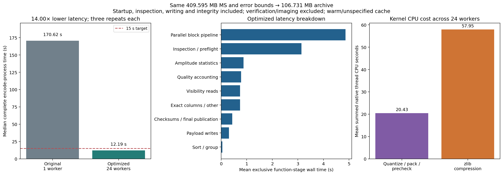

# Profiling and the under-15-second encoder

On 23 October 2026, three fresh encode processes took **12.663, 12.190 and
11.709 seconds** for the inspected 409,594,838-byte MS. All three finished within
15 seconds and passed source verification. The median is **12.190 s**, versus
170.620 s for the earlier encoder: **14.00× lower latency**. The measured preset
uses 24 workers on the existing 48-logical-CPU Xeon Silver 4214 host.

The median complete archive is **106,731,153 bytes**. The quantization ladder,
grouping, scales, error bounds, exact exceptions and flag/weight preservation
policies are unchanged. All 121 inventoried datasets outside numerical quality
arrays match the baseline bit-for-bit, including packed visibility bodies,
permutations and every exact coordinate/auxiliary array. Thus the decoded DATA
and scientific inputs to the existing matched WSClean test are unchanged.
No new imaging run was needed or claimed for this implementation change.



## Scope of the timing

The complete encode-process timer includes Python startup, full input inspection,
metadata preservation, grouping, all precision/scale candidates, measured error
checks, quality arrays, HDF5 writes, checksums, manifest and fsync/publication.
It excludes the original NAS copy/extraction, verification, MS export and imaging.
Each verification ran afterward, taking 8.844–9.334 s. Export and an independent
verification with native kernels disabled also passed for the second repeat.

This is a warm/unspecified-cache, shared-host experiment. The final three repeats
ran sequentially without this task launching profiling, unit tests or image/figure
work concurrently. There was no cache eviction, CPU affinity or resource isolation.
The observed maximum is 12.663 s; this is not a universal latency guarantee for
other machines, error bounds or observations. The speedup combines implementation
changes and parallelism, rather than representing a 14× single-core speedup.

Median throughput is 33.602 MB/s of physical input size, or 3.914 million complex
samples/s. Median peak process RSS is 1.573 GiB. The whole selected visibility
array still resides in RAM. OMP, OpenBLAS and MKL limits were 1; the 24 workers are
explicit encoder threads, not an implicit BLAS setting.

## What the profiler found

A separate baseline cProfile run spent 45.104 s directly in `zlib.compress`,
29.454 s in the old `pack_codes`, 14.089 s directly in `error_metrics`, and
21.084 s in NumPy reductions across callers. These are **self times**; cumulative
parent/child times must not be added. The baseline profile's internal encode time
was 157.272 s, while the earlier three-run process median was 170.620 s; profile
and benchmark samples are kept distinct.

Sorting was already inexpensive (about 0.04 s). The expensive work was generating,
packing, compressing and decoding many candidates, plus repeated array passes.

Changes:

1. Pack/unpack 4/8/12/16-bit codes directly by bytes, eliminating the large
   samples-by-bits temporary. Legacy 2/6-bit packing remains supported.
2. Fuse the nearest-rounding candidate search into an optional C kernel. It
   releases the interpreter lock through quantization, packing, error prechecks
   and zlib compression. Every winner still passes the portable decoder and strict
   NumPy checks. Boundary misses retry the reference search; exact float32 always
   competes. Stochastic rounding and explicit p99 criteria retain reference selection.
3. Use bounded worker queues, deterministic output order and fixed PRNG stream IDs.
   Only the parent accesses casacore and HDF5.
4. Compute amplitude statistics across products concurrently. Fuse quality moments
   into fixed 1024-row chunks, merge in deterministic order, and preserve paired
   covariance masks and exact protected-value checks.
5. Reuse the full inspection's proven cell shapes and read flags in row batches,
   avoiding redundant per-row visibility reads.
6. Give HDF5 an 8 MiB chunk cache. The old smaller cache repeatedly recompressed
   large chunks on partial row writes. Profiled dataset-write self time fell from
   1.909 s to 0.216 s. Checksums and durable finalization are retained.

## Remaining costs

| Exclusive function stage | Mean wall seconds |
| --- | ---: |
| Parallel block pipeline | 4.863 |
| Inspection/preflight | 3.141 |
| Amplitude statistics | 0.878 |
| Quality accounting and writes | 0.781 |
| Visibility input reads | 0.740 |
| Exact-column work and other overhead | 0.737 |
| Integrity/final publication | 0.437 |
| Visibility payload writes | 0.305 |
| Sorting/grouping | 0.049 |

These sum to the mean internal encode time, 11.932 s. The process timer adds
startup and report serialization. Within native search, mean **summed thread CPU
time** is 57.947 s in compression and 20.433 s in quantization/packing/prechecks.
Compression is about 74% of those two kernel CPU categories. Those parallel CPU
seconds overlap; they are not additional wall time.

The optimized cProfile run reports 4.596 s in lock acquisition primarily while
the parent waits for futures. That is not evidence that locks themselves consume
4.596 CPU seconds. cProfile follows the calling thread; native thread CPU counters
and the measured pipeline wall timer provide the worker evidence.

Quality arithmetic now records `native-moments-v2`. Its reduction order differs
from the earlier NumPy path, changing last bits in quality summaries and a small
number of their compressed bytes. This does not change decoded visibilities.
Portable verification recomputes independent NumPy statistics with the documented
rounding tolerance, while enforcing scientific error limits strictly. See the
[format contract](../docs/format.md#optional-cpu-acceleration-and-quality-arithmetic).

## Running it

Install with a C compiler, Python development headers and zlib development headers
available. Native compilation is optional so the portable implementation remains
usable; check that it succeeded before expecting these performance figures:

```bash
python -m pip install -e '.[validation]'
python -c 'from varquanms import _native; print("native kernels available")'
OMP_NUM_THREADS=1 OPENBLAS_NUM_THREADS=1 MKL_NUM_THREADS=1 \
  visarchive encode INPUT.ms NEW.archive.h5 \
  --config configs/performance-adaptive.json --report encode.json

# Override the preset's worker count if needed:
visarchive encode INPUT.ms ANOTHER.archive.h5 \
  --config configs/performance-adaptive.json --workers 16

OMP_NUM_THREADS=1 OPENBLAS_NUM_THREADS=1 MKL_NUM_THREADS=1 \
  visarchive benchmark INPUT.ms --matrix configs/benchmark-performance.json \
  --output results/new-performance-run

# Run profiling separately from benchmark repeats:
python -m cProfile -o results/profile.prof -m varquanms encode INPUT.ms \
  results/profile.archive.h5 --config configs/performance-adaptive.json
```

Default mode remains lossless and default worker count remains one. The performance
preset is an explicit lossy engineering experiment using the existing bounds.
It is tuned to this host and sample, rather than a science-approved archival default.

Evidence: [timings/configurations/environment/source hashes](../reports/performance-runtime.json),
[profile and identity/independent-verification summary](../reports/performance-profile.json),
[original timing benchmark](../reports/paper-runtime.json). The raw `.prof` files,
MSs and archives remain in ignored `results/`; no executable profile serialization
is included in the archive format or published reports.
