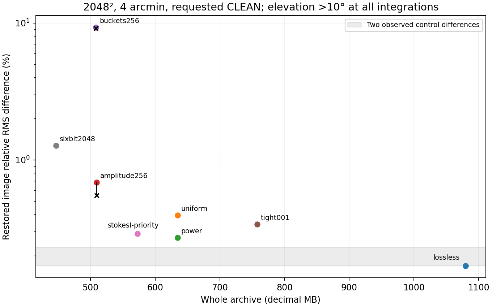
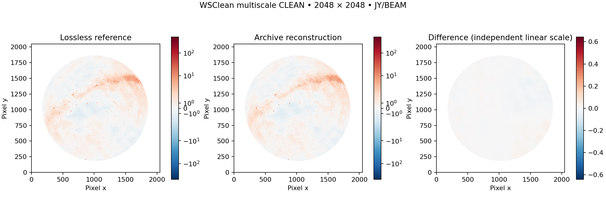
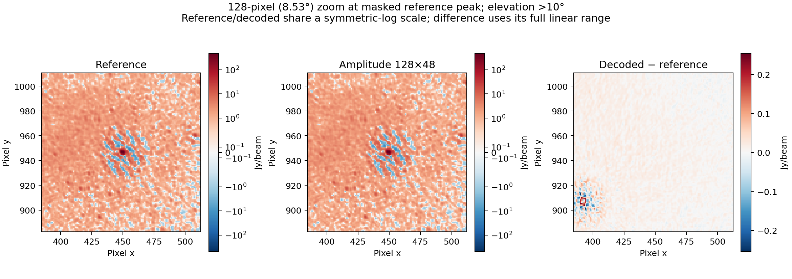
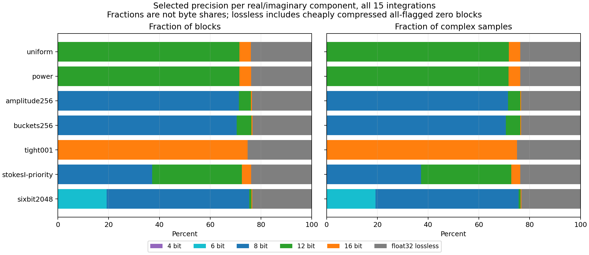
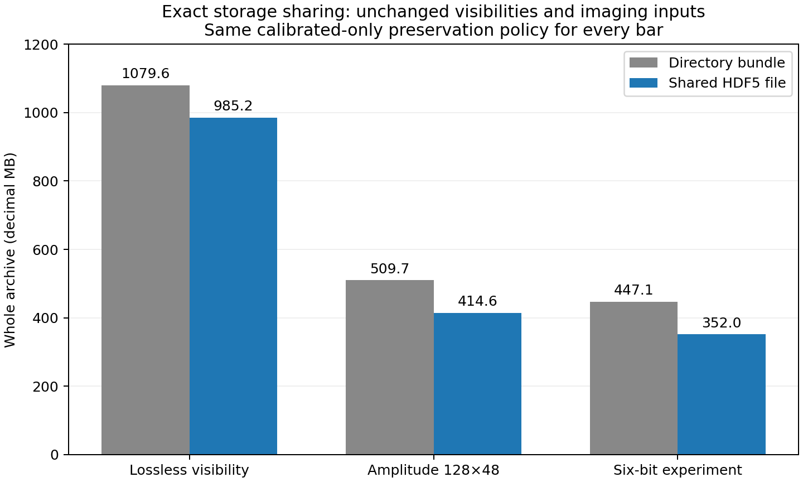

# Calibrated data compression tests

Completed 2026-10-23/24. Tracking: [Calibrated data compression #1](https://github.com/peijin94/vamp/issues/1). The paper is unchanged.

25 October follow-up: [fixed epsilon D with the expanded bit ladder](epsd-dense.md)
adds three calibrated-data experiments and a rewritten methods paper.

Input: `lwa-15slot-flat.ms`, 15 integrations, 931,920 rows, 48 channels (63.966–68.464 MHz), XX/XY/YX/YY. The source is 4,428,203,949 bytes. All 108 files still match the original import checksums. Every archive uses the same calibrated-only policy: omit original DATA/MODEL_DATA, replace flagged values with zero, preserve flags and original UVW/metadata, and encode weights with four bits. Weights are **exact** on this dataset. Default exports recreate calibrated DATA from decoded CORRECTED_DATA.

## CLEAN template and comparison region

```text
wsclean -size 2048 2048 -scale 4amin -data-column CORRECTED_DATA
  -j 8 -pol I -multiscale -multiscale-scale-bias 0.8
  -niter 150000 -mgain 0.95 -auto-threshold 0.5 -auto-mask 3
  -local-rms -horizon-mask 10deg -weight briggs 0 -mem 40
  -reorder -no-update-model-required
```

All runs use the same pinned WSClean 3.7 container, private MS copies, and the reference restoring beam. `-mem 40` is a percentage of system memory. Exact commands, container IDs, source/FITS checksums, beam, iterations and software versions are recorded in the [machine-readable report](../reports/calibrated-template-tests.json).

All image metrics, peaks, apertures and plots use **2,245,726 pixels above 10° elevation at every one of the 15 original TIME epochs**. The mask uses celestial FITS WCS, mean antenna ITRF position, UTC times, Astropy and zero refraction. Original UVW is never regenerated. The independently computed mask differs slightly from WSClean’s own horizon mask (2,250,505 pixels); the same independent mask is used for every comparison. IERS final values cover all epochs. The retained table from `https://maia.usno.navy.mil/ser7/finals2000A.all` has SHA256 `95a61292c957fa74ed624bd4f7a84b1b984077e412b43ed39b99e092f38de9da`.

Reported relative RMS is $100\sqrt{\langle(\widehat I-I)^2\rangle}/\sqrt{\langle I^2\rangle}$ over that mask. It is not a thermal-noise measurement. Faint pixels have $|I|<0.01\max|I|$ in the masked reference. Apertures contain pixels within radius four of the brightest absolute reference pixel; they are not identified solar photometry.

## Whole-dataset image results

| Profile | Whole archive (MB) | Dirty difference (%) | Restored difference (%) | Faint-region difference (%) | Peak change (%) |
| --- | ---: | ---: | ---: | ---: | ---: |
| reference-repeat | — | 0.000045 | 0.2287 | 0.3488 | +0.002286 |
| lossless | 1079.629 | 0.000058 | 0.1683 | 0.2576 | +0.000781 |
| uniform | 634.554 | 0.007096 | 0.3940 | 0.6043 | +0.001693 |
| power | 634.659 | 0.007543 | 0.2702 | 0.4136 | +0.000475 |
| amplitude256 | 509.714 | 0.113410 | 0.6861 | 1.0453 | +0.000856 |
| buckets256 | 508.698 | 0.117361 | 9.2569 | 14.2009 | +0.004072 |
| tight001 | 757.832 | 0.000629 | 0.3381 | 0.5180 | +0.001143 |
| stokesI-priority | 572.851 | 0.007096 | 0.2892 | 0.4425 | +0.002067 |
| sixbit2048 | 447.123 | 0.174145 | 1.2703 | 1.9332 | -0.000162 |

MB is decimal. `lossless` means lossless visibilities under the same destructive calibrated-only policy. Ratios against the original 4.428 GB include intentionally omitted columns and flagged values; use the 1.080 GB calibrated-only lossless archive to isolate the incremental benefit of quantization.

| Repeated candidate | First versus reference (%) | Repeat versus reference (%) | Repeat versus first (%) |
| --- | ---: | ---: | ---: |
| amplitude256 | 0.6861 | 0.5496 | 0.3788 |
| buckets256 | 9.2569 | 9.1830 | 0.2355 |

**Working choice for this dataset and Stokes I:** `amplitude256`, 128 baselines × 48 channels × one product. It gives 509.7 MB and 0.55–0.69% restored-image differences in two runs, versus 1,079.6 MB for the same-policy lossless archive. Its first-run maximum image difference is 0.642 Jy/beam and faint-region relative RMS is 1.045%; small global RMS does not mean every weak feature is unchanged.

`sixbit2048` is smaller at 447.1 MB but gives 1.270% restored and 1.933% faint-region differences. This explicitly adds a six-bit experimental rung; the default precision ladder remains 4/8/12/16. **Reject the tested `buckets256` configuration for this image-fidelity objective:** it saves only about 1 MB relative to amplitude256, but repeatedly produces about 9.2% restored and 14.1–14.2% faint-region differences. Visibility component MSEs are nearly equal (172.508 amplitude versus 174.335 buckets), and dirty-image differences are close. The large difference appears after nonlinear CLEAN; its detailed cause is not established. These configurations also differ in block size and channel segmentation, so this is not an isolated test of ordering.

`stokesI-priority` saves about 62 MB relative to the earlier uniform archive by relaxing XY/YX bounds. Across all 15 partitions, 150 checksum comparisons confirm identical XX/YY payloads and reconstruction mappings to `uniform`. Their different CLEAN results are imaging variability, not an improvement in Stokes I quantization. Neither this profile nor these Stokes I tests establish Q/U/V fidelity. Two reference controls and two candidate repeats do not establish a full statistical distribution of CLEAN variability.



Vertical axis is logarithmic. Black crosses/segments show the two observed candidate runs, not confidence intervals. The shaded band spans the two lossless/reference controls.





The 128-pixel zoom spans 8.53 degrees in image coordinates. Reference and decoded panels share their colour scale; the difference has a separate linear scale. All panels exclude pixels at or below the elevation cut.



Precision fractions count blocks or complex samples, not stored bytes. Lossless includes all-flagged zero blocks; their compressed cost can be small. No four-bit blocks were selected in amplitude256.

[All tested profiles, including the failed bucket configuration](figs/calibrated-test-differences.png). These diagnostic difference maps share a symmetric-log scale and clip extremes at the largest candidate 99.9th-percentile absolute difference; all numerical metrics are unclipped.

## Grouping and precision controls

A deterministic 28-case screen sampled up to 128 groups per product in the first integration. It covered per-baseline scaling, original-order groups, amplitude sorting, factor-of-two amplitude buckets, length/orientation grouping and median/power quantization, with component-MSE ceilings 0.01/1/64/256. Different groupings sampled different values, and these payload rates exclude metadata; the screen is a shortlist, not a whole-MS rate-distortion proof. All sampled results are in the JSON report.

The following controls encode and verify **every sample of the first integration**, counting whole archives:

| First-integration control | Whole archive (MB) | Achieved component MSE | Encode call including inspection (s) |
| --- | ---: | ---: | ---: |
| baseline-mse1 | 56.149 | 0.400261 | 768.23 |
| original32-mse1 | 44.171 | 0.603433 | 39.71 |
| amplitude32-mse1 | 43.444 | 0.682396 | 41.01 |
| buckets32-mse1 | 44.242 | 0.672015 | 48.37 |
| amplitude128-mse1 | 42.244 | 0.664922 | 27.32 |
| amplitude128-mse0.25 | 50.495 | 0.006441 | 9.95 |
| original32-mse0.25 | 50.337 | 0.010464 | 43.87 |

`baseline` uses 1×24 blocks without sorting; the `32` controls use 32×24; `amplitude128` uses 128×48. `original32` keeps original order within auto/cross and no-valid-data classes, without amplitude sorting. Grouping can improve both size and error in this prototype: original32 at MSE ceiling 0.25 uses 50.34 MB with achieved MSE 0.01046, versus 56.15 MB and MSE 0.40026 for per-baseline scaling at ceiling 1. The latter also spends much longer encoding tiny blocks. For matched 32×24 shapes and ceiling 1, amplitude sorting is 1.8% smaller than buckets but has slightly higher achieved MSE; that does not establish a sorting advantage at equal error.

All quantized full-dataset candidates use independent per-product orderings, 4/8/12/16-bit component rails (plus 6 in the explicit experiment), max/.995 range candidates, float32 scales, exceptions and exact float32 fallback. The uniform candidates have no offset; the power control uses component medians and gamma choices 1/.5. Bounds use stored CORRECTED_DATA units, with no thermal-noise claim. For MSE ceiling B, the tested baseline-MSE, maximum complex error and complex bias ceilings are 2B, 10√B and √B. Names indicate B: uniform/power=1, amplitude256/buckets256=256, tight001=.01, sixbit2048=2048. Stokes-I priority uses B=1 for XX/YY and B=256 for XY/YX. Exact configurations are in `configs/calibrated-test-*.json`.

## Time and byte accounting

| Profile | Encoding only, summed over 15 partitions (s) | Complete verified bundle (s) | MS export (s) | WSClean only (s) |
| --- | ---: | ---: | ---: | ---: |
| lossless | 90.29 | 318.19 | not retained | 171.00 |
| uniform | 132.68 | 369.43 | not retained | 180.80 |
| power | 146.76 | 396.51 | not retained | 175.16 |
| amplitude256 | 124.56 | 606.59 | 48.39 | 179.06 |
| buckets256 | 595.34 | 1433.64 | 120.07 | 161.00 |
| tight001 | 143.92 | 1004.31 | 59.06 | 153.44 |
| stokesI-priority | 124.74 | 593.98 | 71.89 | 196.74 |
| sixbit2048 | 136.34 | 1007.65 | 51.92 | 173.41 |

Host: inti.solar.pvt, Intel(R) Xeon(R) Silver 4214 CPU @ 2.20GHz, 48 logical CPUs. Quantized full-dataset encodes use 24 workers; first-integration controls use eight; WSClean uses eight threads. Runs shared the host and overlapped other work; caches were not evicted. These are workload observations, not isolated latency rankings. The first three archives reuse encoding measurements from the earlier session, but all images use the new template. Complete bundle time includes partition copying, inspection and verification; MS export and imaging are separate. No 15-second complete conversion of this 15-integration MS is demonstrated.

For amplitude256, 314.57 MB is allocated visibility block payload, 83.01 MB repeated subtable arrays, 41.51 MB error-accounting arrays, 21.08 MB amplitude statistics, 19.58 MB coordinates, and the rest maps/container metadata. All categories sum to the whole archive. Its 29,224 blocks select 20,825×8-bit, 1,401×12-bit, 120×16-bit and 6,878 lossless; many lossless blocks are cheaply compressed all-flagged zero blocks, not failed error budgets. No four-bit blocks were selected. Complete per-profile histograms, error statistics, exception costs and bytes are in the JSON.

A lossless recompression probe on a 42.248 MB first-partition archive produced 41.194 MB (gzip 1) and 40.791 MB (gzip 9), with every logical-array checksum unchanged. This 2.5–3.4% gain is modest. Repeated subtables and quality arrays are significant remaining costs. Repeated subtables are candidates for exact sharing; the error arrays generally differ and cannot be assumed redundant.

## Reproduction and limits

```bash
export PYTHONPATH=src OPENBLAS_NUM_THREADS=1 OMP_NUM_THREADS=1
python scripts/run_wsclean.py INPUT.ms --output REFERENCE --data-column CORRECTED_DATA --clean-profile calibrated --threads 8
python scripts/make_elevation_mask.py INPUT.ms REFERENCE/image-image.fits above10deg.fits --iers-file finals2000A.all
python scripts/timeslot_archive.py encode INPUT.ms NEW.bundle --config configs/calibrated-test-amplitude256.json --report encode.json
python scripts/validate_partition_export.py NEW.bundle INPUT.ms NEW.ms --report export.json
python scripts/run_wsclean.py NEW.ms --output IMAGES --data-column CORRECTED_DATA --clean-profile calibrated --threads 8 --beam-from REFERENCE/image-image.fits
python scripts/compare_wsclean.py REFERENCE IMAGES --mask above10deg.fits --report comparison.json
```

Use new output paths. `scripts/screen_calibrated.py` reproduces the block screen; `scripts/probe_archive_recompression.py` measures lossless repacking. Local full-resolution FITS, archives, exports, commands and logs are under ignored `results/calibrated-template/`. `scripts/report_calibrated_tests.py` collects them into this note, the figures and the JSON report.

This is joint Stokes I imaging of one 15-integration dataset. It does not validate individual time frames, transient light curves, weak polarization, spectra, calibration solutions, absolute flux or a held-out dataset. No Dysco comparison was run here. The recommendation is specific to this experiment, not a universal scientific archive default.

References: [WSClean local RMS](https://wsclean.readthedocs.io/en/v3.6/local_rms_thresholding.html), [WSClean masks](https://wsclean.readthedocs.io/en/v3.7/masking.html), [Astropy AltAz](https://docs.astropy.org/en/stable/api/astropy.coordinates.AltAz.html).

## Follow-up: exact sharing across integrations

A new single-file HDF5 representation shares only bitwise-identical arrays and compresses manifest JSON. Original scientific manifests, payloads, scales, codebooks, flags, weights, UVW and reconstruction maps are unchanged. This is a storage change with no second quantization pass.

| Profile | Directory bundle (MB) | Shared HDF5 (MB) | Additional repack including checks (s) |
| --- | ---: | ---: | ---: |
| lossless | 1079.629 | 985.236 | 67.62 |
| amplitude256 | 509.714 | 414.599 | 44.25 |
| sixbit2048 | 447.123 | 352.006 | 21.66 |



The working amplitude profile is now **414.6 MB**, versus 985.2 MB for lossless visibility under the same storage and preservation policies. Its independent export matches the previously imaged export in all 147 supported column/metadata checks, bit for bit. All 108 original source-file checksums still match. The existing 0.55–0.69% Stokes I image differences therefore describe unchanged imaging inputs; no new CLEAN run was needed to assess this lossless storage transformation. CLEAN itself remains subject to the previously measured run-to-run variability.

All three shared archives passed full inventory checks and exact scientific-manifest comparison. The amplitude profile additionally passed full MS export/source verification and equality against the prior export. The six-bit profile retains its earlier 1.27% global and 1.93% faint-region image differences.

For amplitude256, exact duplicate arrays remove 82.11 MB, including 77.48 MB of repeated subtables. Manifest compression and container repacking account for the remaining saving. Visibility payload and error-accounting arrays still occupy 314.57 MB and 41.51 MB, respectively; the latter were not assumed redundant.

Repacking took 44.25 s: 32.60 s input validation, 4.91 s copying/sharing, and 5.67 s output validation, plus final accounting/publication. This time is additional to creating the directory bundle. It is not a 44-second MS encoder. The earlier 606.6 s MS-to-bundle run spent 168.9 s copying partitions, 152.1 s inspecting, 124.6 s encoding, and 161.0 s in verification/integrity/other work. About 79.5% was outside encoding; eliminating repeated copies and inspections is the next speed target. These phase timings are shared-host observations, not isolated CPU profiles. The 15-second full-conversion target remains unmet.

```bash
python scripts/timeslot_archive.py compact NEW.bundle SHARED.h5 --report compact.json
python scripts/validate_partition_export.py SHARED.h5 INPUT.ms SHARED.ms --report shared-export.json
```

See the [machine-readable sharing report](../reports/calibrated-shared-storage.json) and [format contract](../docs/format.md#shared-partition-storage-varquanmsshared-partitions1). The source bundle is retained; the shared file can be relocated and decoded independently. Local fixtures cover special-value bits, calibrated DATA reconstruction, direct access to a later partition, and rejection of corrupt payloads, mappings, missing data, unsafe links and incomplete files. The local suite has 95 passing tests.

Follow-up: [gamma selection from maximum/std](gamma_max_std.md) compares two ratio rules with full gamma search, including matched-block rates, complete shared archives and the same elevation-masked CLEAN test.

Follow-up: [absolute versus relative error limits](absolute_relative_error.md) compares absolute, block-relative and hybrid thresholds at matched sampled payload rates, with full-data archives and repeated CLEAN images.

Follow-up: [fixed 25% visibility-payload budget](fixed25.md) compares five complete finalists, physical byte counts and repeated calibrated images, with an opt-in measured configuration.

Follow-up: [10% visibility-payload budget](fixed10.md) uses the new 3/4/6/8/12/16-bit ladder and compares four full-data archives with two CLEAN runs each, including differences normalized to the reference residual RMS.

Follow-up: [16% payload with dimensionless G/S/D/R budgets](fixed16.md) replaces fixed B, screens 333 coefficient/layout combinations and compares ten full-data finalists with repeated calibrated images.
