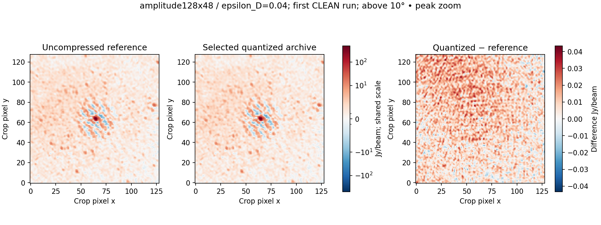

# varquanMS: local-scale, adaptive, variable-quantization-length compression method for radio interferometry data

**Methods and validation manuscript.** The earlier development manuscript is
preserved as [work_note_20261025_init_work.md](work_note_20261025_init_work.md).
This version describes the implemented calibrated-data profile. Numerical results
come from three verified fixed-epsilon archives and six CLEAN runs. Sizes are
decimal MB.

## Abstract

<!-- ABSTRACT_START -->
We present varquanMS, an experimental archive for radio-interferometric Measurement
Sets using local scaling and adaptive integer precision. Baseline–frequency blocks
within one correlation product store a complex median, a shared range, a power
spacing parameter and a selected component width. A dimensionless epsilon-D
criterion bounds reconstruction RMS relative to raw component median deviation,
with maximum-error, bias and baseline guards. The precision ladder is 3, 4, 5, 6,
8, 10, 12, 14 and 16 bits per component plus exact float32, identified by a four-bit
tag. Original UVW, ordering and retained metadata are reconstructed without
coordinate regeneration or averaging. On a calibrated 15-integration OVRO-LWA
observation, epsilon-D values 0.01, 0.04, 0.18 produce visibility payloads of
22.859, 17.433, 9.932% of the original complex64 bytes and complete archives of
427.429, 350.112, 242.766 MB, respectively. The larger restored-image difference across
two multiscale CLEAN runs is 1.260, 1.151, 5.584% of reference residual RMS,
measured above 10° elevation. The calibrated profile explicitly discards raw/model
columns and flagged values while retaining flags; its weights are exact on this
dataset. These results measure agreement with the supplied calibrated reference,
not sky truth or a general thermal-noise guarantee.
<!-- ABSTRACT_END -->

## 1. Introduction

An interferometer records complex correlations for many antenna pairs, frequency
channels and times. The visibility array grows approximately as
$N_{\mathrm{ant}}^2 N_\nu N_t N_p$, making storage and repeated data transfer costly.
Complex64 uses two float32 components: eight bytes per visibility. Averaging can
reduce volume, but also changes time or frequency resolution. We investigate
lossy precision reduction while retaining the original sampling and row identities.
The intended output is an independently decodable archive from which a new MS can
be materialized for existing imaging software.

A Measurement Set includes coordinates, array-valued columns, descriptors,
keywords and references to subtables. Correct archival reconstruction must account
for this structure. Casacore also separates logical columns from physical storage
managers, so repeated logical values do not by themselves establish wasted disk
space. We report allocated payload and complete-file bytes separately.
[MS v2 specification](https://casacore.github.io/casacore-notes/229.html),
[Casacore table system](https://casacore.github.io/casacore-notes/255.html).

Normalization, nonlinear quantization and dithering are established techniques in
visibility compression. Dysco combines these methods, including antenna/frequency
normalizations, and evaluates their effects on LOFAR and MWA observations.
Its published results motivate direct image-domain validation, but do not predict
fidelity for the calibrated observation studied here. The present work investigates
local precision selection, explicit exceptions, a dimensionless error rule and
MS reconstruction. It does not claim normalization or nonlinear quantization as
new, and a matched Dysco comparison has not yet been performed.
[Offringa (2016)](https://arxiv.org/html/1609.02019v1).

Array-based schemas such as XRADIO/MS v4 provide a useful separation between
scientific coordinates and storage representation; this prototype exports MS v2
and does not claim MS v4 conformance.
[XRADIO overview](https://xradio.readthedocs.io/en/latest/measurement_set/overview.html).
Blockwise low-bit formats and scale compression also appear in machine-learning
quantization, including QLoRA. Here, all scale factors remain float32, no learned
model is required, and model-quality results provide no scientific-fidelity
assurance for visibilities.
[Dettmers et al. (2023)](https://arxiv.org/abs/2305.14314).

## 2. Method

### 2.1 Inspection, partitioning and grouping

The input is inspected before encoding. The implemented regular path requires
complex64 visibility cells with channels inside each cell and a homogeneous
configuration within each partition. Multiple contiguous integrations are handled
as separate partitions. Unsupported layouts fail explicitly. Ordered antenna
pairs and distinguishing MS row context are preserved; antennas are not swapped
and visibilities are not conjugated to canonicalize a baseline.

The internal visibility axes are baseline/row, channel and correlation. Product
names and order are read from POLARIZATION metadata. Autocorrelation and
cross-correlation rows are separated. For each product $p$, a stable amplitude
ordering uses

$$A_{b,p}=\operatorname{median}_{\nu\in\mathcal V_{b,p}}|V_{b,\nu,p}|,$$

where $\mathcal V$ excludes flagged and nonfinite samples. Original row index
breaks ties, and rows with no eligible values form a deterministic special group.
Each baseline spectrum stays intact. The stored permutation obeys

$$V^{\mathrm{archive}}_{j,\nu,p}=V^{\mathrm{source}}_{\pi_p(j),\nu,p},\qquad
V^{\mathrm{restored}}_{\pi_p(j),\nu,p}=\widehat V^{\mathrm{archive}}_{j,\nu,p}.$$

A quantization block contains at most $B$ consecutive archived baselines and $F$
consecutive channels for one product. Exact edge bounds and class boundaries are
stored. The present experiment fixes $B=128$ and $F=48$, independently per product.
No time/channel averaging is performed. Sorting changes which values share
factors; the permutation itself removes no information and has a measured byte
cost. The implementation also supports original, baseline-length, orientation,
antenna and amplitude-bucket orders, but this three-tolerance experiment does not
compare those alternatives.


*Figure 1. Spectra are ordered within one configuration, integration, product and
auto/cross class. Each block is independently encoded, reconstructed and checked;
the smallest accepted serialized candidate is stored with its reconstruction map.*

### 2.2 Local centre, range and power spacing

For block $q$, store two component medians
$C_q=C_{q,R}+iC_{q,I}$, a shared range $t_q\ge0$ and a power parameter $\gamma_q$.
The encoder computes the medians from eligible values, excluding flags, nonfinite
values and protected signed-zero samples, then rounds the medians to float32.
Residuals are calculated against these stored medians. Two range candidates are
tested: the maximum and the 99.5th percentile of
$\max(|\Re(V-C_q)|,|\Im(V-C_q)|)$. Each range is rounded upward to float32.
Values outside a candidate range are preserved through exact exceptions.

For either real component $x$, define $y=(x-C)/t_q$ on $[-1,1]$. Let

$$M_b=2^b-1,\qquad u_k=\frac{2k-M_b}{M_b},\qquad k\in\{0,\ldots,M_b\}.$$

The reconstruction levels are

$$\widehat x_k=C+t_q\,\operatorname{sgn}(u_k)|u_k|^{1/\gamma_q}.$$

All $2^b$ unsigned codes are used. The residual grid is symmetric and spans
$[-t_q,t_q]$, without a separate sign bit or a duplicate signed-zero code. Since
$M_b$ is odd, the grid has no exact residual-zero level for $t_q>0$. This is a
midrise grid: an ordinary value at the centre can acquire a small error. Negative
zeros are protected exactly through exceptions. If $t_q=0$, the decoder copies
the stored component centres directly. Entirely zero or otherwise compressible
blocks may instead select the exact representation.

For $\gamma_q=1$, the reconstruction spacing is uniform,
$\Delta_b=2t_q/(2^b-1)$. For $0<\gamma_q<1$, levels concentrate near the centre:

$$\left|\frac{d\widehat x}{du}\right|
=\frac{t_q}{\gamma_q}|u|^{1/\gamma_q-1}.$$

The candidate encoder first computes the continuous coordinate

$$k^*=\frac{M_b}{2}\left[1+\operatorname{sgn}(y)|y|^{\gamma_q}\right].$$

It reconstructs the adjacent integer codes $\lfloor k^*\rfloor$ and
$\lceil k^*\rceil$ using the stored factors and chooses the closer reconstructed
float32 value. Equal errors select the even code. Choosing by reconstructed
values matters for nonlinear spacing; ordinary rounding of $k^*$ alone need not
choose the closest level in data units. Unflagged outliers are never silently
saturated. Endpoint clipping only protects the integer lookup from floating-point
roundoff after the range/exception decision.

The tested gamma rule uses the maximum absolute component residual divided by
pooled within-component population standard deviation, $r_q$. Both statistics
use all eligible residuals before selecting range exceptions, with float64
arithmetic and variance normalization `ddof=0`. It selects

$$\gamma_q=\begin{cases}
1,&r_q\le4\text{ or the ratio is undefined},\\
1/2,&4<r_q\le8,\\
1/4,&r_q>8.
\end{cases}$$

This is a deterministic encoder heuristic, not a noise model. The selected gamma
is stored, so decoding never estimates it again. Full gamma search is available
as a separate experiment. The decoder evaluates normalized codes and powers in
float64, using explicit squares for gamma $1/2$ and fourth powers for gamma $1/4$,
then multiplies by the stored range, adds the stored centre and rounds once to
float32. The reference implementation fixes the operation order.


*Figure 2. Illustrative four-bit reconstruction levels after median subtraction.
Every row contains 16 distinct unsigned codes. Smaller gamma increases resolution
near the centre while increasing spacing near the range endpoints. The experiment
also allows eight other component widths.*

### 2.3 Choosing precision with epsilon D

The reference statistic for acceptance is computed from the original finite,
unflagged samples, before outlier selection. Define raw component deviations

$$d_{q,R}=\operatorname{median}|\Re V-\operatorname{median}(\Re V)|,
\qquad d_{q,I}=\operatorname{median}|\Im V-\operatorname{median}(\Im V)|,$$

$$D_q=\sqrt{\frac{d_{q,R}^2+d_{q,I}^2}{2}},\qquad T_q=\epsilon_DD_q.$$

These medians use float64 arithmetic and no Gaussian conversion factor. $D_q$
describes signal variation; it is not a thermal-noise estimate. It is separate
from the rounded median used for coding. Multiplying all visibilities by a real
amplitude factor scales $D_q$ and the permitted absolute error by its magnitude,
subject to finite-precision effects. Thus the tolerance has no fixed amplitude
unit and requires no denominator floor near an individual zero visibility.

For reconstructed error $e=\widehat V-V$, the tests are

$$\frac{1}{2N_q}\sum_{n\in\mathcal V_q}|e_n|^2\le T_q^2,\qquad
\max_{n\in\mathcal V_q}|e_n|\le10T_q,$$

$$\left|\frac{1}{N_q}\sum_{n\in\mathcal V_q}e_n\right|\le T_q,\qquad
\max_{b\in q}\frac{1}{2N_{q,b}}\sum_{n\in\mathcal V_{q,b}}|e_n|^2\le2T_q^2.$$

Only baselines with eligible samples contribute to the last expression. These
are pooled real/imaginary constraints; separate component errors are measured
but there is no independent per-component relative ceiling. A zero $D_q$ imposes
zero measured error, even when a sparse nonconstant block has zero MAD. Empty
valid sets have zero measured errors. Exact fallback is always available.

The precision ladder is

$$b\in\{3,4,5,6,8,10,12,14,16\}\cup\{\text{exact float32}\}.$$

Each bit width and range candidate is actually reconstructed and tested. The
encoder chooses the candidate with the fewest serialized bytes, including the
header, codes, exception stream and optional lossless compression. Exact storage
also competes on size and wins equal-size ties. A larger epsilon generally permits
coarser precision, but bytes and image error are measured rather than inferred
from the nominal width. Precision is common to the real and imaginary components
within a block. A $b$-bit component codec uses $2b$ payload bits per complex sample
before exceptions and other overhead.

The general interface also supports sampled global std, block std and uncentered
block RMS references through $\epsilon_G$, $\epsilon_S$ and $\epsilon_R$.
Those coefficients are disabled in the present experiment. Their sampling and
combination study is documented in the [16% study](../../devnotes/fixed16.md);
no fixed absolute-error threshold is active here.

### 2.4 Data format and precision tags

The scientific schema is independent of its HDF5 prototype container. The archive
holds typed table descriptors and keywords, exact supported subtable values,
original coordinates, row/cell maps, permutations, flags, weights, visibility
streams, error summaries and integrity inventories. Shared subtable content is
stored once when compacting the integration partitions. Explicit little-endian
dtypes and JSON metadata avoid executable object serialization.

Each block has a 16-byte base header containing a precision selector, compression
identifier, mapping identifier, complex sample count, exception count and a
float32 range or step. Power blocks append two float32 centre components and
float32 gamma, making 28 bytes before the body. An exact block uses the 16-byte
base header and original complex64 bits. The first byte of the new header is
`0xA0 | tag`, with the lower four bits interpreted as follows:

| Tag | Interpretation |
| --- | --- |
| 0 | Exact complex64 |
| 1–9 | 3, 4, 5, 6, 8, 10, 12, 14, 16 bits/component, respectively |
| A | Legacy two-bit representation, outside the tested ladder |
| B–E | Reserved; decoder rejects |
| F | Invalid/error; never a successful encoded block |

Four bits suffice to select the precision, not to represent every visibility.
The upper nibble identifies this header version; aligned header sizes remain
16/28 bytes. The format does not claim an additional half-byte saving per block.
Historical literal-width headers remain decodable, while unsupported tags fail
explicitly.

Codes are interleaved real then imaginary and packed least-significant bit first.
Each width occupies its actual number of bits; 14-bit codes can cross three bytes.
Unused final high bits must be zero. Exact exceptions store increasing uint32
sample positions and original eight-byte complex64 values. They restore protected
special-value bits and outliers after ordinary reconstruction. Block bodies use
DEFLATE only when it reduces their size. Offset indexes and per-block CRC32 allow
independent reads; dataset SHA-256, container checksums and a manifest inventory
provide further corruption detection. These checks detect accidental damage;
they are not authentication signatures. The decoder needs no remote service,
learned model or downloaded codebook. A standard-library reference block decoder
and small literal conformance fixtures accompany the implementation.

### 2.5 Compression, decompression and calibrated-only policy

Compression proceeds through inspection, context partitioning, grouping, candidate
selection, payload writing and source-aware verification. Partial outputs remain
distinguishable from completed archives. The source MS is never overwritten.
Decompression checks inventories and block bounds, reconstructs values, applies
exact exceptions and inverse permutations, rebuilds subtable references, and
writes a new MS. Original UVW float64 values are retained in metres; no antenna
position, time or frequency calculation regenerates them. Bitwise-identical
coordinates may be deduplicated, without tolerance-based merging.

The calibrated-only profile explicitly retains CORRECTED_DATA and removes the
original DATA and MODEL_DATA. Original flagged visibility values are discarded
and represented by positive-zero placeholders, while FLAG, FLAG_ROW and
FLAG_CATEGORY remain preserved. It retains sample presence, array shapes and
resolution. Consequently this profile is not an exact round trip of the original
MS, even when the retained visibilities choose exact storage. On export, DATA is
recreated from decoded CORRECTED_DATA for MS compatibility; original raw DATA is
not recovered. Remaining supported metadata and auxiliary columns stay exact.

Weights use an independent four-bit codebook with checked float32 fallback;
weight approximation, if needed, follows its separately recorded tolerance.
The weights of this particular observation are reconstructed bitwise exactly.
No quantization error estimate overwrites original weights. Optional removal of
flags is a distinct destructive profile and is not enabled in these experiments.

For the supported multi-integration case, the reference workflow is:

```bash
export PYTHONPATH=src
python scripts/timeslot_archive.py encode INPUT.ms blocks.bundle \
  --config configs/calibrated-epsd-018.json --report encode.json
python scripts/timeslot_archive.py compact blocks.bundle archive.h5 \
  --report compact.json
python scripts/timeslot_archive.py decode archive.h5 RESTORED.ms \
  --report decode.json
```

All outputs must be new paths. Decoding receives the archive alone. Source-aware
validation is a separate step and does not supply missing reconstruction data.

## 3. Validation on calibrated OVRO-LWA data

### 3.1 Observation and experiment design

The inspected input `lwa-15slot-flat.ms` contains 15 contiguous integrations,
931,920 rows and 352 antennas. Each integration has 62,128 ordered antenna pairs:
352 autocorrelations and 61,776 cross-correlations. Each cell has 48 channels and
four products in metadata order XX, XY, YX, YY. Channel centres range from
63.965576 to 68.463623 MHz at 95.703125 kHz spacing. Original TIME and
TIME_CENTROID values and their UTC references are retained. The table contains
926,641 bitwise-distinct original UVW vectors.

CORRECTED_DATA contains 178,928,640 complex samples, or 1,431,429,120 logical bytes.
There are 41,752,612 flagged samples. The complete source occupies 4,428,203,949
bytes, including raw and model columns that the calibrated profile deliberately
omits. These different denominators must not be conflated. Source HISTORY records
CASA `applycal`; this establishes the supplied calibration history, not an
independent validation of the calibration or flux scale.
[Input inspection](../../reports/calibrated-inspection.json).

We fix all grouping, median, gamma, exception and preservation settings and test
$\epsilon_D=0.01$, $0.04$ and $0.18$ with the expanded nine-width ladder. The
coefficients are specified in advance and are not retuned to a byte target or
selected from image outcomes. Each case reads the original calibrated source;
none recompresses a previous quantized result. All use 128×48×1 blocks, independent
amplitude ordering, the max/std gamma rule, range quantiles 1 and 0.995, and exact
fallback. Encoder workers are set to 24. Exact configuration files accompany the
results.

### 3.2 Reconstruction and imaging checks

The validation suite exercises every width, partial blocks, special values,
flags, signed zeros, exact fallback, malformed/truncated streams and both header
representations. Independent standard-library, portable NumPy and compiled
reconstructions are compared. Native modules built before a requested width
fall back to portable encoding. The current full suite passes 116 tests.
Source-aware archive/export checks compare original supported metadata,
coordinates, flags and weights exactly, and independently recompute normalized
visibility error criteria. Source checksums are checked against the original
import inventory.

Imaging uses WSClean 3.7 in the same recorded container for reference and
quantized MSs. A private MS copy protects each input from imaging side effects.
The uncompressed reference and every reconstructed case use Stokes I,
2048×2048 pixels, four-arcminute pixels, Briggs robust 0 and multiscale CLEAN.
The remaining settings are eight threads, scale bias 0.8, 150,000 iterations,
mgain 0.95, auto-threshold 0.5, auto-mask 3, local RMS, a 10° horizon mask,
40% memory setting, reordering and no model-column update. Candidate images use
the reference restoring beam. Auto-masks are estimated independently, so
deconvolution-path changes contribute to the measured differences. WSClean is an
established wide-field imager; these particular validation settings and results
belong to this experiment.
[Offringa et al. (2014)](https://arxiv.org/abs/1407.1943).

The comparison mask requires elevation above 10° for all 15 integrations and
contains 2,245,726 pixels. Let $I_0$ be the restored reference image,
$I_\epsilon$ a quantized restored image, and $R_0$ the reference residual map.
We report the uncentered, unclipped statistics

$$E_{\mathrm{image}}=\operatorname{RMS}_{\mathcal M}(I_\epsilon-I_0),\qquad
\eta_{\mathrm{residual}}=100\frac{E_{\mathrm{image}}}{\operatorname{RMS}_{\mathcal M}(R_0)}.$$

The reference residual RMS is 1.031244811 Jy/beam; the restored-reference RMS is
1.898403101 Jy/beam. Residual-normalized difference is not fractional flux loss,
per-pixel relative error, or a thermal-noise budget. The residual contains sky and
deconvolution structure. We additionally compare dirty images, faint-region RMS,
reference-peak changes and visibility errors by baseline, product and frequency.
The reference defines faint pixels below 1% of its peak absolute intensity.
Each compressed MS is CLEANed twice to record observed repeat variation; two
runs do not establish statistical confidence intervals.

### 3.3 Measured size, precision and image differences

<!-- RESULTS_START -->
| εD | Payload MB (% of complex64) | Complete archive MB | Difference mJy/beam, first / repeat | Difference / reference residual RMS %, first / repeat |
| ---: | ---: | ---: | ---: | ---: |
| 0.01 | 327.207 (22.859%) | 427.429 | 12.9866 / 12.9944 | 1.2593 / 1.2601 |
| 0.04 | 249.542 (17.433%) | 350.112 | 11.8731 / 11.8666 | 1.1513 / 1.1507 |
| 0.18 | 142.163 (9.932%) | 242.766 | 57.5807 / 49.4859 | 5.5836 / 4.7987 |

| εD | Dirty difference mJy/beam | Worst reference-peak change % | Worst faint-region RMS difference % | Candidate residual RMS Jy/beam, first / repeat |
| ---: | ---: | ---: | ---: | ---: |
| 0.01 | 1.5080 | 0.00020 | 1.0430 | 1.030953 / 1.030953 |
| 0.04 | 5.4572 | 0.00244 | 0.9556 | 1.031218 / 1.031221 |
| 0.18 | 40.0807 | 0.43340 | 4.5891 | 1.026183 / 1.028690 |

| εD | Cross XX RMSE / signal RMS % | Cross XY % | Cross YX % | Cross YY % |
| ---: | ---: | ---: | ---: | ---: |
| 0.01 | 0.59372 | 0.38169 | 0.48786 | 0.45558 |
| 0.04 | 2.35604 | 1.43210 | 1.87325 | 1.78090 |
| 0.18 | 11.49117 | 10.65014 | 11.56520 | 9.94197 |

Visibility ratios divide component reconstruction RMSE by the original component
signal RMS, pooling all finite unflagged cross-correlations in each product.
They are distinct from the local MAD-normalized acceptance criterion. Cross-hand
visibility statistics do not constitute a polarized-image validation.

All three archives passed full-source export verification. Original supported
metadata, UVW, flags and this observation's weights passed exact checks; all 108
source-file hashes still match. All six CLEAN runs reached the final threshold, with 3 major iterations each.
The new 5/10/14-bit choices encode
26,333,664, 104,509,248 and 0 complex samples,
respectively, summed across the three separate experiments. Exact blocks often
represent highly compressible zeros, so sample fractions and byte fractions differ.
Complete distributions and auto/cross splits are retained in the machine-readable
[experiment report](../../reports/calibrated-epsd-dense.json).


*Figure 3. Fixed epsilon-D values produce measured sizes and image errors; there
is no imposed byte target. Red points show two CLEAN runs. Blue squares show the
first dirty-image difference, all normalized by the same reference residual RMS.*


*Figure 4. Selected component widths by number of complex samples and by serialized
payload bytes. Float32 denotes exact storage, including cheaply compressed zero
blocks. Metadata outside visibility blocks is accounted for separately.*


*Figure 5. Reference and first-run quantized-minus-reference restored images above
10°. Difference panels share one linear colour scale; the reference uses its own
symmetric logarithmic display scale. Pixels outside the mask are excluded.*


*Figure 6. The same comparisons in a fixed 128×128-pixel crop around the reference
peak. The reference peak defines the crop independently of compressed results.*


*Figure 7. Reference, quantized image and difference for epsilon-D 0.04,
the smallest worst-of-two global image-RMS difference in this three-point test.
This selects a display case by error, without asserting an optimal size–error tradeoff.*



*Figure 8. Reference-peak crop for the same case. The first two panels share an
intensity scale; the difference has a separate, explicitly labelled linear scale.*
<!-- RESULTS_END -->

### 3.4 Timing and byte accounting

<!-- TIMING_START -->
| εD | Sum partition encode s | Global sampling s | Verified bundle wall s | Compaction s | MS export s | CLEAN s, first / repeat |
| ---: | ---: | ---: | ---: | ---: | ---: | ---: |
| 0.01 | 196.45 | 7.45 | 456.48 | 33.25 | 58.61 | 174.66 / 185.93 |
| 0.04 | 178.68 | 6.97 | 456.93 | 31.88 | 55.97 | 288.42 / 213.19 |
| 0.18 | 188.12 | 6.29 | 447.38 | 17.17 | 48.29 | 164.56 / 183.58 |

Timings cover all 15 integrations on a shared Intel Xeon Silver 4214 host with
48 logical CPUs and approximately 376 GiB RAM. Grouped encoders use 24 workers;
CLEAN uses eight threads. Concurrent workloads vary between cases, and caches are
not evicted. These measurements describe the observed workflow rather than an
isolated speed ranking. Verified-bundle wall time includes source copying,
inspection, encoding, global-reference sampling and verification; compaction and
MS export are additional. Global references are still recorded even though G is
disabled. The full-conversion 15-second target remains unmet.


*Figure 9. Complete-file size versus RMS(image − reference) / RMS(reference residual),
shown in percent for the two CLEAN runs on the same above-10° mask, and physical
byte categories. Factors and exceptions are inside visibility payload;
quality records, coordinates, permutations and other metadata remain part of the
complete archive. Summing only nominal component bits would understate storage.*
<!-- TIMING_END -->

## 4. Conclusion and discussion

Local median subtraction, full-range unsigned power levels and an explicit
$\epsilon_D$ acceptance rule provide a compact and interpretable encoder policy.
The coefficient expresses allowed error relative to block variation, while actual
reconstruction checks determine which precision is acceptable. Nine quantized
choices plus exact fallback fit within a four-bit precision selector. Broader
precision coverage does not remove the need to count factors, exceptions,
permutations, indexes, coordinates and error summaries in the archive size.

<!-- CONCLUSION_START -->
The three specified epsilon-D values yield complete archives between
242.766 and 427.429 MB. Their worst-of-two image differences range
from 1.151% to 5.584% of the reference residual RMS on the
fixed elevation mask. This is a measured three-point size–error comparison with
constant grouping and codec settings. It does not isolate the effect of expanding
the ladder from the earlier six-width experiments, whose tolerances also differ.
No result here demonstrates a universal optimum or a scientific acceptance
threshold. Preserved exact data, explicit profile losses and complete byte counts
make the tradeoffs reviewable for this observation.

At epsilon-D 0.18, the visibility payload is
9.932% of the original complex64 bytes, with a
worst-of-two restored-image difference of
5.584% of reference residual
RMS. This point measures the stronger compression setting directly, using the
same grouping, reconstruction checks and imaging mask.

The epsilon-D 0.01 case has a smaller first-run dirty-image difference
(0.146% versus
0.529% of reference residual RMS)
than epsilon-D 0.04, yet its worst restored-image difference is larger
(1.260% versus
1.151%). Both outcomes are retained:
tighter visibility bounds do not impose a monotonic ordering on the CLEAN results.
The repeated runs quantify observed variation but do not establish statistical
significance or a causal model for this reversal.
<!-- CONCLUSION_END -->

A single block statistic cannot establish every future science requirement.
Median deviation can vanish for sparse nonconstant data, forcing exact storage;
strong and weak products can have different scientific tolerances. Deterministic
rounding can create structured errors despite a small mean-square bound. Image
agreement depends on visibility weighting and nonlinear deconvolution as well as
visibility error, so dirty-image agreement alone is insufficient. These are
reasons to retain direct image checks and explicit maximum/bias guards.

The present validation covers joint Stokes I on one supplied calibrated
observation. It does not establish polarimetric leakage, narrow spectral-feature,
calibration-solution or transient-light-curve fidelity, and it contains no held-out
observation. CASA compatibility is limited to the checks documented in the
repository; the new experiments directly exercise python-casacore reconstruction
and WSClean. A matched Dysco benchmark, additional observations and isolated
runtime measurements remain necessary before choosing general archival defaults.
The conservative default remains lossless.

The [public repository](https://github.com/peijin94/varquanMS) contains the format,
reference decoder, configurations, conformance tests, machine-readable validation
and figure-generation scripts. Detailed operational history is retained in
[development notes](../../devnotes/README.md) and the preserved initial manuscript,
rather than being appended to this methods paper.
