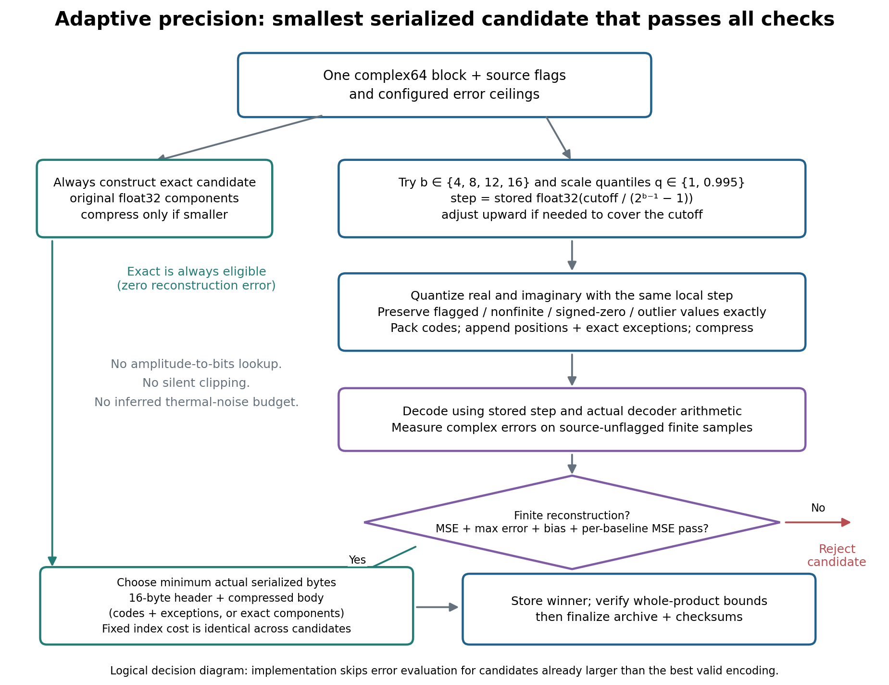
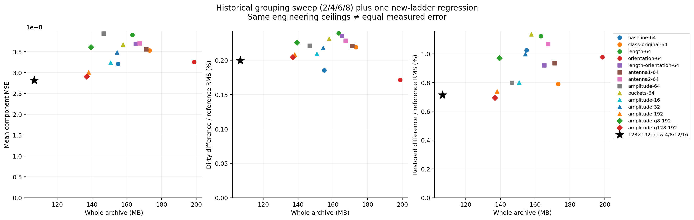
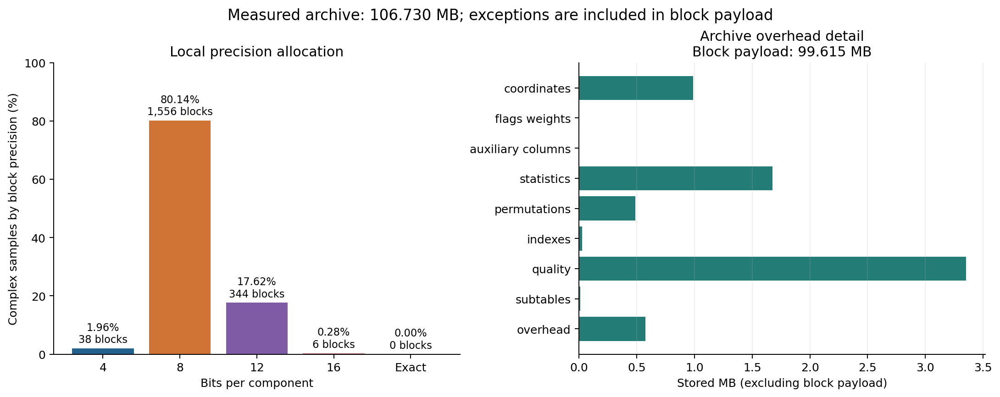
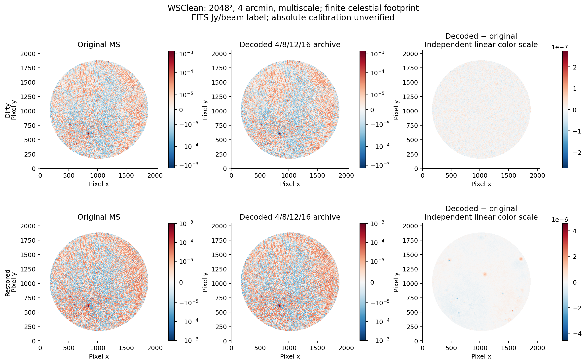
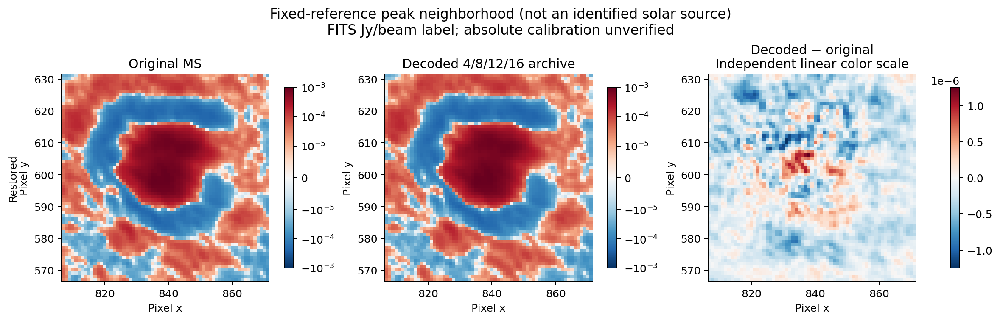
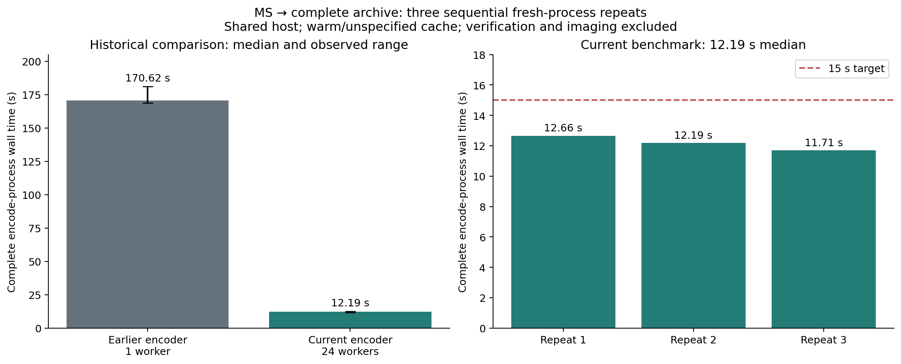
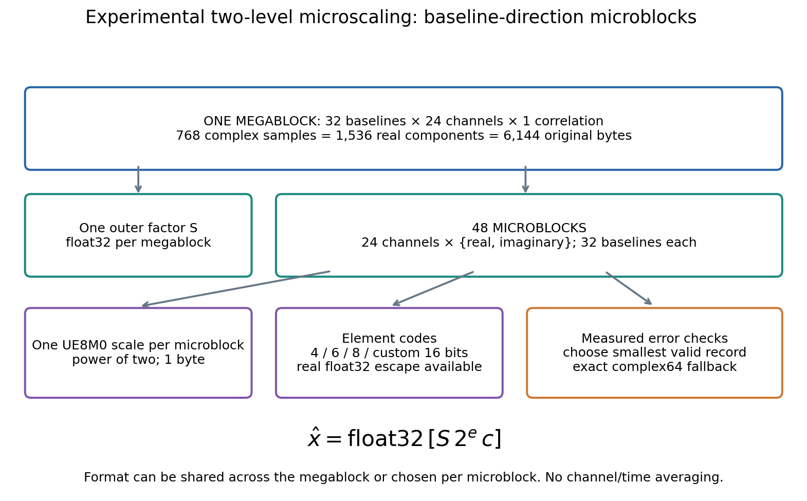
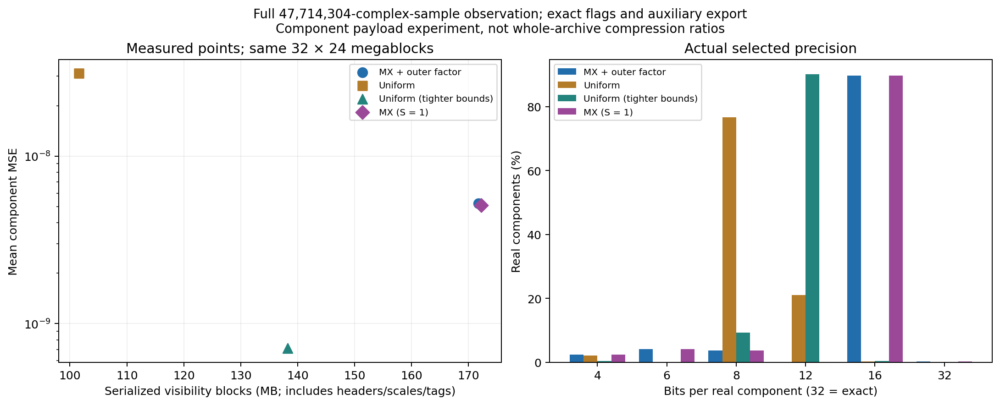
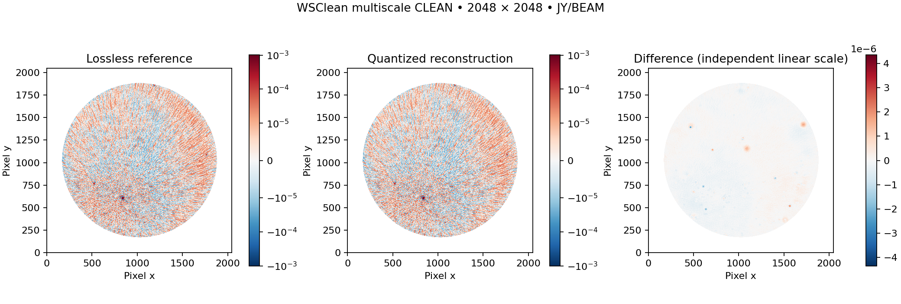

# varquanMS: local-scale, adaptive-precision archives for single-integration Measurement Sets

**Working methods and experiment paper — 23 October 2026.** This document describes
implemented behavior and measured results, not an approved archival science profile.
All sizes use decimal MB unless explicitly stated.

## Abstract

We investigate an independently decodable visibility archive that preserves
Measurement Set (MS v2) coordinates and auxiliary information while quantizing
complex visibilities in local baseline–frequency blocks. Each block uses one
stored float32 scale, exact exception values, and a measured choice among 4, 8,
12 and 16 bits per real/imaginary component or exact float32 components. Precision
is selected by encoded size subject to reconstruction-error constraints, not
by an amplitude-to-bit lookup. Baseline ordering changes which spectra share a
scale; stored permutations recover original row, channel and correlation order.

The inspected test MS has 62,128 rows, 192 channels, four linear-feed products,
and one integration. Its physical file total is 409.595 MB, including 381.714 MB
of logical complex64 DATA. A measured amplitude-sorted, 128-baseline × 192-channel
configuration produces a 106.730 MB archive, a **3.838× whole-MS reduction**.
Mean per-component visibility MSE is `2.8117e-8` in stored DATA units squared.
Matched WSClean 2048², 4-arcmin, multiscale imaging gives dirty/restored relative
RMS differences of **0.1996% / 0.7137%** over the valid celestial footprint.
These image metrics are not thermal-noise estimates. Three sequential encoding
runs with 24 CPU workers take **12.19 s median**, range **11.71–12.66 s**, for a
106.731 MB archive. The benchmark includes startup, inspection, writing and
integrity checks; verification, MS export and imaging are timed separately.
It uses a shared host with warm/unspecified cache. Section 9 describes the test
conditions, individual runs and output validation.

A separate 32×24 two-level MX experiment uses an outer float32 factor and
32-real-component micro scales. Under the tested bounds, 89.65% of components
require a custom scaled-FP16 format. A tighter-error uniform control is 19.50%
smaller in serialized component bytes with 7.34× lower component MSE; this MX
configuration does not improve the measured visibility rate–distortion tradeoff.

## 1. Scope and relationship to earlier work

The goal is to reduce archive size without time/channel averaging or regeneration
of original coordinates. MS v2 associates visibility cells with row identities,
subtable references, flags and weights. UVW is explicitly a three-component
double-precision coordinate in metres. Reconstruction therefore restores stored
UVW rather than recomputing it. [MS v2 specification](https://casacore.github.io/casacore-notes/229.html)

Normalization and quantization are not new contributions. Dysco combines grouped
normalization, nonlinear quantization and dithering, including antenna/frequency
factorizations, and evaluates image-domain errors. Its published telescope results
are dataset-specific, not predictions for this MS. This prototype investigates
adaptive precision, grouping controls, explicit exceptions/error accounting and
standalone reconstruction; no matched Dysco benchmark has yet been run.
[Offringa (2016)](https://arxiv.org/html/1609.02019v1)

QLoRA motivates engineering comparisons such as distribution-adapted codebooks
and quantized scales, but neither language-model quality nor NF4's design is a
visibility-fidelity guarantee. The present codec is uniform, without NF4 or scale
quantization in the production archive path. Section 10 separately evaluates
experimental MX floating-point elements. [Dettmers et al. (2023)](https://arxiv.org/abs/2305.14314)
XRADIO/MS v4 illustrates labeled-array schemas and homogeneous configurations;
this archive does not claim MS v4 conformance and exports MS v2.
[XRADIO overview](https://xradio.readthedocs.io/en/latest/measurement_set/overview.html)

## 2. Inspected observation and storage accounting

The source is `20260904_190008_59MHz.ms`, copied from the supplied 59 MHz event
directory and checked against the source tar. Measurements below refer to the
extracted MS, not its tar wrapper. The channel axis is **inside each DATA cell**;
it is not 192 separate single-channel records. The full machine-readable inventory
is [initial-inspection.json](../../reports/initial-inspection.json).

| Property | Inspected value |
| --- | --- |
| Integration / data description / spectral window / field counts | 1 / 1 / 1 / 1 |
| Antennas; rows | 352; 62,128 |
| Autocorrelation / cross-correlation rows | 352 / 61,776 |
| Python DATA shape and dtype | `[62128, 192, 4]`, complex64 |
| Correlation order read from metadata | XX, XY, YX, YY |
| Complex sample count | 47,714,304 |
| Channel-centre range | 59.3359375–63.90576171875 MHz |
| Channel width | 23,925.78125 Hz |
| TIME; TIME_CENTROID | 5295265208.539846; 5295265213.555357 s, UTC |
| UVW dtype / units / recorded reference | float64 / m / ITRF |
| True FLAG / FLAG_CATEGORY / FLAG_ROW elements | 0 / 0 / 0 |
| DATA nonfinite samples / negative-zero components | 0 / 0 |
| Source physical file lengths | 409,594,838 bytes (65 files) |

The logical DATA size is

$$
N_v=N_rN_fN_p=62{,}128\times192\times4=47{,}714{,}304,
\qquad S_{\mathrm{DATA}}=8N_v=381{,}714{,}432\ \mathrm{bytes}.
$$

| Logical arrays | Bytes |
| --- | ---: |
| DATA | 381,714,432 |
| FLAG + FLAG_CATEGORY | 95,428,608 |
| WEIGHT + SIGMA | 1,988,096 |
| UVW | 1,491,072 |
| Other MAIN columns, including FLAG_ROW | 4,783,856 |
| Subtables | 91,133 |
| Total logical arrays | 485,497,197 |

Logical bytes are not per-column disk usage: unpacked Boolean arrays count one
byte per value here. Casacore separates logical tables from storage managers and
stores Boolean values as bits. This MS uses shared StandardStMan files, so exact
physical bytes cannot be attributed to individual columns by file lengths alone.
[Casacore Table Data System](https://casacore.github.io/casacore-notes/255.html)

UVW occupies one vector per row, not one per channel. Of 62,128 original vectors,
61,777 are bitwise distinct. A plain float64 dictionary plus uint32 row map would
cost 1,731,160 logical bytes, exceeding the original 1,491,072 bytes; it is not
selected on that basis. There is no tolerance-based geometry merging. For imaging
one can form wavelength coordinates

$$
\boldsymbol u_{\lambda}(r,f)
=\boldsymbol u_{\mathrm{m}}(r)\,\frac{\nu_f}{c},
$$

but this frequency-dependent conversion is not used for archival reconstruction.

## 3. Grouping: deciding which samples share a scale

### 3.1 Valid statistics and row identity

Let $V_{rfp}$ be the complex64 visibility at original row $r$, channel $f$ and
correlation $p$. The supported quantized layout has a single integration and
configuration, uniform cells and no duplicate row keys. Row identity includes
the ordered antenna pair and distinguishing time/feed/field/data-description/
scan/array/observation/processor/state context; antenna pairs are never swapped
and visibilities are never conjugated to canonicalize them. Unsupported quantized
layouts fail preflight. The exact archive path supports additional irregular
cell layouts; those are not silently normalized into the current quantized path.

Define the usable-channel set and grouping statistic as

$$
\mathcal F_{rp}=\{f:\neg\mathrm{FLAG}_{rfp},\ \neg\mathrm{FLAG\_ROW}_{r},
\ \Re V_{rfp},\Im V_{rfp}\text{ finite}\},
\qquad n_{rp}=|\mathcal F_{rp}|,
$$

$$
A_{rp}=\operatorname{median}_{f\in\mathcal F_{rp}}
\operatorname{hypot}(\Re V_{rfp},\Im V_{rfp}).
$$

The magnitude calculation is performed robustly in float64. No-valid-channel
rows receive a deterministic special class and stored valid count; NaNs cannot
randomly order them. An absent record is not synthesized as an all-flagged row.

### 3.2 Permutation and block boundaries

For amplitude ordering, sort each product independently by auto/cross class,
valid/no-valid class, $A_{rp}$ and original row index. The current default
`shared_order: false` allows different products to have different permutations.
Let $\pi_p(j)$ be the original row at archived position $j$:

$$
V^{\mathrm{arch}}_{jfp}=V_{\pi_p(j),f,p},
\qquad
\widehat V_{\pi_p(j),f,p}=\operatorname{Decode}(\mathrm{archive})_{jfp}.
$$

Only baseline IDs/spectra are reordered. Channel order within a spectrum is
unchanged. Within each class, consecutive groups of at most $B$ rows and frequency
segments of at most $F$ channels define blocks

$$
\mathcal B_{gsp}
=\{(\pi_p(j),f,p):j_g\le j<j_{g+1},\ f_s\le f<f_{s+1}\}.
$$

Store actual permutations and class/group/segment boundaries; reconstruction
does not rerun the sorting algorithm. Groups do not cross auto/cross, no-valid,
bucket or configured geometry/antenna boundaries. Partial blocks retain exact
bounds. A permutation alone provides no quantization gain if it leaves block
membership unchanged.


*Figure 1. Illustrative grouping within one valid cross-correlation class, with
toy amplitudes and $B=2,F=4$. Whole spectra move together. Orange rectangles are
quantization blocks, not averaging bins. [SVG](figs/grouping.svg),
[PDF](figs/grouping.pdf).*

For the measured $B=128,F=192$ configuration, all source rows have valid samples:

$$
N_{\mathrm{blocks}}
=4\left(\left\lceil\frac{352}{128}\right\rceil
+\left\lceil\frac{61{,}776}{128}\right\rceil\right)
=4(3+483)=1{,}944.
$$

The final auto and cross groups contain 96 and 80 rows respectively. The four
uint32 permutations occupy 994,048 logical bytes, or **488,354 stored bytes** in
the measured archive. Their cost is included in all whole-archive ratios.

### 3.3 Available controls and actual defaults

| Setting | Ordering | Maximum block, rows × channels × products |
| --- | --- | --- |
| Quantizer defaults, when enabled | Original row order | 1 × 192 × 1 |
| Engineering example | Original row order | 32 × 64 × 1 |
| New-ladder measured profile | Independent amplitude ordering | 128 × 192 × 1 |

Default **encoding mode remains lossless**. Other grouping controls include
class-preserving original order, baseline length $\ell_r=\|\mathrm{UVW}_r\|_2$,
projected UV orientation $\theta_r=\operatorname{atan2}(v_r,u_r)\bmod2\pi$,
combined length/orientation, and either ordered antenna endpoint. Orientation
uses 24 bins by default (15° each), without folding opposite ordered baselines.
Log-amplitude buckets use

$$
k_{rp}=\left\lfloor\log_2 A_{rp}-\log_2 A_{\mathrm{ref}}\right\rfloor,
\quad A_{rp}>0,
$$

with zero and no-valid classes kept separate. The reference and actual bucket
boundaries are stored. Combined geometry uses analogous factor-of-two radial
bins referenced to 1 m. Amplitude statistics currently span the whole spectrum,
even when scales use shorter frequency segments. There is no separately sorted
per-frequency-segment mapping in the measured implementation.

## 4. Local uniform quantization and exact exceptions

### 4.1 Scale candidates

For one block with $N$ complex samples, exclude flags, nonfinite values and
signed-zero-protected samples from scale estimation. For the remaining samples,
use the maximum absolute component

$$
a_i=\max(|\Re V_i|,|\Im V_i|),\qquad
t_q=Q_q(\{a_i\}),\qquad q\in\{1,0.995\}.
$$

This is a component-range statistic, distinct from the median complex magnitude
used to order baselines. For a candidate bit width $b\in\{4,8,12,16\}$, define

$$
M_b=2^{b-1}-1,\qquad
\Delta_{bq}=\operatorname{ceil}_{\mathrm{float32}}\left(t_q/M_b\right).
$$

Here the ceiling means rounding to float32 and advancing to the next positive
float32 if necessary so $M_b\Delta_{bq}\ge t_q$; it is not integer ceiling.
The quantizer's stored scale is the **step** $\Delta$, shared by real/imaginary
components within that block. It is neither quantized again nor inferred at
decode time. Zero-range blocks use $\Delta=0$ explicitly. No complex offset or
predictor is used.

### 4.2 Codes and exact decoding

For a finite, unprotected component $x$ inside the supported interval, nearest
ties-to-even rounding in float64 gives

$$
q_b(x)=\operatorname{rint}_{\mathrm{even}}(x/\Delta)+M_b,
\qquad q_b\in\{0,\ldots,2M_b\}.
$$

Code $2^b-1$ is reserved and rejected. Ordinary zero is represented exactly by
code $M_b$; zero-step blocks assign this code to ordinary zeros. The decoder is
defined operationally, including storage precision:

$$
\widehat x=\operatorname{float32}\left[
\operatorname{float32}\left(\operatorname{int32}(q_b)-M_b\right)
\times\Delta_{\mathrm{stored}}\right].
$$

Real and imaginary float32 bit patterns are interleaved into complex64. Evaluating
the actual decoder avoids assuming ideal-arithmetic error bounds survive float32
scale storage and reconstruction. A 16-bit code is a scaled integer, **not
IEEE float16** and not lossless float32 storage. Twelve-bit codes actually pack
into 12 bits; a complex sample then has a three-byte code payload.

Within a block, samples use row-major baseline/channel order and each sample's
real code precedes its imaginary code. Code bits are written least-significant
bit first into a continuous byte stream, with zero padding only at the end.
The header records the expected complex-sample count. Thus 4/8/12/16 component
bits require 1/2/3/4 code bytes per complex sample before exceptions and headers.

### 4.3 Exceptions, flags and exact fallback

Every flagged sample, nonfinite sample, signed zero that would otherwise change,
and sample outside $[-M_b\Delta,+M_b\Delta]$ in either component is restored from
its original complex64 bits. The exception record stores a uint32 sample position
and eight original bytes. Placeholders are quantized safely, then exact exceptions
replace complete complex samples. Unflagged values are never silently saturated.
Conventional lossless compression competes with an uncompressed body.

The default preserves MAIN flags, weights and auxiliary values exactly. An
explicitly destructive `burn_flag` option omits original MAIN flag values and
exports defined flag cells as false; it does not rerun a flagger. Subtable flags
and visibility values remain protected. It was **disabled in all precision and
imaging comparisons in this paper**. Since the current source flags are constant,
burning them saved only 13,008 whole-archive bytes in a separate lossless test,
not their approximately 95 MB of unpacked logical size.
[Flag policy and measurements](../../devnotes/burn-flag.md)

## 5. Choosing precision by measured error and actual bytes

Let $\mathcal U$ be the block's source-unflagged finite samples and
$e_i=\widehat V_i-V_i$. Error calculations use float64 component differences:

$$
\mathrm{MSE}_{\mathrm{comp}}=\frac{1}{2|\mathcal U|}
\sum_{i\in\mathcal U}|e_i|^2,\quad
\mu_e=\frac{1}{|\mathcal U|}\sum_{i\in\mathcal U}e_i,\quad
E_{\max}=\max_{i\in\mathcal U}|e_i|.
$$

Per-baseline MSE uses the same expression restricted to each row's valid channels.
Protected values are checked for bitwise equality independently. Empty valid
domains have zero measured numeric error; their protected values must still be
exact. Real/imaginary errors and percentiles are also reported.

| Check in the measured configuration | Ceiling |
| --- | ---: |
| Block/whole-product component MSE | $10^{-7}$ |
| Maximum within-block per-baseline component MSE | $2\times10^{-7}$ |
| Maximum complex absolute error | $0.003$ |
| Absolute complex mean bias | $0.0003$ |
| Optional p99 constraint | Not enabled; p99 still reported |

For a quantized candidate with $E$ exact exceptions, the uncompressed body size is

$$
L_{bq}=\left\lceil\frac{2Nb}{8}\right\rceil+12E.
$$

With a 16-byte block header and the measured configuration's zlib-wrapped
DEFLATE compressor (including its wrapper in the byte count),

$$
C_{bq}=16+\min\bigl(L_{bq},\operatorname{bytes}(\operatorname{DEFLATE}(\mathrm{body}_{bq}))\bigr).
$$

The exact candidate has body size $8N$ and undergoes the same compressed/raw
comparison. Position indexes and CRCs have fixed size across candidates for a
given block layout. Including them does not change which candidate wins, but
they remain counted in archive totals. Let $\mathcal A$ contain candidates whose
finite reconstruction and all configured error checks pass, including exact
storage. Selection is

$$
c^*=\operatorname*{arg\,min}_{c\in\mathcal A}C(c),
\qquad c=(b,q)\text{ or exact float32}.
$$

Exact float32 is initialized as the incumbent; only a strictly smaller valid
candidate replaces it. This is a local serialized-size choice, not a claim of
global optimality after HDF5 overhead or across alternative groupings. Candidates
already larger than the incumbent can skip decoder/error evaluation. The encoder
then checks whole-product bounds before publishing a complete archive.



*Figure 2. Logical decision path. Every block has its own scale and precision.
The exact branch remains available even at 16 bits. [SVG](figs/precision-selection.svg),
[PDF](figs/precision-selection.pdf).*

There is **no validated thermal-noise model** for this test. Were a defensible
per-component thermal variance $\sigma_{\mathrm{th}}^2$ supplied, one could require
$\mathrm{MSE}_{\mathrm{comp}}\le\epsilon\sigma_{\mathrm{th}}^2$. Independent, unbiased added
noise would then increase RMS by $\sqrt{1+\epsilon}$. Those assumptions are not
established here; median signal amplitude, image RMS and stored WEIGHT/SIGMA are
not silently substituted for thermal variance. Original weights are unchanged.

## 6. Archive reconstruction and verification contract

The scientific schema is stored in HDF5, separate from the block codec. The
manifest holds original descriptors/keywords/references, configuration, typed
metadata, reconstruction maps, software hashes and inventory. Numeric payloads
are portable little-endian values, not pickle objects. The decoder needs no
network models or downloaded codebooks. Original supported coordinates and
auxiliary columns are exact; selected quantized visibility columns are not.

I/O chunks and quantization blocks differ: independently compressed blocks are
indexed in approximately 1 MiB visibility streams; ordinary HDF5 array chunks
target 4 MiB. CRC32 per visibility block, HDF5 chunk checksums, dataset SHA-256 and
manifest SHA-256 detect corruption. These are not authentication signatures.
Source files are never overwritten. Incomplete archives/MSs remain distinguishable
from published complete outputs.

MS export reconstructs original table relationships and cell/row/product/channel
order, but does not reproduce original physical casacore storage files. Source
and export comparison checked coordinates, metadata, flags and weights exactly;
decoded DATA matched encode-time reconstructed errors. The output reopened with
python-casacore and was imaged with WSClean. These are specific checks, not a
claim that every CASA imaging/calibration workflow is compatible.
[Format contract](../format.md), [verification evidence](../../reports/precision-ladder-4-8-12-16.json)

## 7. Compression and grouping results

The earlier 14-profile sweep used **2/4/6/8** bits per component. The current
default ladder is **4/8/12/16**; only the previous 128×192 amplitude configuration
has been remeasured across ladders, not all 14 configurations. Historical report
configurations are authoritative even though example configuration files have
since changed. All comparisons below preserve flags and auxiliary columns.

| Profile | Ladder | Whole MB | Mean component MSE |
| --- | --- | ---: | ---: |
| Exact archive, structural deduplication | Exact | 331.220 | 0 |
| Per baseline, 64-channel segments | 2/4/6/8 | 155.010 | $3.211\times10^{-8}$ |
| Class-original groups 32×64 | 2/4/6/8 | 173.188 | $3.530\times10^{-8}$ |
| Baseline-length groups 32×64 | 2/4/6/8 | 163.285 | $3.902\times10^{-8}$ |
| Amplitude buckets 32×64 | 2/4/6/8 | 157.822 | $3.675\times10^{-8}$ |
| Amplitude sorting 32×64 | 2/4/6/8 | 146.699 | $3.940\times10^{-8}$ |
| Amplitude sorting 128×192 | 2/4/6/8 | 136.921 | $2.908\times10^{-8}$ |
| Amplitude sorting 128×192 | 4/8/12/16 | **106.730** | $2.812\times10^{-8}$ |

Common ceilings are not equal measured error. For example, sorted 32×64 blocks
occupy fewer whole-archive bytes than the per-baseline control but have higher
MSE. In that older comparison, serialized visibility blocks were actually
137.654 MB versus 137.313 MB; reduced headers/indexes account for much of the
whole-archive advantage. Therefore the results do not establish that grouping
intrinsically beats per-baseline scaling at equal error.

The no-dedup exact control occupied 331,693,912 bytes: structural deduplication
saved 473,494 bytes separately from visibility quantization. Comparing ladders
at the same 128×192 grouping saved **30,190,836 bytes (22.05%)**: new 12/16-bit
candidates replaced earlier exact blocks. Larger individual code widths are
not intrinsically smaller; they reduce the need for eight-byte complex fallback.



*Figure 3. Fourteen historical grouping profiles and one new-ladder regression.
All points include metadata, exceptions, maps and quality arrays. Points are
not connected or interpolated into an equal-error curve. Lossless storage is
331.220 MB and lies outside the displayed lossy range. [SVG](figs/rate-distortion.svg).*

| Selected block precision | Blocks | Complex samples | Sample share |
| --- | ---: | ---: | ---: |
| 4 | 38 | 933,888 | 1.957% |
| 8 | 1,556 | 38,240,256 | 80.144% |
| 12 | 344 | 8,404,992 | 17.615% |
| 16 | 6 | 135,168 | 0.283% |
| Exact float32 components | 0 | 0 | 0% |

The exact escape remains implemented and tested even though no entire block
required it in this run. Quantized blocks can still contain exact exceptions;
the table assigns samples by their block's precision, not the width of exception
values. The whole archive is 106,730,115 bytes, with this measured partition:

| Stored category | Bytes |
| --- | ---: |
| Visibility block payload, including exceptions/headers | 99,615,100 |
| Visibility quality arrays | 3,350,424 |
| Grouping amplitude statistics and valid counts | 1,676,751 |
| Coordinates | 988,098 |
| Permutations | 488,354 |
| Visibility block indexes | 25,572 |
| Flags/weights; auxiliary columns; subtables | 98; 184; 9,944 |
| Container and manifest overhead | 575,590 |



*Figure 4. Local precision allocation and non-payload byte categories. Left bars
show sample shares; labels also give block counts, which differ because of edge
blocks. Right panel excludes the 99.615 MB visibility payload to show smaller
categories. [SVG](figs/precision-and-bytes.svg).*

Visibility-associated datasets including maps/statistics occupy 105,156,201 bytes,
giving **3.630×** against logical complex64 DATA. The **3.838×** whole-MS ratio uses
the physical source size and whole archive; these denominators are different and
must not be exchanged.

## 8. Image-domain validation

WSClean 3.7 (`v3.7-79-g2d5c1ed8`) ran in the recorded local container
`sha256:03ffbf70c829e220707b9843e96765f5886005b4b05a26344a0b5bb4d9ece8c6`.
Both reference and decoded DATA used 2048×2048 pixels, 4 arcmin/pixel, Stokes I,
Briggs robustness 0, multiscale CLEAN, mgain 0.8, auto-mask 5, auto-threshold 1,
one thread and a 10,000-iteration limit. A common restoring beam was imposed:
666.0489742 × 517.0156755 arcsec, position angle 43.3244852°.

Both images hit the iteration cap, so CLEAN convergence is not claimed. The
reference was repeated: single-thread/common-beam outputs were pixel-identical.
Earlier eight-thread repeats showed about 0.682% restored-image RMS variation,
motivating the single-thread controls. Automatic masks and nonlinear CLEAN paths
can still differ when visibilities change. Imaging uses cross-correlations while
the archive preserves all rows, including autos.

Let $I$ be the reference image, $\widehat I$ the decoded-data image and
$\Omega$ the common finite, celestial-coordinate-valid pixel set. The metric is

$$
R_I=\frac{\sqrt{|\Omega|^{-1}\sum_{x\in\Omega}(\widehat I_x-I_x)^2}}
{\sqrt{|\Omega|^{-1}\sum_{x\in\Omega}I_x^2}}.
$$

This denominator contains sky signal and imaging artifacts; $R_I$ is **not** an
added-thermal-noise fraction. There are 2,320,513 valid pixels; 1,873,791 SIN
projection-corner pixels are excluded. The mask is not a primary-beam or solar
region selection. FITS units are labeled Jy/beam by software; absolute flux
calibration has not been independently established.

| Product | Earlier ladder $100R_I$ | New ladder $100R_I$ |
| --- | ---: | ---: |
| Dirty | 0.2045% | 0.1996% |
| Restored | 0.6934% | 0.7137% |
| Model | — | 4.8563% |
| Residual | — | 1.5335% |
| PSF | 0% | 0% |



*Figure 5. Real WSClean FITS data: dirty images (top) and restored images (bottom).
Within each row the original/decoded panels share a symmetric-log scale; the
difference panel uses its own linear scale. Color scales are explicit. No
invalid projection-corner pixels are displayed.*

The restored peak at fixed reference pixel `(y=599, x=839)` changes by −0.03976%,
with zero peak-pixel displacement. The sum within a fixed four-pixel-radius
reference aperture changes by −0.01177%. The brightest pixel has not been
independently identified as the Sun; these are not calibrated solar flux results.



*Figure 6. A 65×65-pixel neighborhood around the fixed restored-image reference
peak. This zoom complements full-field RMS and is not a separate source-identification
or weak-polarization validation.*

The smaller new-ladder archive has slightly larger restored-image differences
than the earlier ladder despite slightly smaller aggregate visibility MSE. This
is a useful rate/distortion observation, not a universal monotonic relationship
between visibility MSE and a nonlinear CLEAN product. Full per-region/peak/beam
and checksum records are in [the imaging report](../../reports/wsclean-precision-4-8-12-16.json).

## 9. Encoding-speed benchmark

### 9.1 Test setup and timing scope

We measured the complete conversion of the inspected 409.595 MB MS into an archive
using the amplitude-ordered 128-baseline × 192-channel configuration. The precision
ladder was 4/8/12/16 bits per component, with the error ceilings in Section 5.
Flags, weights, original coordinates and auxiliary columns were preserved.

The benchmark ran on an Intel Xeon Silver 4214 at 2.20 GHz with 48 logical CPUs
and approximately 376.5 GiB RAM. The encoder used 24 CPU workers; OMP, OpenBLAS
and MKL thread limits were set to one. The recorded software environment was
Python 3.11.5, NumPy 1.26.4, python-casacore 3.5.2 and h5py 3.10.0.

Three runs were executed sequentially, each in a fresh process. The wall timer
included program startup, full input inspection, compression and reconstruction-error
checks, preservation of auxiliary data, archive writing, integrity checks and
final publication. Source verification ran separately after each encode. The
initial NAS copy/extraction, MS export and imaging were excluded from encode time.

The input had already been read, so the cache condition was warm/unspecified.
The shared host had no CPU pinning, cache eviction or resource isolation. This
task launched no other benchmark, profiling, test or imaging work during these
three runs. Measurements therefore describe this host and cache condition.

### 9.2 Measured speed

| Repeat | Complete encode process (s) | Separate verification (s) | Archive bytes |
| --- | ---: | ---: | ---: |
| 1 | 12.663 | 9.258 | 106,731,154 |
| 2 | 12.190 | 8.844 | 106,731,153 |
| 3 | 11.709 | 9.334 | 106,731,150 |

Median encode time was **12.190 s**, with range **11.709–12.663 s**. All three runs
met the 15 s target. Mean time was 12.187 s and sample standard deviation was
0.477 s. Median throughput was **33.602 MB/s** of physical input size, equivalent
to **3.914 million complex samples/s**. Median peak process memory was **1.573 GiB**.

The earlier one-worker encoder had a median of 170.620 s across three runs
(range 168.688–181.006 s), using the same observation, grouping, error bounds and
preservation policies. The current 24-worker benchmark has **14.00× lower median
latency**. The worker counts and software versions differ, so this comparison
measures the complete configurations. The earlier runs also overlapped figure
generation and small synthetic tests; their shared-host conditions were less
controlled. The original timings remain in [the baseline report](../../reports/paper-runtime.json).



*Figure 7. Complete MS-to-archive wall times. Left: median and observed
minimum–maximum range for the earlier and current encoders, with three runs each.
Right: individual current runs and the 15 s target. Verification and imaging are
excluded from encode time. [SVG](figs/encoding-speed.svg),
[PDF](figs/encoding-speed.pdf).*

### 9.3 Output validation and measurement limits

Every timed archive passed source verification. All inventoried datasets were
identical across the three current runs; the four-byte spread in total file size
comes from archive overhead. The median archive size was **106.731 MB**, retaining
the approximately **3.838×** whole-MS reduction.

Compared with the earlier encoder, packed visibility payloads, maps, original
coordinates, flags, weights and auxiliary values were bit-for-bit identical.
Small differences in the numerical error summaries do not change the reconstructed
visibilities. The scientific inputs to the existing WSClean comparison are
unchanged; no additional imaging run is claimed. The second archive was exported
to a new MS and passed independent source/export verification. All 65 source files
still matched their frozen SHA-256 inventory.

These three runs establish an observed speed on this sample. Performance may
differ with hardware, cache state, observation size, flag density and error bounds.
The full configurations, per-run measurements and validation evidence are retained
in the [speed benchmark report](../../reports/performance-runtime.json) and
[validation summary](../../reports/performance-profile.json).

## 10. Exploratory two-level MX scaling

We also tested a smaller **32-baseline × 24-channel × 1-correlation megablock**
with two levels of scaling. Each megablock holds 768 complex samples. For each
channel, real and imaginary components separately form 32-baseline microblocks:
48 microblocks in total. The tested ordering is independent amplitude order,
with the same auto/cross separation and exact row reconstruction as above.

The [OCP MX specification](https://www.opencompute.org/wp-content/uploads/2026/10/OCP_MicroXcaling_Spec_v1.1.0-1.pdf)
defines FP4 E2M1, FP6 E2M3/E3M2 and FP8 E4M3/E5M2, with one UE8M0 power-of-two
scale per 32 real elements. Its specified formats do not include MXFP16. Our
16-bit candidate is explicitly **custom scaled IEEE binary16**, with an exact
float32 escape. A float32 outer factor and adaptive format tags make the overall
record a custom extension. Related macroblock scaling has been studied for
neural networks; those accuracy results do not establish visibility fidelity.
[Chhugani et al.](https://arxiv.org/html/2603.08713v1)

For element value $c_{gmi}$ and micro exponent $e_{gm}$, reconstruction is

$$
\widehat x_{gmi}=\operatorname{float32}\left[
\operatorname{float64}(S_g)\,
\operatorname{ldexp}(\operatorname{float64}(c_{gmi}),e_{gm})\right].
$$

The outer factor is either one or the maximum absolute unprotected component
in the megablock, stored as float32. Micro exponents cover the corresponding
component range. Candidates use nearest-even rounding and the original exact
exception policy. Tests compare one format per megablock with a conservative
per-microblock allocation. Every assembled candidate must pass the measured
megablock and per-baseline error criteria, and compete in actual serialized bytes
with exact storage. This is not an exhaustive search of all mixed allocations.



*Figure 8. Experimental megablocks contain 48 independently scaled vectors of
32 real components. Real/imaginary components have separate micro scales. The
outer factor is shared by the whole megablock. [SVG](figs/mx-grouping.svg).*

All full runs cover the original 47,714,304 complex samples in 62,144 megablocks.
The uniform controls use the same 32×24 grouping. The tighter control changes
only the component/per-baseline MSE ceilings to $10^{-8}/(2\times10^{-8})$.

| Codec / allocation | Serialized blocks MB | Component file MB | Component MSE |
| --- | ---: | ---: | ---: |
| Uniform 4/8/12/16, original ceilings | 101.569 | 107.935 | $3.1149\times10^{-8}$ |
| MX with unit outer factor, mixed | 172.260 | 179.268 | $5.0988\times10^{-9}$ |
| MX with float32 outer factor, mixed | 171.725 | 178.222 | $5.2093\times10^{-9}$ |
| Uniform 4/8/12/16, tighter MSE ceilings | 138.239 | 144.653 | $7.0993\times10^{-10}$ |

These component files are **not complete MS archives**. They hold DATA records,
permutations, maps, quality arrays and configuration; MS export obtains exact
auxiliary information from the original source. Serialized block bytes include
headers, scales, tags and exceptions after actual secondary compression. The
full-archive results in Sections 7 and 9 use a different 128×192 grouping and
must not be compared as though these columns had the same preservation scope.

The tighter uniform control is **19.50% smaller** in serialized bytes than
outer-scale MX, with **7.34× lower component MSE**. Its maximum complex error is
0.00025058 versus 0.00282696; maximum within-block per-baseline MSE and block bias
are also lower. Adding the outer factor to MX saves only **0.311%** of serialized
bytes relative to unit-factor MX, with slightly higher aggregate MSE.

Outer-scale MX selects 4/6/8/16/exact32 for **2.398/4.027/3.650/89.649/0.275%**
of real components. Most components therefore need the custom FP16 rung under
these absolute bounds. Code bytes dominate: 179.711 MB before secondary
compression, compared with 2.975 MB of micro scales, 0.685 MB of format tags and
1.989 MB of headers. The outer factors are already included in those headers.



*Figure 9. Measured full-data component rate–distortion points and precision
shares at the same 32×24 block shape. Points are not interpolated into an
equal-error curve. Exact32 denotes lossless components. [SVG](figs/mx-comparison.svg).*

Single-worker diagnostic component-experiment times are 132.50 s for the uniform
control, 165.05 s for unit-factor MX and 167.73 s for outer-factor MX. They include
inspection, writing and per-block source-error checks; separate file decoding,
MS export and imaging are excluded. Each is one warm/unspecified-cache run on
the shared host. The tighter uniform run overlapped imaging and is not used for
latency comparison. These scopes and worker counts differ from Section 9; the
reference MX implementation has not demonstrated a complete archive within 15 s.

Matched WSClean 2048², 4-arcmin, multiscale Stokes-I imaging gives **0.06655% dirty**
and **0.70078% restored** relative RMS differences over the valid celestial
footprint. Model/residual differences are 4.93611%/1.56852%; the PSF is identical.
Both images reach the 10,000-iteration cap, so convergence is not established.
The tighter uniform control has not been imaged and no image-domain superiority
is claimed for it. Thermal noise, calibration, weak polarization and temporal
behavior remain unvalidated. [Imaging evidence](../../reports/wsclean-mx.json)



*Figure 10. Original, outer-scale MX and difference restored images, using the
same valid celestial footprint and matched restoring beam. Difference values
have their own color scale; lower visibility MSE does not ensure proportionally
smaller changes after nonlinear CLEAN.*

The outer-scale MX export preserves all 132 checked non-DATA column entries and
metadata exactly, including original UVW, flags and weights. A fresh component
decode matches encode-time reconstruction bitwise. The experiment demonstrates
that the proposed representation is feasible, but does not establish a storage
advantage for these formats, scale rules and error ceilings. Details and evidence
are in the [microscaling note](../../devnotes/microscaling.md) and
[machine-readable study](../../reports/microscaling-evaluation.json).

## 11. Limits and conclusions

The results demonstrate a reconstructible prototype, not a final archive policy.
Grouping can reduce whole-archive bytes, but overhead and unequal measured error
matter; amplitude sorting has not been shown universally superior to buckets or
per-baseline scaling. The new ladder reduced exact-block fallback for one tested
grouping, not for an exhaustive new-ladder grid. Production scale metadata is not
quantized; Section 10's separate MX component experiment uses exponent micro scales.

Important unavailable checks remain: matched Dysco settings, calibrated thermal
noise, weak Q/U/V products, calibration-solution changes, identified solar flux,
narrow spectral features and multi-frame temporal behavior. One integration
cannot establish transient/light-curve fidelity. No science-approved error
ceilings have been selected. Stochastic rounding is implemented and tested, but
these measurements use nearest-even rounding; subtractive dithering, NF4
codebooks and learned/model residual codecs are not implemented.

The practical conclusion is limited: independent local scaling, measured
4/8/12/16-bit selection, exact exceptions and exact-coordinate reconstruction
provide a 106.730 MB archive for this 409.595 MB input under the stated engineering
constraints. The original resolution and scientific context are retained; the
quantized visibility precision is not. The default encoder remains lossless.

## 12. Reproduction and evidence

Install the validation dependencies and run from the repository root:

```bash
python -m pip install -e '.[validation]'
python -m unittest discover -s tests -v

# Full regression and MS export, using a NEW output directory:
visarchive benchmark INPUT.ms --matrix configs/benchmark-grouping.json \
  --experiments amplitude-g128-192 --output results/new-precision-run

# Speed benchmark: three fresh processes, 24 workers, verification separate.
OMP_NUM_THREADS=1 OPENBLAS_NUM_THREADS=1 MKL_NUM_THREADS=1 \
  visarchive benchmark INPUT.ms --matrix configs/benchmark-performance.json \
  --output results/new-performance-run
python scripts/summarize_runtime.py results/new-performance-run/results.json \
  --source-inventory reports/sample-copy-after-grouping.json \
  --output reports/new-runtime.json

# Diagrams/charts; image panels additionally require the local generated FITS files.
python scripts/build_paper_figures.py
```

Use `--force` only to regenerate existing paper figures. For a checkout without
the untracked observation/FITS data, add `--skip-images` to regenerate diagrams
and report-derived numerical charts. The source-inventory argument above belongs
to this specific sample; use a matching inventory for another input. Historical
reports retain old configurations and are not recreated simply by running today's
default matrices. The measured preset's installation prerequisites are listed in
the [benchmark setup notes](../../devnotes/performance.md#running-it).

The WSClean reproduction command uses a private working MS copy:

```bash
python scripts/run_wsclean.py RESTORED.ms --output results/new-images \
  --container sha256:03ffbf70c829e220707b9843e96765f5886005b4b05a26344a0b5bb4d9ece8c6 \
  --size 2048 --scale 4amin --threads 1 \
  --beam-from results/wsclean-grouping/reference/image-image.fits
python scripts/compare_wsclean.py results/wsclean-grouping/reference-single \
  results/new-images --report reports/new-image-comparison.json
```

Primary local evidence:

- [Input inventory](../../reports/initial-inspection.json)
- [Historical grouping measurements](../../reports/grouping-results.json)
- [New-ladder configuration, byte/error accounting and imaging summary](../../reports/precision-ladder-4-8-12-16.json)
- [Full WSClean comparison](../../reports/wsclean-precision-4-8-12-16.json)
- [Single-thread reference repeatability](../../reports/wsclean-single-reference-repeat.json)
- [Historical timing measurements](../../reports/paper-runtime.json)
- [Current encoding-speed benchmark](../../reports/performance-runtime.json)
- [Output identity and independent verification](../../reports/performance-profile.json)
- [Two-level MX study and component-byte accounting](../../reports/microscaling-evaluation.json)
- [MX image-domain comparison](../../reports/wsclean-mx.json)
- [Archive/codec format](../format.md)

All flow diagrams, measured charts and image panels are in [figs/](figs/).
Figures 1–2 are explicitly schematic. Numerical figures derive from the linked
reports; image panels derive from the actual matched FITS outputs. Observation
payloads, archives, exported MSs and FITS files remain outside Git.
