# varquanMS: local-scale, adaptive, variable-quantization-length compression method for radio interferometry data

## Abstract

<!-- ABSTRACT_START -->
We present varquanMS, an experimental archive for radio-interferometric
Measurement Sets using local scaling and adaptive integer precision. Each
baseline–frequency block stores a complex median, range, power-spacing parameter
and a selected component width. A dimensionless epsilon-D criterion bounds
reconstruction error relative to local component median deviation, with maximum,
bias and baseline guards. Nine widths from 3 to 16 bits plus exact float32 fit
within a four-bit selector. Original UVW, sampling and retained metadata are
preserved. On one calibrated 15-integration OVRO-LWA observation, epsilon-D
0.01, 0.04 and 0.18 yield visibility payloads of 22.859, 17.433 and 9.932% of
logical complex64 bytes. At 0.18, a complete archive is 242.769 MB versus
985.236 MB for the same-policy retained-data lossless archive. The calibrated
profile explicitly discards raw/model columns and flagged values while retaining
flags; its four-bit weights are exact on this dataset. Additional I/V imaging
above 10° gives difference RMS of 4.810–4.876% and 10.056% of the matching
reference residual RMS, respectively. A follow-up extends V validation to all
three epsilon values. Three repeated full-MS conversion runs
reduce median time from 485.870 to 72.685 s (6.685×), including verification;
the 15-second target remains unmet. These measurements establish agreement with
the supplied calibrated reference, not sky truth or general polarization fidelity.
<!-- ABSTRACT_END -->

## 1. Introduction

An interferometer records complex correlations for many antenna pairs, frequency
channels and times. The visibility array grows approximately as
$N_{\mathrm{ant}}^2 N_\nu N_t N_p$, making storage and repeated data transfer costly.
Complex64 uses two float32 components: eight bytes per visibility. Averaging can
reduce volume, but also changes time or frequency resolution. We investigate
lossy precision reduction while retaining the original sampling and row identities.
The intended output is an independently decodable archive from which a new MS can
be materialized for existing imaging software.

A Measurement Set includes coordinates, array-valued columns, descriptors,
keywords and references to subtables. Correct archival reconstruction must account
for this structure. Casacore also separates logical columns from physical storage
managers, so repeated logical values do not by themselves establish wasted disk
space. We report allocated payload and complete-file bytes separately.
[MS v2 specification](https://casacore.github.io/casacore-notes/229.html),
[Casacore table system](https://casacore.github.io/casacore-notes/255.html).

Normalization, nonlinear quantization and dithering are established techniques in
visibility compression. Dysco combines these methods, including antenna/frequency
normalizations, and evaluates their effects on LOFAR and MWA observations.
Its published results motivate direct image-domain validation, but do not predict
fidelity for the calibrated observation studied here. The present work investigates
local precision selection, explicit exceptions, a dimensionless error rule and
MS reconstruction. It does not claim normalization or nonlinear quantization as
new. A matched Dysco comparison is reported in Section 3.7.
[Offringa (2016)](https://arxiv.org/html/1609.02019v1).

Array-based schemas such as XRADIO/MS v4 provide a useful separation between
scientific coordinates and storage representation; this prototype exports MS v2
and does not claim MS v4 conformance.
[XRADIO overview](https://xradio.readthedocs.io/en/latest/measurement_set/overview.html).
Blockwise low-bit formats and scale compression also appear in machine-learning
quantization, including QLoRA. Here, all scale factors remain float32, no learned
model is required, and model-quality results provide no scientific-fidelity
assurance for visibilities.
[Dettmers et al. (2023)](https://arxiv.org/abs/2305.14314).

## 2. Method

### 2.1 Inspection, partitioning and grouping

The input is inspected before encoding. The implemented regular path requires
complex64 visibility cells with channels inside each cell and a homogeneous
configuration within each partition. Multiple contiguous integrations are handled
as separate partitions. Unsupported layouts fail explicitly. Ordered antenna
pairs and distinguishing MS row context are preserved; antennas are not swapped
and visibilities are not conjugated to canonicalize a baseline.

The internal visibility axes are baseline/row, channel and correlation. Product
names and order are read from POLARIZATION metadata. Autocorrelation and
cross-correlation rows are separated. For each product $p$, a stable amplitude
ordering uses

$$A_{b,p}=\operatorname{median}_{\nu\in\mathcal V_{b,p}}|V_{b,\nu,p}|,$$

where $\mathcal V$ excludes flagged and nonfinite samples. Original row index
breaks ties, and rows with no eligible values form a deterministic special group.
Each baseline spectrum stays intact. The stored permutation obeys

$$V^{\mathrm{archive}}_{j,\nu,p}=V^{\mathrm{source}}_{\pi_p(j),\nu,p},\qquad
V^{\mathrm{restored}}_{\pi_p(j),\nu,p}=\widehat V^{\mathrm{archive}}_{j,\nu,p}.$$

A quantization block contains at most $B$ consecutive archived baselines and $F$
consecutive channels for one product. Exact edge bounds and class boundaries are
stored. The present experiment fixes $B=128$ and $F=48$, independently per product.
No time/channel averaging is performed. Sorting changes which values share
factors; the permutation itself removes no information and has a measured byte
cost. The implementation also supports original, baseline-length, orientation,
antenna and amplitude-bucket orders, but this three-tolerance experiment does not
compare those alternatives.

Figure 1a illustrates the grouping operation: rows move as whole spectra, while
channel order stays fixed. Each outlined block shares a complex centre, range,
power-spacing parameter and selected component width. Figure 1b connects those
groups to the reconstruction-error checks and precision decision.

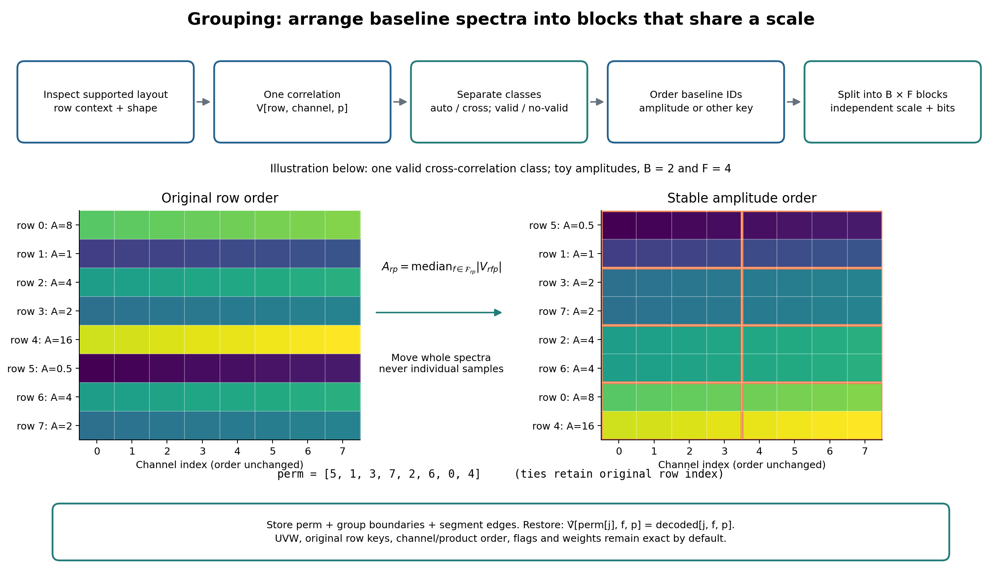

*Figure 1a. Grouping concept for one integration, configuration and correlation
product, after separating auto/cross classes. The illustrative amplitudes show
stable whole-spectrum sorting; equal amplitudes retain original row order.
Orange outlines mark blocks of two baselines by four channels. This small
schematic illustrates segmentation; the measured calibrated-data experiments use
128 baselines by all 48 channels per product, with partial edge blocks. The
stored permutation restores original row positions without channel averaging
or antenna-pair reversal. Colours illustrate amplitude, not measured data.*

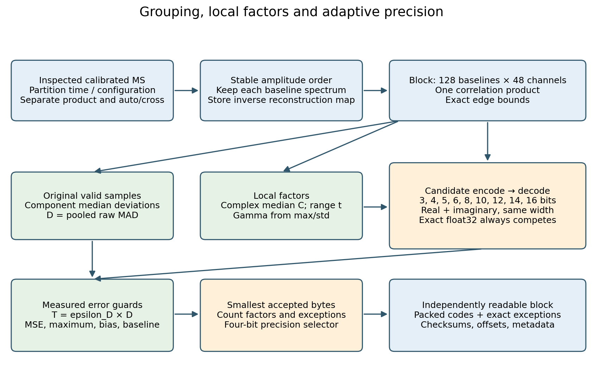

*Figure 1b. Spectra are ordered within one configuration, integration, product and
auto/cross class. Each block is independently encoded, reconstructed and checked;
the smallest accepted serialized candidate is stored with its reconstruction map.*

### 2.2 Local centre, range and power spacing

For block $q$, store two component medians
$C_q=C_{q,R}+iC_{q,I}$, a shared range $t_q\ge0$ and a power parameter $\gamma_q$.
The encoder computes the medians from eligible values, excluding flags, nonfinite
values and protected signed-zero samples, then rounds the medians to float32.
Residuals are calculated against these stored medians. Two range candidates are
tested: the maximum and the 99.5th percentile of
$\max(|\Re(V-C_q)|,|\Im(V-C_q)|)$. Each range is rounded upward to float32.
Values outside a candidate range are preserved through exact exceptions.

For either real component $x$, define $y=(x-C)/t_q$ on $[-1,1]$. Let

$$M_b=2^b-1,\qquad u_k=\frac{2k-M_b}{M_b},\qquad k\in\{0,\ldots,M_b\}.$$

The reconstruction levels are

$$\widehat x_k=C+t_q\,\operatorname{sgn}(u_k)|u_k|^{1/\gamma_q}.$$

All $2^b$ unsigned codes are used. The residual grid is symmetric and spans
$[-t_q,t_q]$, without a separate sign bit or a duplicate signed-zero code. Since
$M_b$ is odd, the grid has no exact residual-zero level for $t_q>0$. This is a
midrise grid: an ordinary value at the centre can acquire a small error. Negative
zeros are protected exactly through exceptions. If $t_q=0$, the decoder copies
the stored component centres directly. Entirely zero or otherwise compressible
blocks may instead select the exact representation.

For $\gamma_q=1$, the reconstruction spacing is uniform,
$\Delta_b=2t_q/(2^b-1)$. For $0<\gamma_q<1$, levels concentrate near the centre:

$$\left|\frac{d\widehat x}{du}\right|
=\frac{t_q}{\gamma_q}|u|^{1/\gamma_q-1}.$$

The candidate encoder first computes the continuous coordinate

$$k^*=\frac{M_b}{2}\left[1+\operatorname{sgn}(y)|y|^{\gamma_q}\right].$$

It reconstructs the adjacent integer codes $\lfloor k^*\rfloor$ and
$\lceil k^*\rceil$ using the stored factors and chooses the closer reconstructed
float32 value. Equal errors select the even code. Choosing by reconstructed
values matters for nonlinear spacing; ordinary rounding of $k^*$ alone need not
choose the closest level in data units. Unflagged outliers are never silently
saturated. Endpoint clipping only protects the integer lookup from floating-point
roundoff after the range/exception decision.

The tested gamma rule uses the maximum absolute component residual divided by
pooled within-component population standard deviation, $r_q$. Both statistics
use all eligible residuals before selecting range exceptions, with float64
arithmetic and variance normalization `ddof=0`. It selects

$$\gamma_q=\begin{cases}
1,&r_q\le4\text{ or the ratio is undefined},\\
1/2,&4<r_q\le8,\\
1/4,&r_q>8.
\end{cases}$$

This is a deterministic encoder heuristic, not a noise model. The selected gamma
is stored, so decoding never estimates it again. Full gamma search is available
as a separate experiment. The decoder evaluates normalized codes and powers in
float64, using explicit squares for gamma $1/2$ and fourth powers for gamma $1/4$,
then multiplies by the stored range, adds the stored centre and rounds once to
float32. The reference implementation fixes the operation order.

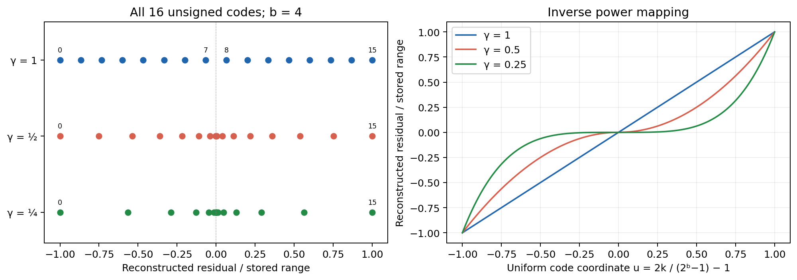

*Figure 2. Illustrative four-bit reconstruction levels after median subtraction.
Every row contains 16 distinct unsigned codes. Smaller gamma increases resolution
near the centre while increasing spacing near the range endpoints. The experiment
also allows eight other component widths.*

### 2.3 Choosing precision with epsilon D

The reference statistic for acceptance is computed from the original finite,
unflagged samples, before outlier selection. Define raw component deviations

$$d_{q,R}=\operatorname{median}|\Re V-\operatorname{median}(\Re V)|,
\qquad d_{q,I}=\operatorname{median}|\Im V-\operatorname{median}(\Im V)|,$$

$$D_q=\sqrt{\frac{d_{q,R}^2+d_{q,I}^2}{2}},\qquad T_q=\epsilon_DD_q.$$

These medians use float64 arithmetic and no Gaussian conversion factor. $D_q$
describes signal variation; it is not a thermal-noise estimate. It is separate
from the rounded median used for coding. Multiplying all visibilities by a real
amplitude factor scales $D_q$ and the permitted absolute error by its magnitude,
subject to finite-precision effects. Thus the tolerance has no fixed amplitude
unit and requires no denominator floor near an individual zero visibility.

For reconstructed error $e=\widehat V-V$, the tests are

$$\frac{1}{2N_q}\sum_{n\in\mathcal V_q}|e_n|^2\le T_q^2,\qquad
\max_{n\in\mathcal V_q}|e_n|\le10T_q,$$

$$\left|\frac{1}{N_q}\sum_{n\in\mathcal V_q}e_n\right|\le T_q,\qquad
\max_{b\in q}\frac{1}{2N_{q,b}}\sum_{n\in\mathcal V_{q,b}}|e_n|^2\le2T_q^2.$$

Only baselines with eligible samples contribute to the last expression. These
are pooled real/imaginary constraints; separate component errors are measured
but there is no independent per-component relative ceiling. A zero $D_q$ imposes
zero measured error, even when a sparse nonconstant block has zero MAD. Empty
valid sets have zero measured errors. Exact fallback is always available.

The precision ladder is

$$b\in\{3,4,5,6,8,10,12,14,16\}\cup\{\text{exact float32}\}.$$

Each bit width and range candidate is actually reconstructed and tested. The
encoder chooses the candidate with the fewest serialized bytes, including the
header, codes, exception stream and optional lossless compression. Exact storage
also competes on size and wins equal-size ties. A larger epsilon generally permits
coarser precision, but bytes and image error are measured rather than inferred
from the nominal width. Precision is common to the real and imaginary components
within a block. A $b$-bit component codec uses $2b$ payload bits per complex sample
before exceptions and other overhead.

The general interface also supports sampled global std, block std and uncentered
block RMS references through $\epsilon_G$, $\epsilon_S$ and $\epsilon_R$.
Those coefficients are disabled in the present experiment. Their sampling and
combination study is documented in the [16% study](../../devnotes/fixed16.md);
no fixed absolute-error threshold is active here.

### 2.4 Data format and precision tags

The scientific schema is independent of its HDF5 prototype container. The archive
holds typed table descriptors and keywords, exact supported subtable values,
original coordinates, row/cell maps, permutations, flags, weights, visibility
streams, error summaries and integrity inventories. Shared subtable content is
stored once when compacting the integration partitions. Explicit little-endian
dtypes and JSON metadata avoid executable object serialization.

Each block has a 16-byte base header containing a precision selector, compression
identifier, mapping identifier, complex sample count, exception count and a
float32 range or step. Power blocks append two float32 centre components and
float32 gamma, making 28 bytes before the body. An exact block uses the 16-byte
base header and original complex64 bits. The first byte of the new header is
`0xA0 | tag`, with the lower four bits interpreted as follows:

| Tag | Interpretation |
| --- | --- |
| 0 | Exact complex64 |
| 1–9 | 3, 4, 5, 6, 8, 10, 12, 14, 16 bits/component, respectively |
| A | Legacy two-bit representation, outside the tested ladder |
| B–E | Reserved; decoder rejects |
| F | Invalid/error; never a successful encoded block |

Four bits suffice to select the precision, not to represent every visibility.
The upper nibble identifies this header version; aligned header sizes remain
16/28 bytes. The format does not claim an additional half-byte saving per block.
Historical literal-width headers remain decodable, while unsupported tags fail
explicitly.

Codes are interleaved real then imaginary and packed least-significant bit first.
Each width occupies its actual number of bits; 14-bit codes can cross three bytes.
Unused final high bits must be zero. Exact exceptions store increasing uint32
sample positions and original eight-byte complex64 values. They restore protected
special-value bits and outliers after ordinary reconstruction. Block bodies use
DEFLATE only when it reduces their size. Offset indexes and per-block CRC32 allow
independent reads; dataset SHA-256, container checksums and a manifest inventory
provide further corruption detection. These checks detect accidental damage;
they are not authentication signatures. The decoder needs no remote service,
learned model or downloaded codebook. A standard-library reference block decoder
and small literal conformance fixtures accompany the implementation.

### 2.5 Compression, decompression and calibrated-only policy

Compression proceeds through inspection, context partitioning, grouping, candidate
selection, payload writing and source-aware verification. Partial outputs remain
distinguishable from completed archives. The source MS is never overwritten.
Decompression checks inventories and block bounds, reconstructs values, applies
exact exceptions and inverse permutations, rebuilds subtable references, and
writes a new MS. Original UVW float64 values are retained in metres; no antenna
position, time or frequency calculation regenerates them. Bitwise-identical
coordinates may be deduplicated, without tolerance-based merging.

The calibrated-only profile explicitly retains CORRECTED_DATA and removes the
original DATA and MODEL_DATA. Original flagged visibility values are discarded
and represented by positive-zero placeholders, while FLAG, FLAG_ROW and
FLAG_CATEGORY remain preserved. It retains sample presence, array shapes and
resolution. Consequently this profile is not an exact round trip of the original
MS, even when the retained visibilities choose exact storage. On export, DATA is
recreated from decoded CORRECTED_DATA for MS compatibility; original raw DATA is
not recovered. Remaining supported metadata and auxiliary columns stay exact.

Weights use an independent four-bit codebook with checked float32 fallback;
weight approximation, if needed, follows its separately recorded tolerance.
The weights of this particular observation are reconstructed bitwise exactly.
No quantization error estimate overwrites original weights. Optional removal of
flags is a distinct destructive profile and is not enabled in these experiments.

For the supported multi-integration case, the reference workflow is:

```bash
export PYTHONPATH=src
python scripts/timeslot_archive.py encode INPUT.ms blocks.bundle \
  --config configs/calibrated-epsd-018.json --report encode.json
python scripts/timeslot_archive.py compact blocks.bundle archive.h5 \
  --report compact.json
python scripts/timeslot_archive.py decode archive.h5 RESTORED.ms \
  --report decode.json
```

All outputs must be new paths. Decoding receives the archive alone. Source-aware
validation is a separate step and does not supply missing reconstruction data.

## 3. Validation on calibrated OVRO-LWA data

### 3.1 Observation and experiment design

The inspected input `lwa-15slot-flat.ms` contains 15 contiguous integrations,
931,920 rows and 352 antennas. Each integration has 62,128 ordered antenna pairs:
352 autocorrelations and 61,776 cross-correlations. Each cell has 48 channels and
four products in metadata order XX, XY, YX, YY. Channel centres range from
63.965576 to 68.463623 MHz at 95.703125 kHz spacing. Original TIME and
TIME_CENTROID values and their UTC references are retained. The table contains
926,641 bitwise-distinct original UVW vectors.

CORRECTED_DATA contains 178,928,640 complex samples, or 1,431,429,120 logical bytes.
There are 41,752,612 flagged samples. The complete source occupies 4,428,203,949
bytes, including raw and model columns that the calibrated profile deliberately
omits. These different denominators must not be conflated. Source HISTORY records
CASA `applycal`; this establishes the supplied calibration history, not an
independent validation of the calibration or flux scale.
[Input inspection](../../reports/calibrated-inspection.json).

We fix all grouping, median, gamma, exception and preservation settings and test
$\epsilon_D=0.01$, $0.04$ and $0.18$ with the expanded nine-width ladder. The
coefficients are specified in advance and are not retuned to a byte target or
selected from image outcomes. Each case reads the original calibrated source;
none recompresses a previous quantized result. All use 128×48×1 blocks, independent
amplitude ordering, the max/std gamma rule, range quantiles 1 and 0.995, and exact
fallback. The initial three-epsilon study used 24 encoder workers. A subsequent speed and
I/V study retains the epsilon-D 0.18 scientific settings and decoded values, with
a different execution configuration (Section 3.6). Exact configurations and
versioned reports accompany both studies.

### 3.2 Reconstruction and imaging checks

The validation suite exercises every width, partial blocks, special values,
flags, signed zeros, exact fallback, malformed/truncated streams and both header
representations. Independent standard-library, portable NumPy and compiled
reconstructions are compared. Native modules built before a requested width
fall back to portable encoding. The subsequent performance validation passes 124 tests.
Source-aware archive/export checks compare original supported metadata,
coordinates, flags and weights exactly, and independently recompute normalized
visibility error criteria. Source checksums are checked against the original
import inventory.

Imaging uses WSClean 3.7 in the same recorded container for reference and
quantized MSs. A private MS copy protects each input from imaging side effects.
The initial study uses Stokes I; the subsequent epsilon-D 0.18 study runs
Stokes I and V separately against matching references. A further V sweep images
the same three epsilon cases, each twice, using their verified exports.
All use 2048×2048 pixels,
four-arcminute pixels, Briggs robust 0 and multiscale CLEAN.
The remaining settings are eight threads, scale bias 0.8, 150,000 iterations,
mgain 0.95, auto-threshold 0.5, auto-mask 3, local RMS, a 10° horizon mask,
40% memory setting, reordering and no model-column update. Candidate images use
the reference restoring beam. Auto-masks are estimated independently, so
deconvolution-path changes contribute to the measured differences. WSClean is an
established wide-field imager; these particular validation settings and results
belong to this experiment.
[Offringa et al. (2014)](https://arxiv.org/abs/1407.1943).

The comparison mask requires elevation above 10° for all 15 integrations and
contains 2,245,726 pixels. For $S\in\{I,V\}$, let $S_0$ be the restored reference,
$S_\epsilon$ the corresponding quantized image, and $R_{0,S}$ the reference
residual map. We report uncentered, unclipped statistics on this fixed mask:

$$E_S=\operatorname{RMS}_{\mathcal M}(S_\epsilon-S_0),\qquad
\eta_S=100\frac{E_S}{\operatorname{RMS}_{\mathcal M}(R_{0,S})}.$$

The I and V reference residual RMS values are 1.031244811 and 0.384439444 Jy/beam,
respectively. Each denominator is a single scalar measured from the matching
reference residual; there is no pixelwise residual division. These percentages
are not fractional flux loss or thermal-noise budgets. Residual maps contain sky
and deconvolution structure. We additionally compare dirty images, faint-region
RMS, reference-peak changes and visibility errors by baseline, product and
frequency. Faint pixels are defined by reference intensity below 1% of its peak.
Each quantized imaging case is CLEANed twice, and the I/V study includes a repeat
of each uncompressed reference. Two runs measure observed variation, not a
statistical confidence interval.

### 3.3 Three-epsilon Stokes I comparison

<!-- RESULTS_START -->
| εD | Payload MB (% of complex64) | Complete archive MB | Difference mJy/beam, first / repeat | Difference / reference residual RMS %, first / repeat |
| ---: | ---: | ---: | ---: | ---: |
| 0.01 | 327.207 (22.859%) | 427.429 | 12.9866 / 12.9944 | 1.2593 / 1.2601 |
| 0.04 | 249.542 (17.433%) | 350.112 | 11.8731 / 11.8666 | 1.1513 / 1.1507 |
| 0.18 | 142.163 (9.932%) | 242.766 | 57.5807 / 49.4859 | 5.5836 / 4.7987 |

| εD | Dirty difference mJy/beam | Worst reference-peak change % | Worst faint-region RMS difference % | Candidate residual RMS Jy/beam, first / repeat |
| ---: | ---: | ---: | ---: | ---: |
| 0.01 | 1.5080 | 0.00020 | 1.0430 | 1.030953 / 1.030953 |
| 0.04 | 5.4572 | 0.00244 | 0.9556 | 1.031218 / 1.031221 |
| 0.18 | 40.0807 | 0.43340 | 4.5891 | 1.026183 / 1.028690 |

| εD | Cross XX RMSE / signal RMS % | Cross XY % | Cross YX % | Cross YY % |
| ---: | ---: | ---: | ---: | ---: |
| 0.01 | 0.59372 | 0.38169 | 0.48786 | 0.45558 |
| 0.04 | 2.35604 | 1.43210 | 1.87325 | 1.78090 |
| 0.18 | 11.49117 | 10.65014 | 11.56520 | 9.94197 |

Visibility ratios divide component reconstruction RMSE by the original component
signal RMS, pooling all finite unflagged cross-correlations in each product.
They are distinct from the local MAD-normalized acceptance criterion. Cross-hand
visibility statistics do not constitute a polarized-image validation.

All three archives passed full-source export verification. Original supported
metadata, UVW, flags and this observation's weights passed exact checks; all 108
source-file hashes still match. All six CLEAN runs reached the final threshold, with 3 major iterations each.
The new 5/10/14-bit choices encode
26,333,664, 104,509,248 and 0 complex samples,
respectively, summed across the three separate experiments. Exact blocks often
represent highly compressible zeros, so sample fractions and byte fractions differ.
Complete distributions and auto/cross splits are retained in the machine-readable
[experiment report](../../reports/calibrated-epsd-dense.json).


*Figure 3. Fixed epsilon-D values produce measured sizes and image errors; there
is no imposed byte target. Red points show two CLEAN runs. Blue squares show the
first dirty-image difference, all normalized by the same reference residual RMS.*


*Figure 4. Selected component widths by number of complex samples and by serialized
payload bytes. Float32 denotes exact storage, including cheaply compressed zero
blocks. Metadata outside visibility blocks is accounted for separately.*

For the pixelwise I and V displays in Figures 5–8, define

$$P_{\epsilon,S}(\boldsymbol\theta)=100\,
\frac{S_\epsilon(\boldsymbol\theta)-S_0(\boldsymbol\theta)}{\mathrm{RMS}_{\mathrm{residual},S}},\qquad
\mathrm{RMS}_{\mathrm{residual},S}=\sqrt{\frac{1}{N_{\mathcal M}}\sum_{\boldsymbol\theta\in\mathcal M}
R_{0,S}(\boldsymbol\theta)^2},\quad S\in\{I,V\}.$$

The denominators are the uncentred reference residual RMS over the full
above-10° mask: 1.031244811 Jy/beam for I and 0.384439444 Jy/beam for V.
Each remains fixed across epsilon cases and zooms, matching the normalization of
the tabulated image-error metrics. Colourbar ticks express the ratios as
percentages, with the compact label
$(S_{\mathrm{quant}}-S_{\mathrm{ref}})/\mathrm{RMS}_{\mathrm{residual}}$.

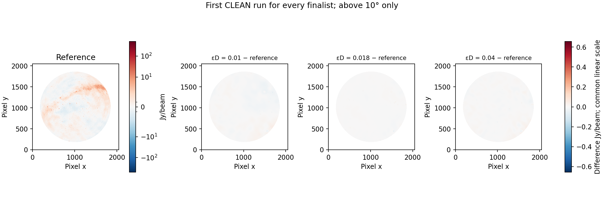

*Figure 5. Two rows and three columns, with $\epsilon_D=0.01$, $0.04$ and $0.18$
from left to right. Top: first-run recovered Stokes I images in Jy/beam, using
viridis and a common symmetric logarithmic intensity scale. Bottom: signed
$100(I_\epsilon-I_0)/\mathrm{RMS}_{\mathrm{residual},I}$ differences, using bwr and a common linear
percentage scale from −30% to +30%. Values beyond these display limits use the
endpoint colours, indicated by the extended colourbar. Pixels outside the
above-10° mask are excluded. Top-row x axes and y axes in columns 2–3 are omitted.*

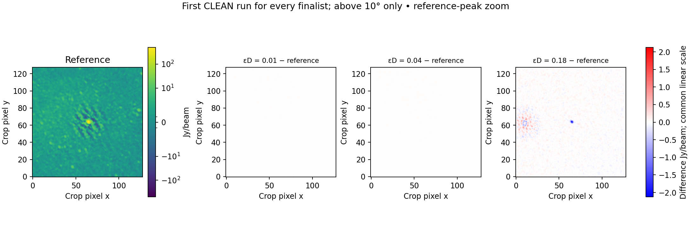

*Figure 6. The same two-row, three-column comparisons in a fixed 128×128-pixel
crop around the reference peak. Recovered images occupy the top row; percentage
differences occupy the bottom row. The full-mask reference residual RMS and
both colour scales are identical to Figure 5. The uncompressed reference defines
the crop independently of the recovered images.*

<!-- RESULTS_END -->

### 3.4 Additional Stokes I and V validation

<!-- IV_START -->
The subsequent test uses the epsilon-D 0.18 archive produced by the measured
optimized workflow. Its decoded visibilities equal those of the earlier 0.18
case: 147 column comparisons and the retained metadata match. An independent
frozen decoder exports the new archive, and original-source checks pass. Across
archive implementations, 5,040 scientific dataset references have matching
shapes, dtypes and hashes, with unchanged measured visibility errors. The extra
I runs below are distinct CLEAN realizations of the same decoded values; they
do not replace the earlier I measurements. In that performance study, V was
tested at 0.18; the subsequent three-epsilon V sweep is reported below.

| Stokes | Reference residual RMS Jy/beam | Difference mJy/beam, first / repeat | Difference / reference residual RMS %, first / repeat |
| --- | --- | --- | --- |
| I | 1.031245 | 49.6019 / 50.2789 | 4.8099 / 4.8756 |
| V | 0.384439 | 38.6601 / 38.6601 | 10.0562 / 10.0562 |

A repeat of each uncompressed reference quantifies observed CLEAN variation:

| Stokes | Reference-repeat difference mJy/beam | Difference / reference residual RMS % |
| --- | --- | --- |
| I | 4.341164 | 0.420964 |
| V | 0.042750 | 0.011120 |

All four quantized I/V CLEAN runs reached the final threshold. The V discrepancy
is about 10.06% of its reference residual RMS, compared with 4.81–4.88% in I.
Although the absolute V difference is smaller, its normalization is also smaller.
Both exceed their corresponding reference-repeat differences; the V discrepancy
cannot be explained by the observed repeat alone. These controls are not
subtracted from the reported errors. Visual agreement or a small I difference
does not establish weak-polarization or leakage fidelity. The follow-up below
measures the two stricter V cases directly.
[Measured I/V and identity report](../../reports/calibrated-performance.json).

A follow-up on 27 October images Stokes V at all three epsilon values,
using the original verified exports and the same template, reference beam and
above-10° mask. Each case is CLEANed twice. All six runs reach the final
threshold and preserve their input MS hashes. These new runs are separate from
the preceding performance-study V pair at 0.18; no result has been relabelled or
substituted. The matching V reference residual RMS is 0.384439444 Jy/beam.

| εD | V difference mJy/beam, first / repeat | V difference / reference residual RMS %, first / repeat |
| --- | --- | --- |
| 0.01 | 4.1801 / 4.1802 | 1.0873 / 1.0873 |
| 0.04 | 8.0278 / 8.0278 | 2.0882 / 2.0882 |
| 0.18 | 38.6601 / 38.6601 | 10.0562 / 10.0562 |

[Full three-epsilon V measurements](../../reports/calibrated-epsd-v.json).
Figures 7–8 use the same layout as the I comparisons in Figures 5–6. The V
reference selects a source-centred crop independently of the reconstructions.

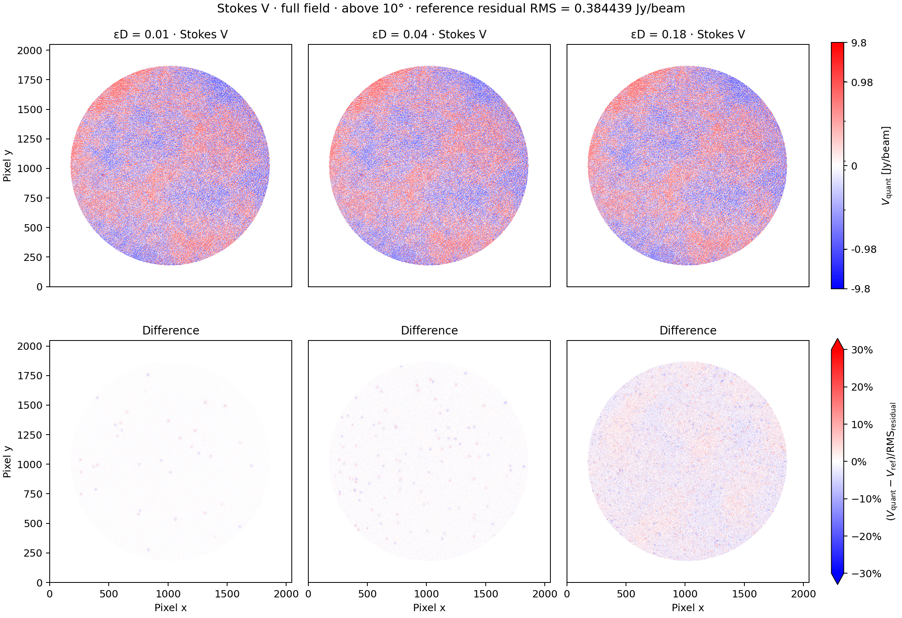

*Figure 7. Stokes V counterparts to Figure 5: recovered images above signed
percentage differences, with epsilon-D 0.01, 0.04 and 0.18 from left to right.
Both rows use bwr; the intensity scale is linear with fixed
limits of −2.5 to +2.5 Jy/beam, and the RMS-normalized difference scale is linear
from −30% to +30%. Extended colourbar ends indicate values outside the displayed
ranges. Only the fixed above-10° mask
is shown. Top-row x axes and the last two columns' y axes are omitted.*

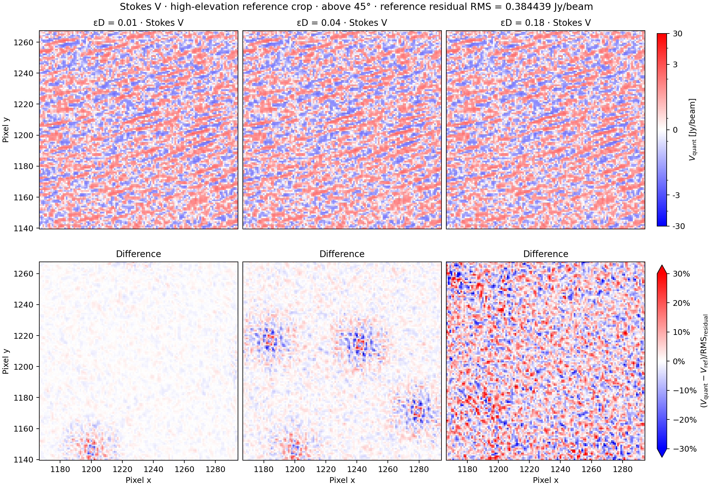

*Figure 8. The same V comparisons in a fixed 64×64-pixel crop around a compact
V feature in the Taurus A (Crab Nebula) region. The reference peak is
+6.091 Jy/beam, coincident with the bright I source and within one restoring
beam of the [catalogue position](https://simbad.u-strasbg.fr/simbad/sim-id?Ident=Crab+Nebula).
Circles mark the selected reference peak. The centre stays above 50° elevation
and every crop pixel remains above 45°
throughout the observation. Selection uses only the reference; the full-field
residual RMS denominator and ±30% difference scale are retained. The linear V
intensity scale runs from −8 to +8 Jy/beam. This is measured V
at a radio-source position; intrinsic circular polarization and instrumental
leakage have not been separated.*
<!-- IV_END -->

### 3.5 Before/after sizes and storage contributors

<!-- STORAGE_START -->
| Representation | Whole MB | Visibility MB | Scope |
| --- | --- | --- | --- |
| Original full MS (physical) | 4428.204 | — | Includes raw and model columns |
| Original CORRECTED_DATA (logical) | — | 1431.429 | Denominator for payload fractions |
| Calibrated-only, exact retained values | 985.236 | 955.400 | Shared single-file lossless control |
| Quantized, εD=0.01 | 427.429 | 327.207 | Initial three-epsilon study |
| Quantized, εD=0.04 | 350.112 | 249.542 | Initial three-epsilon study |
| Quantized, εD=0.18 | 242.766 | 142.163 | Initial three-epsilon study |
| Quantized, εD=0.18, optimized | 242.769 | 142.163 | I/V and speed benchmark, run 1 |

The full-source-to-archive change includes a deliberate preservation-policy
change: raw DATA and MODEL_DATA each contain 1431.429 logical MB and are
omitted; original flagged visibility values are zeroed. Their combined
2862.858 logical MB must not be interpreted as separately measured
physical file savings. The exact control uses the same calibrated-only policy,
flags and exact-on-this-dataset four-bit weights, with no visibility quantization.
Its verified shared-file archive occupies 985.236 MB.
Before lossless structural sharing, its directory bundle occupied
1079.629 MB; sharing and
container compaction save 94.393 MB without requantization.

Relative to this retained-data lossless control, the optimized 0.18 archive is
4.058× smaller (24.641% remaining).
Its visibility stream is 9.932% of logical complex64 bytes,
or 14.880% of
the already losslessly compressed control stream. The complete archive is
5.482% of the physical source, but that
ratio combines omission, lossless compression, deduplication and quantization.
The 3,630-byte increase relative to the earlier
0.18 file is provenance/container overhead; visibility bytes are unchanged.
[Lossless sharing measurements](../../reports/calibrated-shared-storage.json),
[storage audit](../../reports/calibrated-paper-storage.json).

The optimized run-1 archive has the following physical allocation. Every byte is
included, including container overhead; percentages may round independently.

| Contributor | Bytes | % of archive |
| --- | --- | --- |
| Visibility blocks (codes, headers, factors, exceptions, exact blocks) | 142,163,290 | 58.559 |
| Measured visibility-error records | 42,153,640 | 17.364 |
| Quantization/reference statistics | 21,032,024 | 8.663 |
| Original coordinates and identities | 19,510,556 | 8.037 |
| Baseline permutations | 6,185,493 | 2.548 |
| Shared subtables | 5,531,017 | 2.278 |
| Container, manifests, verification and links | 5,345,063 | 2.202 |
| Reconstruction maps | 462,886 | 0.191 |
| Visibility-block indexes | 352,749 | 0.145 |
| Flags and weights | 32,166 | 0.013 |
| Other auxiliary columns | 292 | 0.000 |
| Total | 242,769,176 | 100.000 |

Visibility payload contributes 58.56% of the file. Error records
and quantization statistics together occupy
63.186 MB
(26.03%).
These diagnostic arrays, followed by coordinates, are the main remaining costs;
metadata has not disappeared into a visibility-only compression claim.

The 0.18 precision distribution is shown numerically below. Each width applies
to both real and imaginary components; a four-bit component block has eight
nominal code bits per complex sample. Figure 4 compares all three epsilon cases.

| Bits/component | Blocks | Complex samples | % samples | Stored block MB |
| --- | --- | --- | --- | --- |
| 3 | 0 | 0 | 0.000 | 0.000000 |
| 4 | 17,997 | 110,527,680 | 61.772 | 107.846086 |
| 5 | 4,295 | 26,333,664 | 14.717 | 32.098492 |
| 6 | 56 | 165,216 | 0.092 | 0.206102 |
| 8 | 28 | 172,032 | 0.096 | 0.285262 |
| 10 | 0 | 0 | 0.000 | 0.000000 |
| 12 | 0 | 0 | 0.000 | 0.000000 |
| 14 | 0 | 0 | 0.000 | 0.000000 |
| 16 | 0 | 0 | 0.000 | 0.000000 |
| Exact float32 | 6,848 | 41,730,048 | 23.322 | 1.727348 |

The 29,224 blocks include 22,376 quantized and
6,848 exact blocks. All exact blocks in this case contain
positive-zero placeholders: 41,730,048 samples but only
1.727348 MB after lossless compression. This does
not recover discarded flagged values. The remaining 22,564
flagged placeholders are exact exceptions inside mixed blocks. Thus a large
exact sample fraction does not imply a large exact-byte cost. Widths unused here
remain available to other data.

Before secondary compression, packed integer codes occupy
144.036648 MB, exact-block component arrays
333.840384 MB, exception positions
2.294332 MB and exception values
4.588664 MB. Headers total
0.736096 MB, including 0.358016 MB for the four
float32 factors (two centre components, range and gamma). Factor bytes are a
subset of headers, not an additional category. These are logical precompression
counts: codes and exceptions share compressed block bodies, so their final
physical contributions cannot be uniquely separated. The measured combined
visibility stream is 142.163290 MB.

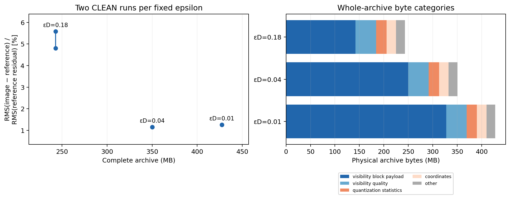

*Figure 9. Initial three-epsilon Stokes I study: complete archive size versus
RMS(image − reference) / RMS(reference residual), in percent for both CLEAN runs
(left), and physical byte contributors (right). The 0.18 visibility payload is
identical in the subsequent I/V study. Full optimized-file accounting is given
above; nominal component widths alone do not determine whole-archive size.*
<!-- STORAGE_END -->

### 3.6 Measured MS-to-archive performance

<!-- PERFORMANCE_START -->
Three unprofiled, fresh-process runs of each implementation measure elapsed
wall time from the complete 15-integration MS to a verified single-file archive.
The boundary includes discovery, reference sampling, inspection, encoding,
integrity and source checks, and final compaction/validation. It excludes MS
export and imaging. Scientific settings, flags/weights policy and decoded values
are held fixed at epsilon-D 0.18; no error bound is relaxed for this comparison.

The host has two Intel Xeon Silver 4214 CPUs, 48 logical CPUs and 376.5 GiB RAM.
Runs use a warm OS cache without eviction. Task-owned timing runs execute
sequentially, separately from profiling, unit tests and CLEAN; unrelated activity
on this shared host is not controlled. Six one-run process/thread allocation
pilots preceded selection of eight processes with six encoder threads each.
The table reports the subsequent three repeats, not the fastest pilot.

| Execution | Three full-workflow runs, s | Median s | Min–max s |
| --- | --- | --- | --- |
| Baseline (1 process × 24 threads) | 489.143 / 464.957 / 485.870 | 485.870 | 464.957–489.143 |
| Optimized (8 processes × 6 threads) | 71.636 / 72.685 / 72.965 | 72.685 | 71.636–72.965 |

The median falls from 485.870 to
72.685 s, a 6.685× speedup.
In the optimized repeats, verified-bundle creation takes 53.105–56.132 s and
single-file compaction/validation another 16.592–19.325 s. The complete-MS
15-second target remains unmet. Parallel stage-time sums are not elapsed latency.
This benchmark compares complete execution configurations; it does not isolate
algorithmic changes from the increased worker allocation.

Reported parent peak RSS is 0.991–1.016 GB for the baseline and approximately
0.136 GB for the optimized workflow; the largest individual optimized worker
peak is 0.714–0.738 GB. A simultaneous aggregate memory peak was not measured,
so these values are not a total-memory comparison. Separately, the frozen
independent decoder exported the optimized archive in 58.35 s; export plus
source verification and resampling took 118.08 s. That check overlapped later
imaging and is not a repeated decoder-performance benchmark.

All repeated archives preserve the same 142,163,290-byte visibility payload,
precision distribution and reconstructed values. Their few-hundred-byte total
size variation comes from provenance. The performance validation reports
124 passing tests, independent decoding and exact retained-column checks.
Detailed profiles, software records and reproduction commands are kept in the
[benchmark note](../../devnotes/calibrated-performance.md) and
[measured report](../../reports/calibrated-performance.json).

The following breakdown uses the recorded median run (run 2), whose full
process wall time is 72.685 s. Rows are non-overlapping elapsed intervals, or
explicit differences of those measured intervals, and sum to the complete run.

| Phase | Wall seconds | % of total |
| --- | --- | --- |
| Global reference sampling | 6.141 | 8.45 |
| Remaining bundle work: discovery, parallel inspection/encoding/source checks, finalization | 46.964 | 64.61 |
| Validate input bundle for compaction | 6.117 | 8.42 |
| Copy/share arrays into final archive | 4.848 | 6.67 |
| Validate final archive | 5.309 | 7.30 |
| Other compaction/finalization overhead | 3.051 | 4.20 |
| Process startup/shutdown and remaining orchestration | 0.255 | 0.35 |
| Total process wall time | 72.685 | 100.00 |

The remaining bundle interval includes discovery, overlapping partition work
and finalization. The instrumentation does not separate these into individual
additive wall-time contributions. The two overhead rows are measured remainders.
Input-bundle validation, array copying/sharing and final-archive validation are
sequential subphases of the 19.325-second compaction stage.

For context, the same run also records the following work summed across the
15 partitions. These totals overlap in wall time and must not be added
to the preceding table:

| Parallel work | Summed partition seconds |
| --- | --- |
| Inspection | 23.466 |
| Encoding and writing, including integrity finalization | 223.877 |
| Source/integrity verification | 73.778 |

Encoding/writing is the largest recorded partition-work total. The parent
waits while partition processes run, so attributing that interval to parent CPU
or adding thread/partition durations would misrepresent the 72.685-second
latency. A finer additive split inside parallel encoding would require new
instrumentation; none is inferred from unrelated single-context profiles.
[Median-run timing audit](../../reports/calibrated-runtime-breakdown.json).
<!-- PERFORMANCE_END -->

### 3.7 Comparison

<!-- DYSCO_COMPARISON_START -->
We compare the calibrated archive against one-pass Dysco compression on the
same 15-integration dataset. Both paths retain the original flags, weights,
UVW and other supported metadata, omit raw and model visibilities, and discard
flagged visibility values. The varquanMS export uses zeros for discarded
values; Dysco receives complex NaN markers as described by Offringa (2016).
Unflagged calibrated inputs are identical. The Dysco output is a directly
readable MS, whereas the varquanMS HDF5 archive is exported to an MS for
imaging. Both use the same WSClean I/V settings, reference beams and fixed
above-10° mask. The original source was not modified.

Dysco uses truncated-Gaussian levels with row-frequency (RF) normalization
at 3, 4, 6 and 8 bits per component and truncations 1.5σ or 2.5σ; the
antenna-frequency (AF) control uses 3 and 8 bits at 2.5σ. VarquanMS
uses the same 128-baseline × 48-channel grouping and adaptive ladder as
above, with additional $\epsilon_D=0.09$ and $0.3$ measurements. Table 1
reports actual bytes. Visibility storage includes varquanMS permutations
and indexes, or Dysco DATA-manager scales and headers; complete sizes also
include the different container and metadata representations.

The paired-I column is the relative visibility RMS error for
$(XX+YY)/2$ over unflagged cross-baselines. The I/V columns use
$100\,\mathrm{RMS}(I_{\mathrm{quant}}-I_{\mathrm{ref}})/\mathrm{RMS}(I_{\mathrm{residual}})$
and the corresponding V expression:
the denominators are reference residual RMS, not image flux or thermal
noise. Values are first CLEAN runs.

| Method and setting | Vis. MB | Total MB | Paired-I % | I % | V % |
| -------- | ---: | ---: | ---: | ---: | ---: |
| varquanMS $\epsilon_D=0.01$ | 333.745 | 427.429 | 0.425 | 1.259 | 1.087 |
| varquanMS $\epsilon_D=0.04$ | 256.080 | 350.112 | 1.678 | 1.151 | 2.088 |
| varquanMS $\epsilon_D=0.09$ | 188.904 | 282.826 | 4.658 | 2.800 | 5.764 |
| varquanMS $\epsilon_D=0.18$ | 148.702 | 242.766 | 8.650 | 5.584 | 10.056 |
| varquanMS $\epsilon_D=0.3$ | 124.769 | 218.750 | 13.353 | 20.098 | 12.964 |
| Dysco RF 1.5σ, 3-bit | 149.119 | 318.774 | 22.448 | 12.049 | 27.154 |
| Dysco RF 1.5σ, 4-bit | 193.851 | 363.506 | 9.841 | 16.908 | 12.259 |
| Dysco RF 1.5σ, 6-bit | 283.315 | 452.970 | 2.268 | 3.089 | 3.666 |
| Dysco RF 1.5σ, 8-bit | 372.780 | 542.435 | 0.559 | 3.717 | 1.642 |
| Dysco RF 2.5σ, 3-bit | 149.119 | 318.774 | 22.767 | 22.359 | 26.433 |
| Dysco RF 2.5σ, 4-bit | 193.851 | 363.506 | 11.060 | 6.145 | 12.111 |
| Dysco RF 2.5σ, 6-bit | 283.315 | 452.970 | 3.669 | 4.323 | 4.033 |
| Dysco RF 2.5σ, 8-bit | 372.780 | 542.435 | 1.171 | 0.985 | 1.806 |
| Dysco AF 2.5σ, 3-bit | 134.293 | 303.948 | 112.984 | 77.316 | 111.051 |
| Dysco AF 2.5σ, 8-bit | 357.953 | 527.608 | 2.687 | 3.439 | 3.277 |

*Table 1. Measured calibrated-data sizes and errors. MB uses $10^6$ bytes;
visibility and whole-output sizes have different accounting boundaries.
All listed CLEANs reached their configured final threshold.
See the machine-readable reports for repeats, absolute errors, per-product
and baseline/frequency diagnostics, exact-column checks and provenance.*

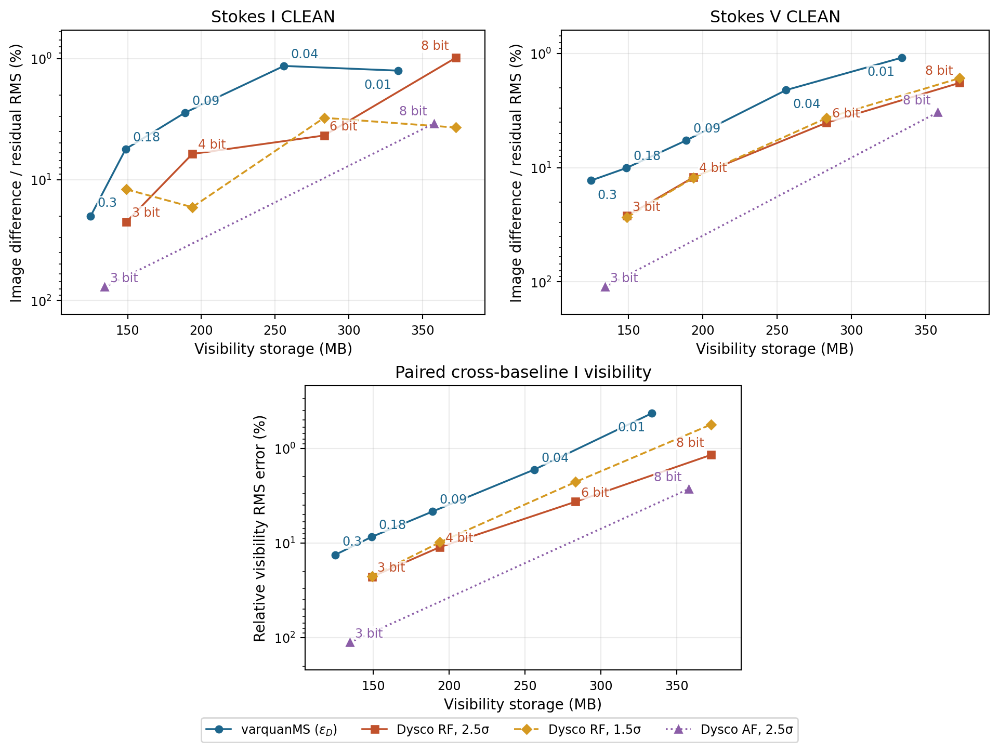

*Figure 10. I/V restored-image differences and paired cross-baseline I
visibility error versus visibility storage. Points at $\epsilon_D=0.09$
and $0.3$ are newly measured; labels on the varquanMS points are $\epsilon_D$.
Lines join measured settings of the same
method; they do not establish interpolation or monotonic CLEAN behavior.
Error axes are reversed, placing smaller errors higher. RF truncations use
separate series; AF has only the two measured bit widths.*

At nearly identical visibility storage, the $\epsilon_D=0.18$ archive uses
148.702 MB, compared with 149.119 MB
for 3-bit RF at 1.5σ. Their first I/V differences are
5.58% / 10.06% and
12.05% / 27.15% of the matching reference residual RMS.
The comparison is specific to this observation; output images are not
independent evidence of the true sky or a general fidelity guarantee.

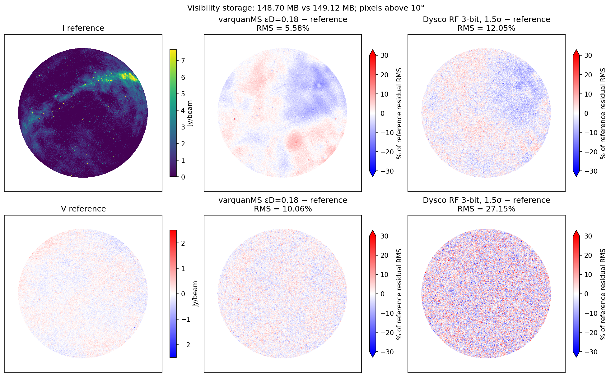

*Figure 11. Full-field reference I and V images and signed differences
for $\epsilon_D=0.18$ and Dysco RF 3-bit, 1.5σ. Each difference is
expressed as a percentage of the matching full-mask reference residual
RMS. Reference I uses viridis, reference V and signed differences use bwr;
the difference scale is limited to ±30%, with extensions for clipped values.*

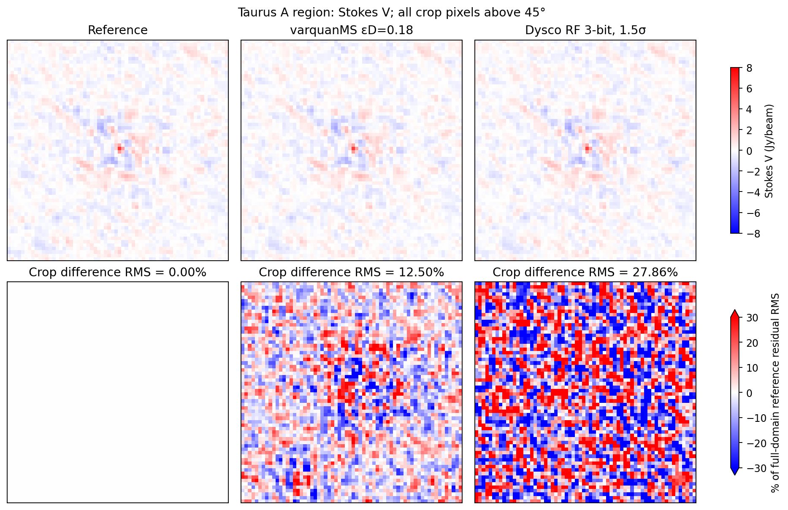

*Figure 12. Stokes V reference and reconstructions around the selected
Taurus A feature, with signed differences below. The 64×64 crop is above
45° throughout the observation; differences use the same full above-10°
reference residual RMS. Intrinsic circular polarization and instrumental
leakage have not been separated.*


*Figure 13. Complex-sample counts by selected precision for varquanMS
$\epsilon_D=0.18$ and 3-bit Dysco RF. Counts include flagged sample slots;
varquanMS exact-zero blocks are stored compactly. These are sample shares,
not byte shares; Table 1 includes the corresponding storage costs.*

CLEAN can be nonmonotonic: for Dysco RF at 1.5σ, the 4-bit I dirty-image
difference is smaller than at 3 bits, while its restored-image difference
is larger. Repeated images and stochastic-encoding variation have distinct
causes; the measured points should not be interpreted as a monotonic
guarantee. Autocorrelations are excluded from these images. In the full
8-bit AF run, XX and YY autocorrelation relative RMS errors are 97.15% and 96.65%,
while the cross-baseline paired-I error is 2.69%. Image agreement alone
therefore does not establish autocorrelation fidelity.

[Dysco comparison data](../../reports/dysco-comparison.json);
[additional epsilon measurements](../../reports/dysco-paper-extra.json);
[detailed comparison notes](../../devnotes/compare-dysco.md).
<!-- DYSCO_COMPARISON_END -->

## 4. Conclusion and discussion

Local median subtraction, full-range unsigned power levels and an explicit
$\epsilon_D$ acceptance rule provide a compact and interpretable encoder policy.
The coefficient expresses allowed error relative to block variation, while actual
reconstruction checks determine which precision is acceptable. Nine quantized
choices plus exact fallback fit within a four-bit precision selector. Broader
precision coverage does not remove the need to count factors, exceptions,
permutations, indexes, coordinates and error summaries in the archive size.

<!-- CONCLUSION_START -->
The three fixed epsilon-D values produce archives of 242.766–427.429 MB;
the initial Stokes I study has worst-of-two differences of 1.151–5.584% of
reference residual RMS. Epsilon-D 0.01 gives a smaller dirty-image difference
than 0.04 (0.146% versus 0.529%), yet a larger worst restored difference
(1.260% versus 1.151%). Tighter visibility limits therefore do not impose a
monotonic ordering on these CLEAN results. Two repeats do not establish
significance or a causal explanation for this reversal.

The additional 0.18 study measures I differences of 4.810–4.876% and V differences
of 10.056% of their respective reference residual RMS. V is more affected by this
measure than I, and exceeds its observed reference-repeat variation. The
242.769 MB complete archive is 4.058× smaller than the same-policy lossless
control; visibility payload is only 58.56% of the final file, with quality and
reference-statistics arrays contributing a further 26.03%. Full conversion takes
a median 72.685 s, including verification, versus 485.870 s for the baseline.
These are measured size, fidelity and speed tradeoffs for one observation;
none defines a universal optimum or a scientific acceptance threshold.
<!-- CONCLUSION_END -->

A single block statistic cannot establish every future science requirement.
Median deviation can vanish for sparse nonconstant data, forcing exact storage;
strong and weak products can have different scientific tolerances. Deterministic
rounding can create structured errors despite a small mean-square bound. Image
agreement depends on visibility weighting and nonlinear deconvolution as well as
visibility error, so dirty-image agreement alone is insufficient. These are
reasons to retain direct image checks and explicit maximum/bias guards.

The present validation covers joint-frequency Stokes I and V imaging on one
supplied calibrated observation. It does not establish polarimetric leakage,
narrow spectral-feature, calibration-solution or transient-light-curve fidelity,
and contains no held-out observation. Python-casacore reconstruction and WSClean
are directly exercised. CASA 5.4.1 reopened the export and produced a 64×64-pixel
natural-weight Stokes I dirty-image smoke test on a private copy. Its installed
observatory, Earth-orientation and leap-second tables issued warnings; this is
not a CASA 6 or precision-astrometry validation. The matched Dysco comparison
covers the same observation; additional observations and dedicated weak-polarization checks remain necessary
before choosing general archival defaults. The conservative default remains lossless.

The [public repository](https://github.com/peijin94/varquanMS) contains the format,
reference decoder, configurations, conformance tests, machine-readable validation
and figure-generation scripts. Detailed operational history is retained in
[development notes](../../devnotes/README.md) and the preserved initial manuscript,
rather than being appended to this methods paper.
