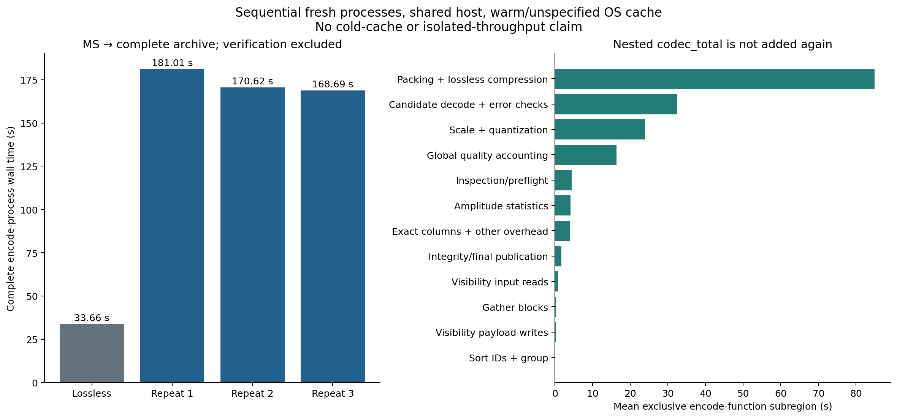

# varquanMS: local-scale, adaptive-precision archives for single-integration Measurement Sets

**Working methods and experiment paper — 23 October 2026.** This document describes
implemented behavior and measured results, not an approved archival science profile.
The repository/software name is **varquanMS**; this manuscript retains the requested
filename `varquantMS.md`. All sizes use decimal MB unless explicitly stated.

## Abstract

We investigate an independently decodable visibility archive that preserves
Measurement Set (MS v2) coordinates and auxiliary information while quantizing
complex visibilities in local baseline–frequency blocks. Each block uses one
stored float32 scale, exact exception values, and a measured choice among 4, 8,
12 and 16 bits per real/imaginary component or exact float32 components. Precision
is selected by encoded size subject to reconstruction-error constraints, not
by an amplitude-to-bit lookup. Baseline ordering changes which spectra share a
scale; stored permutations recover original row, channel and correlation order.

The inspected test MS has 62,128 rows, 192 channels, four linear-feed products,
and one integration. Its physical file total is 409.595 MB, including 381.714 MB
of logical complex64 DATA. A measured amplitude-sorted, 128-baseline × 192-channel
configuration produces a 106.730 MB archive, a **3.838× whole-MS reduction**.
Mean per-component visibility MSE is `2.8117e-8` in stored DATA units squared.
Matched WSClean 2048², 4-arcmin, multiscale imaging gives dirty/restored relative
RMS differences of **0.1996% / 0.7137%** over the valid celestial footprint.
These image metrics are not thermal-noise estimates. Three fresh-process encoding
runs of the initial encoder had a median wall time of 170.62 s (2.84 min).
After profiling and CPU optimization, three fresh processes with 24 workers take
**12.19 s median**, range **11.71–12.66 s**, retaining bit-identical visibility
payloads and exact auxiliary datasets. Both experiments used a shared host with
warm/unspecified cache. Verification, MS export and imaging are excluded from
encode time; full scope and repeatability are in Section 9.

## 1. Scope and relationship to earlier work

The goal is to reduce archive size without time/channel averaging or regeneration
of original coordinates. MS v2 associates visibility cells with row identities,
subtable references, flags and weights. UVW is explicitly a three-component
double-precision coordinate in metres. Reconstruction therefore restores stored
UVW rather than recomputing it. [MS v2 specification](https://casacore.github.io/casacore-notes/229.html)

Normalization and quantization are not new contributions. Dysco combines grouped
normalization, nonlinear quantization and dithering, including antenna/frequency
factorizations, and evaluates image-domain errors. Its published telescope results
are dataset-specific, not predictions for this MS. This prototype investigates
adaptive precision, grouping controls, explicit exceptions/error accounting and
standalone reconstruction; no matched Dysco benchmark has yet been run.
[Offringa (2016)](https://arxiv.org/html/1609.02019v1)

QLoRA motivates engineering comparisons such as distribution-adapted codebooks
and quantized scales, but neither language-model quality nor NF4's design is a
visibility-fidelity guarantee. The present codec is uniform, without NF4 or scale
quantization. [Dettmers et al. (2023)](https://arxiv.org/abs/2305.14314)
XRADIO/MS v4 illustrates labeled-array schemas and homogeneous configurations;
this archive does not claim MS v4 conformance and exports MS v2.
[XRADIO overview](https://xradio.readthedocs.io/en/latest/measurement_set/overview.html)

## 2. Inspected observation and storage accounting

The source is `20260904_190008_59MHz.ms`, copied from the supplied 59 MHz event
directory and checked against the source tar. Measurements below refer to the
extracted MS, not its tar wrapper. The channel axis is **inside each DATA cell**;
it is not 192 separate single-channel records. The full machine-readable inventory
is [initial-inspection.json](../../reports/initial-inspection.json).

| Property | Inspected value |
| --- | --- |
| Integration / data description / spectral window / field counts | 1 / 1 / 1 / 1 |
| Antennas; rows | 352; 62,128 |
| Autocorrelation / cross-correlation rows | 352 / 61,776 |
| Python DATA shape and dtype | `[62128, 192, 4]`, complex64 |
| Correlation order read from metadata | XX, XY, YX, YY |
| Complex sample count | 47,714,304 |
| Channel-centre range | 59.3359375–63.90576171875 MHz |
| Channel width | 23,925.78125 Hz |
| TIME; TIME_CENTROID | 5295265208.539846; 5295265213.555357 s, UTC |
| UVW dtype / units / recorded reference | float64 / m / ITRF |
| True FLAG / FLAG_CATEGORY / FLAG_ROW elements | 0 / 0 / 0 |
| DATA nonfinite samples / negative-zero components | 0 / 0 |
| Source physical file lengths | 409,594,838 bytes (65 files) |

The logical DATA size is

$$
N_v=N_rN_fN_p=62{,}128\times192\times4=47{,}714{,}304,
\qquad S_{\mathrm{DATA}}=8N_v=381{,}714{,}432\ \mathrm{bytes}.
$$

| Logical arrays | Bytes |
| --- | ---: |
| DATA | 381,714,432 |
| FLAG + FLAG_CATEGORY | 95,428,608 |
| WEIGHT + SIGMA | 1,988,096 |
| UVW | 1,491,072 |
| Other MAIN columns, including FLAG_ROW | 4,783,856 |
| Subtables | 91,133 |
| Total logical arrays | 485,497,197 |

Logical bytes are not per-column disk usage: unpacked Boolean arrays count one
byte per value here. Casacore separates logical tables from storage managers and
stores Boolean values as bits. This MS uses shared StandardStMan files, so exact
physical bytes cannot be attributed to individual columns by file lengths alone.
[Casacore Table Data System](https://casacore.github.io/casacore-notes/255.html)

UVW occupies one vector per row, not one per channel. Of 62,128 original vectors,
61,777 are bitwise distinct. A plain float64 dictionary plus uint32 row map would
cost 1,731,160 logical bytes, exceeding the original 1,491,072 bytes; it is not
selected on that basis. There is no tolerance-based geometry merging. For imaging
one can form wavelength coordinates

$$
\boldsymbol u_{\lambda}(r,f)
=\boldsymbol u_{\mathrm m}(r)\,\frac{\nu_f}{c},
$$

but this frequency-dependent conversion is not used for archival reconstruction.

## 3. Grouping: deciding which samples share a scale

### 3.1 Valid statistics and row identity

Let $V_{rfp}$ be the complex64 visibility at original row $r$, channel $f$ and
correlation $p$. The supported quantized layout has a single integration and
configuration, uniform cells and no duplicate row keys. Row identity includes
the ordered antenna pair and distinguishing time/feed/field/data-description/
scan/array/observation/processor/state context; antenna pairs are never swapped
and visibilities are never conjugated to canonicalize them. Unsupported quantized
layouts fail preflight. The exact archive path supports additional irregular
cell layouts; those are not silently normalized into the current quantized path.

Define the usable-channel set and grouping statistic as

$$
\mathcal F_{rp}=\{f:\neg\mathrm{FLAG}_{rfp},\ \neg\mathrm{FLAG\_ROW}_{r},
\ \Re V_{rfp},\Im V_{rfp}\text{ finite}\},
\qquad n_{rp}=|\mathcal F_{rp}|,
$$

$$
A_{rp}=\operatorname{median}_{f\in\mathcal F_{rp}}
\operatorname{hypot}(\Re V_{rfp},\Im V_{rfp}).
$$

The magnitude calculation is performed robustly in float64. No-valid-channel
rows receive a deterministic special class and stored valid count; NaNs cannot
randomly order them. An absent record is not synthesized as an all-flagged row.

### 3.2 Permutation and block boundaries

For amplitude ordering, sort each product independently by auto/cross class,
valid/no-valid class, $A_{rp}$ and original row index. The current default
`shared_order: false` allows different products to have different permutations.
Let $\pi_p(j)$ be the original row at archived position $j$:

$$
V^{\mathrm{arch}}_{jfp}=V_{\pi_p(j),f,p},
\qquad
\widehat V_{\pi_p(j),f,p}=\operatorname{Decode}(\mathrm{archive})_{jfp}.
$$

Only baseline IDs/spectra are reordered. Channel order within a spectrum is
unchanged. Within each class, consecutive groups of at most $B$ rows and frequency
segments of at most $F$ channels define blocks

$$
\mathcal B_{gsp}
=\{(\pi_p(j),f,p):j_g\le j<j_{g+1},\ f_s\le f<f_{s+1}\}.
$$

Store actual permutations and class/group/segment boundaries; reconstruction
does not rerun the sorting algorithm. Groups do not cross auto/cross, no-valid,
bucket or configured geometry/antenna boundaries. Partial blocks retain exact
bounds. A permutation alone provides no quantization gain if it leaves block
membership unchanged.


*Figure 1. Illustrative grouping within one valid cross-correlation class, with
toy amplitudes and $B=2,F=4$. Whole spectra move together. Orange rectangles are
quantization blocks, not averaging bins. [SVG](figs/grouping.svg),
[PDF](figs/grouping.pdf).*

For the measured $B=128,F=192$ configuration, all source rows have valid samples:

$$
N_{\rm blocks}
=4\left(\left\lceil\frac{352}{128}\right\rceil
+\left\lceil\frac{61{,}776}{128}\right\rceil\right)
=4(3+483)=1{,}944.
$$

The final auto and cross groups contain 96 and 80 rows respectively. The four
uint32 permutations occupy 994,048 logical bytes, or **488,354 stored bytes** in
the measured archive. Their cost is included in all whole-archive ratios.

### 3.3 Available controls and actual defaults

| Setting | Ordering | Maximum block, rows × channels × products |
| --- | --- | --- |
| Quantizer defaults, when enabled | Original row order | 1 × 192 × 1 |
| Engineering example | Original row order | 32 × 64 × 1 |
| New-ladder measured profile | Independent amplitude ordering | 128 × 192 × 1 |

Default **encoding mode remains lossless**. Other grouping controls include
class-preserving original order, baseline length $\ell_r=\|\mathrm{UVW}_r\|_2$,
projected UV orientation $\theta_r=\operatorname{atan2}(v_r,u_r)\bmod2\pi$,
combined length/orientation, and either ordered antenna endpoint. Orientation
uses 24 bins by default (15° each), without folding opposite ordered baselines.
Log-amplitude buckets use

$$
k_{rp}=\left\lfloor\log_2 A_{rp}-\log_2 A_{\rm ref}\right\rfloor,
\quad A_{rp}>0,
$$

with zero and no-valid classes kept separate. The reference and actual bucket
boundaries are stored. Combined geometry uses analogous factor-of-two radial
bins referenced to 1 m. Amplitude statistics currently span the whole spectrum,
even when scales use shorter frequency segments. There is no separately sorted
per-frequency-segment mapping in the measured implementation.

## 4. Local uniform quantization and exact exceptions

### 4.1 Scale candidates

For one block with $N$ complex samples, exclude flags, nonfinite values and
signed-zero-protected samples from scale estimation. For the remaining samples,
use the maximum absolute component

$$
a_i=\max(|\Re V_i|,|\Im V_i|),\qquad
t_q=Q_q(\{a_i\}),\qquad q\in\{1,0.995\}.
$$

This is a component-range statistic, distinct from the median complex magnitude
used to order baselines. For a candidate bit width $b\in\{4,8,12,16\}$, define

$$
M_b=2^{b-1}-1,\qquad
\Delta_{bq}=\operatorname{ceil}_{\mathrm{float32}}\left(t_q/M_b\right).
$$

Here the ceiling means rounding to float32 and advancing to the next positive
float32 if necessary so $M_b\Delta_{bq}\ge t_q$; it is not integer ceiling.
The quantizer's stored scale is the **step** $\Delta$, shared by real/imaginary
components within that block. It is neither quantized again nor inferred at
decode time. Zero-range blocks use $\Delta=0$ explicitly. No complex offset or
predictor is used.

### 4.2 Codes and exact decoding

For a finite, unprotected component $x$ inside the supported interval, nearest
ties-to-even rounding in float64 gives

$$
q_b(x)=\operatorname{rint}_{\rm even}(x/\Delta)+M_b,
\qquad q_b\in\{0,\ldots,2M_b\}.
$$

Code $2^b-1$ is reserved and rejected. Ordinary zero is represented exactly by
code $M_b$; zero-step blocks assign this code to ordinary zeros. The decoder is
defined operationally, including storage precision:

$$
\widehat x=\operatorname{float32}\!\left[
\operatorname{float32}\!\left(\operatorname{int32}(q_b)-M_b\right)
\times\Delta_{\rm stored}\right].
$$

Real and imaginary float32 bit patterns are interleaved into complex64. Evaluating
the actual decoder avoids assuming ideal-arithmetic error bounds survive float32
scale storage and reconstruction. A 16-bit code is a scaled integer, **not
IEEE float16** and not lossless float32 storage. Twelve-bit codes actually pack
into 12 bits; a complex sample then has a three-byte code payload.

Within a block, samples use row-major baseline/channel order and each sample's
real code precedes its imaginary code. Code bits are written least-significant
bit first into a continuous byte stream, with zero padding only at the end.
The header records the expected complex-sample count. Thus 4/8/12/16 component
bits require 1/2/3/4 code bytes per complex sample before exceptions and headers.

### 4.3 Exceptions, flags and exact fallback

Every flagged sample, nonfinite sample, signed zero that would otherwise change,
and sample outside $[-M_b\Delta,+M_b\Delta]$ in either component is restored from
its original complex64 bits. The exception record stores a uint32 sample position
and eight original bytes. Placeholders are quantized safely, then exact exceptions
replace complete complex samples. Unflagged values are never silently saturated.
Conventional lossless compression competes with an uncompressed body.

The default preserves MAIN flags, weights and auxiliary values exactly. An
explicitly destructive `burn_flag` option omits original MAIN flag values and
exports defined flag cells as false; it does not rerun a flagger. Subtable flags
and visibility values remain protected. It was **disabled in all precision and
imaging comparisons in this paper**. Since the current source flags are constant,
burning them saved only 13,008 whole-archive bytes in a separate lossless test,
not their approximately 95 MB of unpacked logical size.
[Flag policy and measurements](../../devnotes/burn-flag.md)

## 5. Choosing precision by measured error and actual bytes

Let $\mathcal U$ be the block's source-unflagged finite samples and
$e_i=\widehat V_i-V_i$. Error calculations use float64 component differences:

$$
\mathrm{MSE}_{\rm comp}=\frac{1}{2|\mathcal U|}
\sum_{i\in\mathcal U}|e_i|^2,\quad
\mu_e=\frac{1}{|\mathcal U|}\sum_{i\in\mathcal U}e_i,\quad
E_{\max}=\max_{i\in\mathcal U}|e_i|.
$$

Per-baseline MSE uses the same expression restricted to each row's valid channels.
Protected values are checked for bitwise equality independently. Empty valid
domains have zero measured numeric error; their protected values must still be
exact. Real/imaginary errors and percentiles are also reported.

| Check in the measured configuration | Ceiling |
| --- | ---: |
| Block/whole-product component MSE | $10^{-7}$ |
| Maximum within-block per-baseline component MSE | $2\times10^{-7}$ |
| Maximum complex absolute error | $0.003$ |
| Absolute complex mean bias | $0.0003$ |
| Optional p99 constraint | Not enabled; p99 still reported |

For a quantized candidate with $E$ exact exceptions, the uncompressed body size is

$$
L_{bq}=\left\lceil\frac{2Nb}{8}\right\rceil+12E.
$$

With a 16-byte block header and the measured configuration's zlib-wrapped
DEFLATE compressor (including its wrapper in the byte count),

$$
C_{bq}=16+\min\bigl(L_{bq},\operatorname{bytes}(\operatorname{DEFLATE}(\mathrm{body}_{bq}))\bigr).
$$

The exact candidate has body size $8N$ and undergoes the same compressed/raw
comparison. Position indexes and CRCs have fixed size across candidates for a
given block layout. Including them does not change which candidate wins, but
they remain counted in archive totals. Let $\mathcal A$ contain candidates whose
finite reconstruction and all configured error checks pass, including exact
storage. Selection is

$$
c^*=\operatorname*{arg\,min}_{c\in\mathcal A}C(c),
\qquad c=(b,q)\text{ or exact float32}.
$$

Exact float32 is initialized as the incumbent; only a strictly smaller valid
candidate replaces it. This is a local serialized-size choice, not a claim of
global optimality after HDF5 overhead or across alternative groupings. Candidates
already larger than the incumbent can skip decoder/error evaluation. The encoder
then checks whole-product bounds before publishing a complete archive.


*Figure 2. Logical decision path. Every block has its own scale and precision.
The exact branch remains available even at 16 bits. [SVG](figs/precision-selection.svg),
[PDF](figs/precision-selection.pdf).*

There is **no validated thermal-noise model** for this test. Were a defensible
per-component thermal variance $\sigma_{\rm th}^2$ supplied, one could require
$\mathrm{MSE}_{\rm comp}\le\epsilon\sigma_{\rm th}^2$. Independent, unbiased added
noise would then increase RMS by $\sqrt{1+\epsilon}$. Those assumptions are not
established here; median signal amplitude, image RMS and stored WEIGHT/SIGMA are
not silently substituted for thermal variance. Original weights are unchanged.

## 6. Archive reconstruction and verification contract

The scientific schema is stored in HDF5, separate from the block codec. The
manifest holds original descriptors/keywords/references, configuration, typed
metadata, reconstruction maps, software hashes and inventory. Numeric payloads
are portable little-endian values, not pickle objects. The decoder needs no
network models or downloaded codebooks. Original supported coordinates and
auxiliary columns are exact; selected quantized visibility columns are not.

I/O chunks and quantization blocks differ: independently compressed blocks are
indexed in approximately 1 MiB visibility streams; ordinary HDF5 array chunks
target 4 MiB. CRC32 per visibility block, HDF5 chunk checksums, dataset SHA-256 and
manifest SHA-256 detect corruption. These are not authentication signatures.
Source files are never overwritten. Incomplete archives/MSs remain distinguishable
from published complete outputs.

MS export reconstructs original table relationships and cell/row/product/channel
order, but does not reproduce original physical casacore storage files. Source
and export comparison checked coordinates, metadata, flags and weights exactly;
decoded DATA matched encode-time reconstructed errors. The output reopened with
python-casacore and was imaged with WSClean. These are specific checks, not a
claim that every CASA imaging/calibration workflow is compatible.
[Format contract](../format.md), [verification evidence](../../reports/precision-ladder-4-8-12-16.json)

## 7. Compression and grouping results

The earlier 14-profile sweep used **2/4/6/8** bits per component. The current
default ladder is **4/8/12/16**; only the previous 128×192 amplitude configuration
has been remeasured across ladders, not all 14 configurations. Historical report
configurations are authoritative even though example configuration files have
since changed. All comparisons below preserve flags and auxiliary columns.

| Profile | Ladder | Whole MB | Mean component MSE |
| --- | --- | ---: | ---: |
| Exact archive, structural deduplication | Exact | 331.220 | 0 |
| Per baseline, 64-channel segments | 2/4/6/8 | 155.010 | $3.211\times10^{-8}$ |
| Class-original groups 32×64 | 2/4/6/8 | 173.188 | $3.530\times10^{-8}$ |
| Baseline-length groups 32×64 | 2/4/6/8 | 163.285 | $3.902\times10^{-8}$ |
| Amplitude buckets 32×64 | 2/4/6/8 | 157.822 | $3.675\times10^{-8}$ |
| Amplitude sorting 32×64 | 2/4/6/8 | 146.699 | $3.940\times10^{-8}$ |
| Amplitude sorting 128×192 | 2/4/6/8 | 136.921 | $2.908\times10^{-8}$ |
| Amplitude sorting 128×192 | 4/8/12/16 | **106.730** | $2.812\times10^{-8}$ |

Common ceilings are not equal measured error. For example, sorted 32×64 blocks
occupy fewer whole-archive bytes than the per-baseline control but have higher
MSE. In that older comparison, serialized visibility blocks were actually
137.654 MB versus 137.313 MB; reduced headers/indexes account for much of the
whole-archive advantage. Therefore the results do not establish that grouping
intrinsically beats per-baseline scaling at equal error.

The no-dedup exact control occupied 331,693,912 bytes: structural deduplication
saved 473,494 bytes separately from visibility quantization. Comparing ladders
at the same 128×192 grouping saved **30,190,836 bytes (22.05%)**: new 12/16-bit
candidates replaced earlier exact blocks. Larger individual code widths are
not intrinsically smaller; they reduce the need for eight-byte complex fallback.


*Figure 3. Fourteen historical grouping profiles and one new-ladder regression.
All points include metadata, exceptions, maps and quality arrays. Points are
not connected or interpolated into an equal-error curve. Lossless storage is
331.220 MB and lies outside the displayed lossy range. [SVG](figs/rate-distortion.svg).*

| Selected block precision | Blocks | Complex samples | Sample share |
| --- | ---: | ---: | ---: |
| 4 | 38 | 933,888 | 1.957% |
| 8 | 1,556 | 38,240,256 | 80.144% |
| 12 | 344 | 8,404,992 | 17.615% |
| 16 | 6 | 135,168 | 0.283% |
| Exact float32 components | 0 | 0 | 0% |

The exact escape remains implemented and tested even though no entire block
required it in this run. Quantized blocks can still contain exact exceptions;
the table assigns samples by their block's precision, not the width of exception
values. The whole archive is 106,730,115 bytes, with this measured partition:

| Stored category | Bytes |
| --- | ---: |
| Visibility block payload, including exceptions/headers | 99,615,100 |
| Visibility quality arrays | 3,350,424 |
| Grouping amplitude statistics and valid counts | 1,676,751 |
| Coordinates | 988,098 |
| Permutations | 488,354 |
| Visibility block indexes | 25,572 |
| Flags/weights; auxiliary columns; subtables | 98; 184; 9,944 |
| Container and manifest overhead | 575,590 |


*Figure 4. Local precision allocation and non-payload byte categories. Left bars
show sample shares; labels also give block counts, which differ because of edge
blocks. Right panel excludes the 99.615 MB visibility payload to show smaller
categories. [SVG](figs/precision-and-bytes.svg).*

Visibility-associated datasets including maps/statistics occupy 105,156,201 bytes,
giving **3.630×** against logical complex64 DATA. The **3.838×** whole-MS ratio uses
the physical source size and whole archive; these denominators are different and
must not be exchanged.

## 8. Image-domain validation

WSClean 3.7 (`v3.7-79-g2d5c1ed8`) ran in the recorded local container
`sha256:03ffbf70c829e220707b9843e96765f5886005b4b05a26344a0b5bb4d9ece8c6`.
Both reference and decoded DATA used 2048×2048 pixels, 4 arcmin/pixel, Stokes I,
Briggs robustness 0, multiscale CLEAN, mgain 0.8, auto-mask 5, auto-threshold 1,
one thread and a 10,000-iteration limit. A common restoring beam was imposed:
666.0489742 × 517.0156755 arcsec, position angle 43.3244852°.

Both images hit the iteration cap, so CLEAN convergence is not claimed. The
reference was repeated: single-thread/common-beam outputs were pixel-identical.
Earlier eight-thread repeats showed about 0.682% restored-image RMS variation,
motivating the single-thread controls. Automatic masks and nonlinear CLEAN paths
can still differ when visibilities change. Imaging uses cross-correlations while
the archive preserves all rows, including autos.

Let $I$ be the reference image, $\widehat I$ the decoded-data image and
$\Omega$ the common finite, celestial-coordinate-valid pixel set. The metric is

$$
R_I=\frac{\sqrt{|\Omega|^{-1}\sum_{x\in\Omega}(\widehat I_x-I_x)^2}}
{\sqrt{|\Omega|^{-1}\sum_{x\in\Omega}I_x^2}}.
$$

This denominator contains sky signal and imaging artifacts; $R_I$ is **not** an
added-thermal-noise fraction. There are 2,320,513 valid pixels; 1,873,791 SIN
projection-corner pixels are excluded. The mask is not a primary-beam or solar
region selection. FITS units are labeled Jy/beam by software; absolute flux
calibration has not been independently established.

| Product | Earlier ladder $100R_I$ | New ladder $100R_I$ |
| --- | ---: | ---: |
| Dirty | 0.2045% | 0.1996% |
| Restored | 0.6934% | 0.7137% |
| Model | — | 4.8563% |
| Residual | — | 1.5335% |
| PSF | 0% | 0% |


*Figure 5. Real WSClean FITS data: dirty images (top) and restored images (bottom).
Within each row the original/decoded panels share a symmetric-log scale; the
difference panel uses its own linear scale. Color scales are explicit. No
invalid projection-corner pixels are displayed.*

The restored peak at fixed reference pixel `(y=599, x=839)` changes by −0.03976%,
with zero peak-pixel displacement. The sum within a fixed four-pixel-radius
reference aperture changes by −0.01177%. The brightest pixel has not been
independently identified as the Sun; these are not calibrated solar flux results.


*Figure 6. A 65×65-pixel neighborhood around the fixed restored-image reference
peak. This zoom complements full-field RMS and is not a separate source-identification
or weak-polarization validation.*

The smaller new-ladder archive has slightly larger restored-image differences
than the earlier ladder despite slightly smaller aggregate visibility MSE. This
is a useful rate/distortion observation, not a universal monotonic relationship
between visibility MSE and a nonlinear CLEAN product. Full per-region/peak/beam
and checksum records are in [the imaging report](../../reports/wsclean-precision-4-8-12-16.json).

## 9. End-to-end MS-to-archive timing

### 9.1 Initial implementation baseline

The timing experiment uses the unchanged source and the measured amplitude
128×192 profile, with three sequential fresh-process adaptive repeats and one
lossless control. OMP/OPENBLAS/MKL thread limits are all 1. The host is an Intel
Xeon Silver 4214 at 2.20 GHz with 48 logical CPUs and approximately 376.5 GiB RAM.
It is a shared host: no CPU pinning, cache eviction or resource isolation is
claimed. Source reads preceded these runs, so this is a warm/unspecified-cache
measurement, not a cold-storage benchmark. Figure generation and small synthetic
unit tests overlapped this task and are recorded as possible interference. No
other full-observation encode or imaging job was launched concurrently by this task.

The headline wall timer surrounds a new `visarchive encode` process and includes
Python startup, full inspection/preflight, all selected-column encoding, metadata
preservation, HDF5 writing, checksums, manifest/final publication and report
serialization. Copying/extracting the NAS tar and the separate source-hash audit
are not timed; the input is the already extracted local MS. `encode()`'s internal
wall time is reported separately. Source
verification runs afterward in another process; neither it nor MS export or
imaging is included in the headline encode time. The earlier single trial was
171.181 s at process scope and 170.918 s inside `encode()`; the repeated benchmark
below supersedes using that single sample as a performance summary.

| Run | Complete encode process (s) | `encode()` function (s) | Separate verification (s) | Archive bytes |
| --- | ---: | ---: | ---: | ---: |
| Lossless control (one run) | 33.657 | 33.351 | 8.725 | 331,220,418 |
| Adaptive repeat 1 | 181.006 | 180.499 | 33.301 | 106,730,113 |
| Adaptive repeat 2 | 170.620 | 170.353 | 34.989 | 106,730,111 |
| Adaptive repeat 3 | 168.688 | 168.453 | 38.799 | 106,730,116 |

The adaptive process-wall median is **170.620 s**, mean 173.438 s, sample standard
deviation 6.625 s, and range 168.688–181.006 s ($n=3$). Median throughput is
**2.401 MB/s of physical source size**, or **0.280 million complex DATA samples/s**.
These are whole-workflow rates, not raw disk or quantizer-kernel bandwidths.
Median peak process RSS is **2.136 GiB** (range 2.135–2.138 GiB); the encoder holds
selected visibility arrays in memory and is not an out-of-core implementation.

All four timed archives passed source verification. Across adaptive repeats,
all inventoried dataset paths, shapes, dtypes and SHA-256 hashes were identical.
The five-byte file-length spread is outside these scientific datasets, in
manifest/container overhead; timestamps and measured timing fields differ.
All 65 original source-file hashes still match the earlier frozen inventory.

| Exclusive adaptive encode-function region | Mean seconds across three repeats |
| --- | ---: |
| Inspection/preflight | 4.411 |
| Visibility input reading | 0.795 |
| Amplitude statistics | 4.130 |
| Baseline ID sorting and grouping | 0.044 |
| Memory gathering | 0.313 |
| Scale estimation and quantization | 23.962 |
| Packing and secondary lossless compression | 84.894 |
| Candidate decoding and error checks | 32.383 |
| Visibility payload writes | 0.155 |
| Whole-product quality accounting, including quality-array writes | 16.321 |
| Integrity finalization/publication | 1.756 |
| Other exact-column work and uninstrumented overhead | 3.940 |

The mean exclusive stages sum to the mean internal encode time (173.102 s), not
to the median process time. Packing/compression, candidate evaluation and global
quality checks dominate this prototype; sorting IDs alone does not. Latency can
change with cache, hardware, flags, bounds and grouping. This three-run shared-host
sample supplies an observed range, not a population confidence interval or
production-throughput guarantee. The single lossless control is not a repeated
lossless-performance distribution.



*Figure 7. Complete encode-process timings (left) and mean exclusive adaptive
function-stage times (right). The right panel excludes interpreter startup and
CLI report serialization. Every complete archive was then verified separately.
[SVG](figs/runtime.svg), [machine-readable timings](../../reports/paper-runtime.json).*

Packing and conventional secondary compression share one timer; they cannot be
reported as separately measured phases. Likewise `payload_writing` counts only
visibility stream writes, not all I/O. Quality-array writes are inside
`quality_accounting`; exact-column/index/statistic writes and remaining untimed
setup are reported as residual overhead. Nested `codec_total` and cumulative
`before_integrity_finalization` are **not** added to their child timers. Raw
per-run values and timer scopes remain in the machine-readable report.

### 9.2 Profiled implementation and the 15-second target

Profiling found 45.104 s of self time in zlib compression and 29.454 s in bit
packing in a separate baseline run. The encoder now packs codes directly by bytes,
uses an optional C candidate-search kernel that releases the interpreter lock,
and runs bounded work queues. It preserves all candidates, scale precision,
exceptions, error thresholds and the exact escape. Every winner passes the portable
decoder and strict NumPy checks; near-threshold misses repeat the reference search.

Amplitude statistics run across products concurrently. Quality moments use fixed
1024-row chunks and ordered merges, independent of worker count. The full inspection
reuses already-proven uniform cell shapes and reads flags in batches. An 8 MiB
HDF5 cache prevents repeated compression of partially written chunks. Integrity
checks, fsync and final publication remain inside the measured workflow.

The measured performance preset uses 24 encoder workers on the same host, with
OMP/OpenBLAS/MKL limits of one. Three sequential fresh processes gave:

| Repeat | Complete encode process (s) | Internal encode (s) | Separate verification (s) | Archive bytes |
| --- | ---: | ---: | ---: | ---: |
| 1 | 12.663 | 12.391 | 9.258 | 106,731,154 |
| 2 | 12.190 | 11.937 | 8.844 | 106,731,153 |
| 3 | 11.709 | 11.468 | 9.334 | 106,731,150 |

All three are below 15 s. Median latency is **12.190 s**, a **14.00×** reduction
relative to the earlier 170.620 s median. This combines implementation improvements
and parallelism; it is not a single-core speedup. Mean process time is 12.187 s,
sample standard deviation 0.477 s, and median peak RSS 1.573 GiB. The shared host
and warm/unspecified cache qualify this measured result; it is not a latency
guarantee for other observations or hardware. No other profiling, tests or full-data
work from this task overlapped the final repeats.

The principal remaining wall-time costs are the parallel block pipeline (4.863 s
mean) and inspection/preflight (3.141 s). Amplitude statistics take 0.878 s and
quality accounting 0.781 s. Inside the native search, compression accounts for
57.947 summed thread CPU seconds versus 20.433 for quantization/packing/prechecks.
These CPU times overlap across workers and must not be added to wall time.
The parent cProfile's lock-acquisition time primarily measures waiting for futures.


*Figure 8. Measured baseline and optimized process medians; exclusive optimized
wall-time regions; summed native thread CPU costs. The dashed line is the 15 s
target. Three repeats contribute to each median. [SVG](figs/performance.svg),
[PDF](figs/performance.pdf).*

All timed archives passed source verification. All 121 inventoried datasets
outside the numerical quality arrays match the baseline's dtypes, shapes and
SHA-256 values, including packed visibilities, maps, original coordinates, flags
and weights. All scientific inputs to the existing WSClean comparison are therefore
unchanged; no additional imaging run is claimed. The second archive was exported
to a new MS and passed independent source/export verification with native kernels
disabled. All 65 original source files still match their frozen SHA-256 inventory.

The quality calculation is explicitly marked `native-moments-v2`: its different
float64 reduction order can change the last bits of stored error moments. Portable
verification allows the documented rounding tolerance for those moments while
checking error limits strictly. Quality-array compression and additional provenance
explain the approximately 1 kB whole-archive increase to 106.731 MB. The visibility
payload and scientific reconstruction are unchanged. Full measurements and setup
are in [the performance note](../../devnotes/performance.md),
[runtime report](../../reports/performance-runtime.json) and
[profiling evidence](../../reports/performance-profile.json).

## 10. Limits and conclusions

The results demonstrate a reconstructible prototype, not a final archive policy.
Grouping can reduce whole-archive bytes, but overhead and unequal measured error
matter; amplitude sorting has not been shown universally superior to buckets or
per-baseline scaling. The new ladder reduced exact-block fallback for one tested
grouping, not for an exhaustive new-ladder grid. Scale metadata is not quantized.

Important unavailable checks remain: matched Dysco settings, calibrated thermal
noise, weak Q/U/V products, calibration-solution changes, identified solar flux,
narrow spectral features and multi-frame temporal behavior. One integration
cannot establish transient/light-curve fidelity. No science-approved error
ceilings have been selected. Stochastic rounding is implemented and tested, but
these measurements use nearest-even rounding; subtractive dithering, nonuniform
codebooks and learned/model residual codecs are not implemented.

The practical conclusion is limited: independent local scaling, measured
4/8/12/16-bit selection, exact exceptions and exact-coordinate reconstruction
provide a 106.730 MB archive for this 409.595 MB input under the stated engineering
constraints. The original resolution and scientific context are retained; the
quantized visibility precision is not. The default encoder remains lossless.

## 11. Reproduction and evidence

Install the validation dependencies and run from the repository root:

```bash
python -m pip install -e '.[validation]'
python -m unittest discover -s tests -v

# Full regression and MS export, using a NEW output directory:
visarchive benchmark INPUT.ms --matrix configs/benchmark-grouping.json \
  --experiments amplitude-g128-192 --output results/new-precision-run

# Timing: lossless control + three sequential adaptive repeats, verification separate.
OMP_NUM_THREADS=1 OPENBLAS_NUM_THREADS=1 MKL_NUM_THREADS=1 \
  visarchive benchmark INPUT.ms --matrix configs/benchmark-paper-runtime.json \
  --output results/new-runtime-run
python scripts/summarize_runtime.py results/new-runtime-run/results.json \
  --source-inventory reports/sample-copy-after-grouping.json \
  --output reports/new-runtime.json

# Optimized 24-worker preset, with the optional compiled kernels installed:
python -c 'from varquanms import _native'
OMP_NUM_THREADS=1 OPENBLAS_NUM_THREADS=1 MKL_NUM_THREADS=1 \
  visarchive benchmark INPUT.ms --matrix configs/benchmark-performance.json \
  --output results/new-performance-run

# Diagrams/charts; image panels additionally require the local generated FITS files.
python scripts/build_paper_figures.py --timing reports/paper-runtime.json
```

Use `--force` only to regenerate existing paper figures. For a checkout without
the untracked observation/FITS data, add `--skip-images` to regenerate diagrams
and report-derived numerical charts. The source-inventory argument above belongs
to this specific sample; use a matching inventory for another input. Historical
reports retain old configurations and are not recreated simply by running today's
default matrices.

The WSClean reproduction command uses a private working MS copy:

```bash
python scripts/run_wsclean.py RESTORED.ms --output results/new-images \
  --container sha256:03ffbf70c829e220707b9843e96765f5886005b4b05a26344a0b5bb4d9ece8c6 \
  --size 2048 --scale 4amin --threads 1 \
  --beam-from results/wsclean-grouping/reference/image-image.fits
python scripts/compare_wsclean.py results/wsclean-grouping/reference-single \
  results/new-images --report reports/new-image-comparison.json
```

Primary local evidence:

- [Input inventory](../../reports/initial-inspection.json)
- [Historical grouping measurements](../../reports/grouping-results.json)
- [New-ladder configuration, byte/error accounting and imaging summary](../../reports/precision-ladder-4-8-12-16.json)
- [Full WSClean comparison](../../reports/wsclean-precision-4-8-12-16.json)
- [Single-thread reference repeatability](../../reports/wsclean-single-reference-repeat.json)
- [Repeated timing measurements](../../reports/paper-runtime.json)
- [Optimized repeated timings](../../reports/performance-runtime.json)
- [Profiling and independent verification](../../reports/performance-profile.json)
- [Archive/codec format](../format.md)

All flow diagrams, measured charts and image panels are in [figs/](figs/).
Figures 1–2 are explicitly schematic. Numerical figures derive from the linked
reports; image panels derive from the actual matched FITS outputs. Observation
payloads, archives, exported MSs and FITS files remain outside Git.
